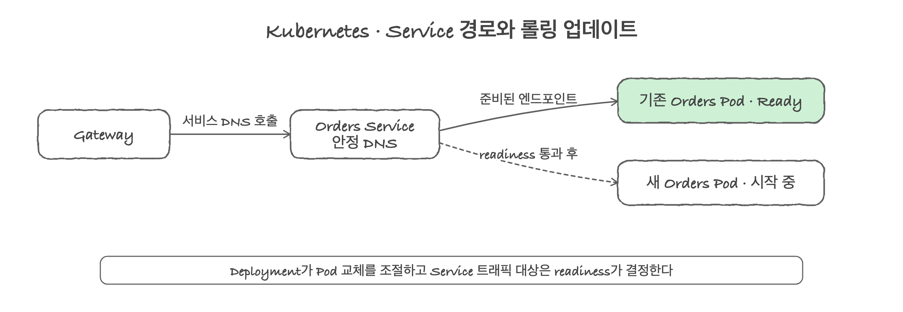

# Kubernetes에서 서비스 발견과 롤링 배포 설계하기

클러스터 내부의 주문 호출은 Orders의 안정된 Service DNS를 사용할 수 있다. 애플리케이션이 DiscoveryClient 인터페이스로 후보 인스턴스를 직접 선택해야 할 때 Spring Cloud Kubernetes 연동을 검토한다. [Kubernetes Service](https://kubernetes.io/docs/concepts/services-networking/service/) · [Spring Cloud Kubernetes 5.1](https://docs.spring.io/spring-cloud-kubernetes/reference/)

그림의 근거 · [Kubernetes Service](https://kubernetes.io/docs/concepts/services-networking/service/) · [Kubernetes Pod probe](https://kubernetes.io/docs/concepts/workloads/pods/probes/) · [Kubernetes Deployment](https://kubernetes.io/docs/concepts/workloads/controllers/deployment/)

## 1. 플랫폼과 애플리케이션의 발견 책임을 고른다

클러스터 안에서 일반 ClusterIP Service를 쓰면 호출자는 Service 이름으로 접속하고, selector에 맞는 Pod들의 주소는 EndpointSlice에 반영된다. 예시에서는 Kubernetes 내부 Orders 트래픽에 이 경로를 선택하고, Kubernetes 밖의 레지스트리와 연계해야 하는 경우에만 Eureka나 DiscoveryClient를 별도 경계로 둔다. [Kubernetes Service](https://kubernetes.io/docs/concepts/services-networking/service/) · [Spring Cloud Kubernetes 5.1](https://docs.spring.io/spring-cloud-kubernetes/reference/) · [Spring Cloud 프로젝트](https://spring.io/projects/spring-cloud/)

## 2. 기동·준비·생존을 분리해 새 버전을 전환한다

startup probe는 느린 기동 동안 나머지 probe를 유예한다. readiness는 처리 가능한 시점에 Service 대상에 합류시키고, liveness는 프로세스의 회복 불능에 대한 재시작 기준으로 둔다. 공유 DB 장애를 모든 Pod의 liveness 실패로 연결하면 재시작이 장애를 확대할 수 있어 의존성을 별도로 다룬다. [Kubernetes Pod probe](https://kubernetes.io/docs/concepts/workloads/pods/probes/) · [Spring Boot Actuator](https://docs.spring.io/spring-boot/reference/actuator/endpoints.html)

Deployment의 `maxSurge`와 `maxUnavailable`로 동시에 추가할 자원과 허용 불가용 수를 정한다. 이전 버전과 새 버전이 공존할 때 두 버전의 클라이언트와 API 계약이 호환되는지 확인한다. `ProgressDeadlineExceeded`는 진행 실패를 보고하므로 롤백은 배포 운영 정책에서 결정한다. [Kubernetes Deployment](https://kubernetes.io/docs/concepts/workloads/controllers/deployment/) · [OpenAPI 3.2.1 명세](https://spec.openapis.org/oas/v3.2.1.html)

## 3. 실패하면 어느 지점에서 트래픽이 멈추는지 검사한다

새 Pod 준비 실패, 이전 Pod 종료, Service 대상 부재를 따로 재현한다. 준비 지표만 보지 않고 외부 API의 오류율과 주문 처리 상태가 유지되는지 확인한다. 롤백한 이후에도 진행 중이던 주문의 업무 상태는 재조회할 수 있어야 한다. [Kubernetes Pod probe](https://kubernetes.io/docs/concepts/workloads/pods/probes/) · [Kubernetes Deployment](https://kubernetes.io/docs/concepts/workloads/controllers/deployment/) · [AWS Saga 오케스트레이션](https://docs.aws.amazon.com/prescriptive-guidance/latest/cloud-design-patterns/saga-orchestration.html)
