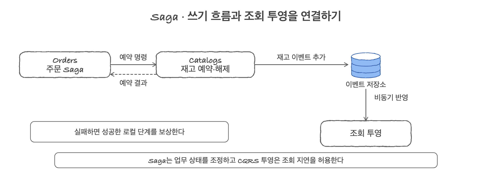

# Saga·CQRS·Event Sourcing의 책임을 연결하기

주문과 재고 변경을 연결할 때 Saga는 단계의 진행과 보상을, CQRS는 쓰기와 조회 모델을, Event Sourcing은 상태를 복원할 원본 이벤트를 다룬다. 이 예에서는 Catalogs의 재고 쓰기에 Event Sourcing을 적용하는 선택을 다룬다. [AWS Saga 오케스트레이션](https://docs.aws.amazon.com/prescriptive-guidance/latest/cloud-design-patterns/saga-orchestration.html) · [Microsoft CQRS](https://learn.microsoft.com/en-us/azure/architecture/patterns/cqrs) · [Microsoft Event Sourcing](https://learn.microsoft.com/en-us/azure/architecture/patterns/event-sourcing)

그림의 근거 · [AWS Saga 오케스트레이션](https://docs.aws.amazon.com/prescriptive-guidance/latest/cloud-design-patterns/saga-orchestration.html) · [Microsoft CQRS](https://learn.microsoft.com/en-us/azure/architecture/patterns/cqrs) · [Microsoft Event Sourcing](https://learn.microsoft.com/en-us/azure/architecture/patterns/event-sourcing)

## 1. 주문과 재고 변경에서 성공 조건과 보상 계약을 둔다

Orders가 주문을 접수한 뒤 Catalogs에 재고 예약을 요청한다. 후속 단계가 실패하면 성공했던 예약의 ID를 찾아 해제하고 주문 실패를 기록한다. 타임아웃으로 결과를 모르는 단계는 먼저 기존 작업을 대조하고, 같은 명령이 재전달돼도 예약이 중복 변경되지 않게 한다. [AWS Saga 오케스트레이션](https://docs.aws.amazon.com/prescriptive-guidance/latest/cloud-design-patterns/saga-orchestration.html) · [AWS Transactional Outbox](https://docs.aws.amazon.com/prescriptive-guidance/latest/cloud-design-patterns/transactional-outbox.html)

## 2. 조회는 지연을 감수하며 별도 모델로 제공한다

조회 투영은 재고나 주문 이벤트를 읽어 화면용 모델을 만든다. 화면이 최신 쓰기 결과를 반드시 알아야 한다면 현재 주문 상태를 원본 API로 조회할 경로를 남긴다. 투영의 체크포인트와 이벤트 식별자를 기록해 재생이나 재전달에도 한 변경이 반복 적용되지 않는지 검증한다. [Microsoft CQRS](https://learn.microsoft.com/en-us/azure/architecture/patterns/cqrs) · [Microsoft Event Sourcing](https://learn.microsoft.com/en-us/azure/architecture/patterns/event-sourcing) · [AWS Transactional Outbox](https://docs.aws.amazon.com/prescriptive-guidance/latest/cloud-design-patterns/transactional-outbox.html)

## 3. 이벤트 저장소의 선택과 발행 경계를 함께 검토한다

Event Sourcing을 적용한 Catalogs는 예약·해제와 같은 이벤트를 추가하고 그 이력에서 재고 상태를 복원한다. 다른 서비스로 상태를 알릴 때는 커밋된 이벤트를 전달할 수 있는 경계를 정한다. Event Sourcing을 선택하지 않은 Orders는 현재 상태와 발행용 Outbox를 같은 트랜잭션에 저장할 수 있다. [Microsoft Event Sourcing](https://learn.microsoft.com/en-us/azure/architecture/patterns/event-sourcing) · [AWS Transactional Outbox](https://docs.aws.amazon.com/prescriptive-guidance/latest/cloud-design-patterns/transactional-outbox.html)

예약 이후 단계 실패, 동일 메시지 재전달, 조회 투영 재구축을 각각 재현한다. 보상이 완료돼 예약이 한 번만 해제되고, 조회 모델의 지연 뒤 원본과 기대 상태가 일치하는지 확인한다. 구현 예시는 [분산 트랜잭션과 Saga](../microservice-architecture/11_distributed_transactions_sagas_and_outbox.md)와 [Kafka Saga 코레오그래피](../microservice-architecture/25_choreographing_order_sagas_with_kafka.md)에 이어진다. [AWS Saga 오케스트레이션](https://docs.aws.amazon.com/prescriptive-guidance/latest/cloud-design-patterns/saga-orchestration.html) · [Microsoft Event Sourcing](https://learn.microsoft.com/en-us/azure/architecture/patterns/event-sourcing) · [Microsoft CQRS](https://learn.microsoft.com/en-us/azure/architecture/patterns/cqrs) · [AWS Transactional Outbox](https://docs.aws.amazon.com/prescriptive-guidance/latest/cloud-design-patterns/transactional-outbox.html)
