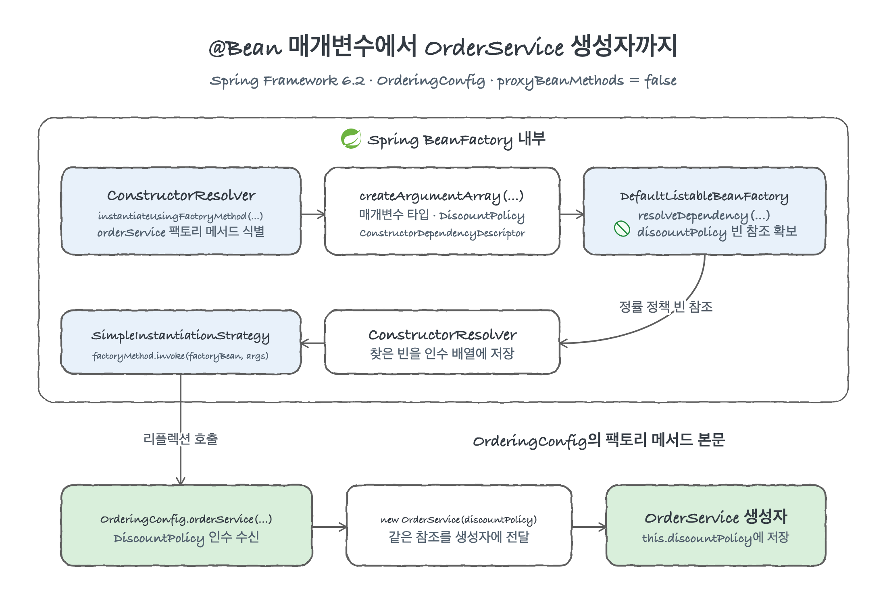

# Dependency Injection and Spring Configuration

주문 금액의 10%를 할인하도록 정책이 바뀌었다. 주문 서비스는 할인 정책의 계약을 그대로 사용하고, 정책을 고르는 책임은 구성 코드로 옮긴다. [Spring Framework 6.2 · 의존관계 주입](https://docs.spring.io/spring-framework/reference/6.2/core/beans/dependencies/factory-collaborators.html)

## 1. 정률 정책과 생성자 주입

```java
public class PercentageDiscountPolicy implements DiscountPolicy {
    @Override
    public int discountFor(int subtotal) {
        return subtotal / 10;
    }
}
```

`OrderService`의 정책 필드 선언을 다음과 같이 바꾸고, 기존 `price()`는 유지한다. 10% 계산에서 원 미만은 버린다.

```java
private final DiscountPolicy discountPolicy;

public OrderService(DiscountPolicy discountPolicy) {
    this.discountPolicy = discountPolicy;
}
```

순수 Java에서도 `new OrderService(new PercentageDiscountPolicy())`로 객체를 조립할 수 있다. 컴파일 시점의 의존성은 `DiscountPolicy`, 실행 시점에 연결되는 실제 인스턴스는 `PercentageDiscountPolicy`다. 테스트에서는 같은 생성자에 정책을 바꿔 전달할 수 있다. [Spring Framework 6.2 · 생성자 기반 DI](https://docs.spring.io/spring-framework/reference/6.2/core/beans/dependencies/factory-collaborators.html)

## 2. Java 설정으로 스프링 빈 조립

```java
@Configuration(proxyBeanMethods = false)
public class OrderingConfig {
    @Bean
    DiscountPolicy discountPolicy() {
        return new PercentageDiscountPolicy();
    }

    @Bean
    OrderService orderService(DiscountPolicy discountPolicy) {
        return new OrderService(discountPolicy);
    }
}
```

```java
try (var context = new AnnotationConfigApplicationContext(OrderingConfig.class)) {
    OrderService service = context.getBean(OrderService.class);
    assert service.price("BOOK-1", 20_000).total() == 18_000;
}
```

`@Bean` 메서드가 반환한 객체를 컨테이너가 관리한다. 메서드 매개변수로 필요한 빈을 요청하면 컨테이너가 찾아서 전달한다. 위 구성은 빈 메서드끼리 직접 호출하지 않으므로 `proxyBeanMethods = false`를 사용할 수 있다. [Spring Framework 6.2 · Java 기반 설정](https://docs.spring.io/spring-framework/reference/6.2/core/beans/java/basic-concepts.html) · [Spring Framework 6.2 · Bean 의존성 선언](https://docs.spring.io/spring-framework/reference/6.2/core/beans/java/bean-annotation.html)



그림의 구현 근거 · [Spring Framework 6.2.19 · ConstructorResolver](https://github.com/spring-projects/spring-framework/blob/v6.2.19/spring-beans/src/main/java/org/springframework/beans/factory/support/ConstructorResolver.java#L484-L614) · [매개변수 기술과 resolveDependency 위임](https://github.com/spring-projects/spring-framework/blob/v6.2.19/spring-beans/src/main/java/org/springframework/beans/factory/support/ConstructorResolver.java#L729-L856) · [DefaultListableBeanFactory의 의존관계 해결](https://github.com/spring-projects/spring-framework/blob/v6.2.19/spring-beans/src/main/java/org/springframework/beans/factory/support/DefaultListableBeanFactory.java#L1534-L1666) · [SimpleInstantiationStrategy의 리플렉션 호출](https://github.com/spring-projects/spring-framework/blob/v6.2.19/spring-beans/src/main/java/org/springframework/beans/factory/support/SimpleInstantiationStrategy.java#L152-L163)

## 3. IoC와 DI

IoC는 객체의 생성과 조립을 외부에서 제어한다는 원리다. DI는 생성자나 팩토리 메서드 매개변수 같은 경로로 실제 의존 객체를 전달하는 방법이다. 주문 서비스는 돈을 계산하는 규칙을 실행하고, 구성은 서비스를 만들 때 어떤 규칙을 연결할지 결정한다. [Spring Framework 6.2 · IoC 컨테이너 소개](https://docs.spring.io/spring-framework/reference/6.2/core/beans/introduction.html)
