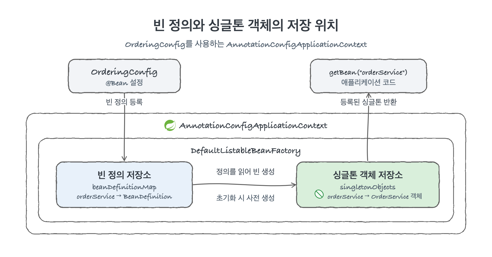

# Spring Container and Bean Definitions

`ApplicationContext`는 빈을 등록하고 생성·조립하며, 초기화와 종료를 관리한다. Java 설정을 사용하는 [03번 예제](03_dependency_injection_and_spring_configuration.md)는 `AnnotationConfigApplicationContext`에 구성 클래스를 전달하는 방식이다. [Spring Framework 6.2 · 컨테이너 개요](https://docs.spring.io/spring-framework/reference/6.2/core/beans/basics.html)

## 1. 등록 정보와 인스턴스

컨테이너는 먼저 설정을 읽어 `BeanDefinition`을 등록한다. 정의에는 빈 클래스나 팩토리 메서드, 스코프, 의존관계, 초기화·종료 메서드 같은 생성 정보가 들어갈 수 있다. 빈 인스턴스는 이 정의에 따라 만들어진 실제 객체다. 일반적인 지연 초기화 설정이 없는 싱글톤은 컨텍스트가 초기화될 때 생성된다. [Spring Framework 6.2 · 빈 정의](https://docs.spring.io/spring-framework/reference/6.2/core/beans/definition.html) · [Spring Framework 6.2 · 지연 초기화](https://docs.spring.io/spring-framework/reference/6.2/core/beans/dependencies/factory-lazy-init.html)



그림의 구현 근거 · [빈 정의 저장소](https://github.com/spring-projects/spring-framework/blob/v6.2.19/spring-beans/src/main/java/org/springframework/beans/factory/support/DefaultListableBeanFactory.java#L185-L198) · [싱글톤 객체 저장소](https://github.com/spring-projects/spring-framework/blob/v6.2.19/spring-beans/src/main/java/org/springframework/beans/factory/support/DefaultSingletonBeanRegistry.java#L78-L95) · [컨텍스트 내부의 빈 팩토리](https://github.com/spring-projects/spring-framework/blob/v6.2.19/spring-context/src/main/java/org/springframework/context/support/GenericApplicationContext.java#L103-L122) · [싱글톤 사전 생성](https://github.com/spring-projects/spring-framework/blob/v6.2.19/spring-context/src/main/java/org/springframework/context/support/AbstractApplicationContext.java#L983-L992)

```java
try (var context = new AnnotationConfigApplicationContext(OrderingConfig.class)) {
    var factory = context.getBeanFactory();
    for (String name : factory.getBeanDefinitionNames()) {
        BeanDefinition definition = factory.getBeanDefinition(name);
        if (definition.getRole() == BeanDefinition.ROLE_APPLICATION) {
            System.out.println(name);
        }
    }
}
```

`@Bean`의 기본 이름은 메서드명이다. `@Bean("pricingPolicy")`처럼 이름을 별도로 정할 수 있다. 정의의 역할은 애플리케이션 빈과 내부 인프라 빈을 출력에서 구분할 때 사용할 수 있다. [Spring Framework 6.2 · Bean 선언과 이름](https://docs.spring.io/spring-framework/reference/6.2/core/beans/java/bean-annotation.html) · [Spring Framework 6.2 · BeanDefinition API](https://docs.spring.io/spring-framework/docs/6.2.x/javadoc-api/org/springframework/beans/factory/config/BeanDefinition.html)

## 2. 이름과 타입으로 조회

| 호출 | 찾는 방식 |
| --- | --- |
| `getBean("orderService")` | 이름이 같은 빈을 찾는다. |
| `getBean("orderService", OrderService.class)` | 이름과 타입을 모두 확인한다. |
| `getBean(DiscountPolicy.class)` | 해당 타입과 호환되는 빈에서 하나를 고른다. |
| `getBeansOfType(DiscountPolicy.class)` | 타입이 호환되는 빈을 이름과 객체의 맵으로 가져온다. |

인터페이스나 부모 타입으로 조회하면 구현체도 후보에 포함된다. 선택 가능한 빈이 없으면 `NoSuchBeanDefinitionException`, 타입 후보가 여럿이고 하나를 결정할 수 없으면 `NoUniqueBeanDefinitionException`이 발생한다. 애플리케이션 코드의 일반적인 의존관계는 컨테이너를 직접 조회하는 코드 대신 생성자로 전달할 수 있다. [Spring Framework 6.2 · BeanFactory API](https://docs.spring.io/spring-framework/docs/6.2.x/javadoc-api/org/springframework/beans/factory/BeanFactory.html) · [Spring Framework 6.2 · ListableBeanFactory API](https://docs.spring.io/spring-framework/docs/6.2.x/javadoc-api/org/springframework/beans/factory/ListableBeanFactory.html)

## 3. BeanFactory와 ApplicationContext

`BeanFactory`는 빈 조회와 의존관계 관리의 기초 API를 제공한다. `ApplicationContext`는 여기에 리소스 로딩, 메시지 국제화, 애플리케이션 이벤트 등을 더한다. Java 설정과 XML 설정은 서로 다른 입력 형식이며, 컨테이너가 빈을 만들 때 사용하는 내부 표현은 `BeanDefinition`이다. [Spring Framework 6.2 · BeanFactory API와 ApplicationContext](https://docs.spring.io/spring-framework/reference/6.2/core/beans/beanfactory.html) · [Spring Framework 6.2 · 설정 메타데이터](https://docs.spring.io/spring-framework/reference/6.2/core/beans/basics.html)
