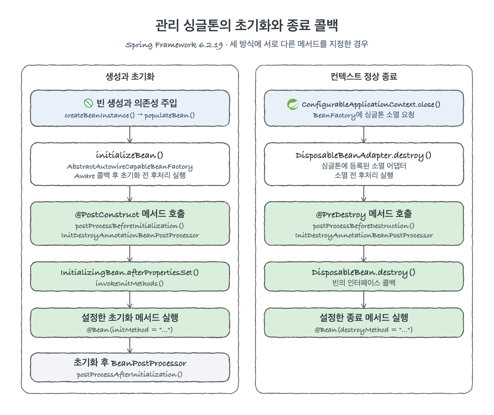

# Spring Bean Lifecycle Callbacks

빈의 생성자에서는 필요한 의존 객체를 받아 기본 상태를 만든다. 주입 이후 연결을 초기화하거나 설정을 검증하고, 빈이 더 이상 쓰이지 않을 때 자원을 해제하려면 생명주기 콜백을 사용한다. [Spring Framework 6.2 · 빈의 생명주기](https://docs.spring.io/spring-framework/reference/6.2/core/beans/factory-nature.html)

## 1. 초기화와 종료 콜백 선택

| 초기화 | 종료 | 적합한 경우 |
| --- | --- | --- |
| `@PostConstruct` | `@PreDestroy` | 빈 클래스에 콜백을 직접 선언할 수 있다. |
| `InitializingBean.afterPropertiesSet()` | `DisposableBean.destroy()` | 기존 타입이 Spring 콜백 인터페이스를 구현하고 있다. |
| `@Bean(initMethod = "...")` | `@Bean(destroyMethod = "...")` | 클래스 코드를 바꾸기 어려운 객체의 메서드를 설정에서 지정한다. |

서로 다른 메서드로 세 방식을 함께 등록하면 초기화와 종료에서 각각 애노테이션 콜백, 인터페이스 콜백, 설정한 메서드 순으로 실행된다. 같은 메서드를 여러 방식으로 지정한 경우 컨테이너가 한 번만 호출한다. Spring Framework 6.x에서 두 콜백 애노테이션은 `jakarta.annotation` 패키지를 사용한다. [Spring Framework 6.2 · 생명주기 콜백 조합](https://docs.spring.io/spring-framework/reference/6.2/core/beans/factory-nature.html) · [Spring Framework 6.2 · PostConstruct와 PreDestroy](https://docs.spring.io/spring-framework/reference/6.2/core/beans/annotation-config/postconstruct-and-predestroy-annotations.html)



그림의 구현 근거 · [AbstractAutowireCapableBeanFactory 초기화](https://github.com/spring-projects/spring-framework/blob/v6.2.19/spring-beans/src/main/java/org/springframework/beans/factory/support/AbstractAutowireCapableBeanFactory.java#L1684-L1754) · [InitDestroyAnnotationBeanPostProcessor 애노테이션 콜백](https://github.com/spring-projects/spring-framework/blob/v6.2.19/spring-beans/src/main/java/org/springframework/beans/factory/annotation/InitDestroyAnnotationBeanPostProcessor.java#L198-L236) · [CommonAnnotationBeanPostProcessor의 Jakarta 콜백 등록](https://github.com/spring-projects/spring-framework/blob/v6.2.19/spring-context/src/main/java/org/springframework/context/annotation/CommonAnnotationBeanPostProcessor.java#L193-L207) · [컨텍스트 종료와 싱글톤 소멸](https://github.com/spring-projects/spring-framework/blob/v6.2.19/spring-context/src/main/java/org/springframework/context/support/AbstractApplicationContext.java#L1095-L1155) · [DisposableBeanAdapter 종료 콜백](https://github.com/spring-projects/spring-framework/blob/v6.2.19/spring-beans/src/main/java/org/springframework/beans/factory/support/DisposableBeanAdapter.java#L183-L243)

## 2. 초기화·종료 메서드를 설정으로 연결

```java
public class LocalConnection {
    private boolean open;

    public void start() {
        open = true;
    }

    public void stop() {
        open = false;
    }

    public boolean isOpen() {
        return open;
    }
}
```

```java
@Configuration(proxyBeanMethods = false)
public class ConnectionConfig {
    @Bean(initMethod = "start", destroyMethod = "stop")
    LocalConnection localConnection() {
        return new LocalConnection();
    }
}
```

```java
LocalConnection connection;
try (var context = new AnnotationConfigApplicationContext(ConnectionConfig.class)) {
    connection = context.getBean(LocalConnection.class);
    assert connection.isOpen();
}
assert !connection.isOpen();
```

컨텍스트가 빈을 준비할 때 `start()`가 실행되고, 정상적으로 닫힐 때 관리 싱글톤의 `stop()`이 실행된다. `@Bean`은 기본적으로 공개된 `close()`나 `shutdown()`을 종료 메서드로 추론할 수 있다. 추론을 끄려면 `destroyMethod = ""`를 지정한다. [Spring Framework 6.2 · Bean 생명주기 메서드](https://docs.spring.io/spring-framework/reference/6.2/core/beans/java/bean-annotation.html)

오래 걸리는 외부 초기화가 시작 실패를 일으킬 수 있다면 연결 제한 시간과 실패 처리를 명시한다. 프로토타입의 시작과 종료는 [09번 문서](09_spring_bean_scopes_and_scoped_proxies.md)에서 다룬다.
