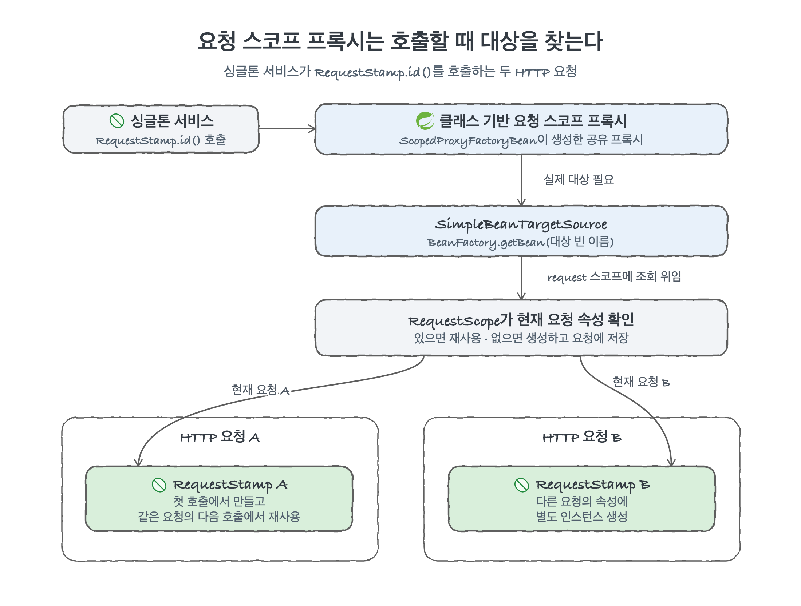

# Spring Bean Scopes and Scoped Proxies

스코프는 빈 인스턴스가 언제 만들어지고 얼마나 공유되는지를 정한다. 긴 수명의 빈이 더 짧은 수명의 빈에 의존할 때는 실제 객체를 얻는 시점에 주의한다. [Spring Framework 6.2 · 빈 스코프](https://docs.spring.io/spring-framework/reference/6.2/core/beans/factory-scopes.html)

## 1. 스코프별 공유 범위

| 스코프 | 인스턴스 범위 |
| --- | --- |
| `singleton` | 컨테이너의 빈 정의마다 하나 |
| `prototype` | 컨테이너에 해당 빈을 요청할 때마다 하나 |
| `request` | HTTP 요청마다 하나 |
| `session` | HTTP 세션마다 하나 |
| `application` | `ServletContext`마다 하나 |
| `websocket` | WebSocket 세션마다 하나 |

웹 스코프는 웹 스코프를 등록한 컨텍스트에서 사용한다. 프로토타입은 컨테이너가 생성하고 초기화하지만, 받은 객체의 수명과 자원 해제는 호출자가 관리한다. 컨테이너를 닫아도 반환된 프로토타입의 종료 콜백이 자동으로 호출되지 않는다. [Spring Framework 6.2 · 프로토타입과 웹 스코프](https://docs.spring.io/spring-framework/reference/6.2/core/beans/factory-scopes.html)

## 2. 싱글톤에서 호출마다 새 프로토타입 사용

싱글톤의 생성자에 프로토타입 인스턴스를 직접 받으면 싱글톤을 만들 때 얻은 한 객체가 필드에 남는다. 실행마다 새 카운터가 필요하면 `ObjectProvider`를 받아 실행 시점에 `getObject()`를 호출한다. 다음 코드에서 `TaskRunner`를 연속으로 두 번 호출하면 각각 새 카운터에서 시작해 모두 `1`을 반환한다. [Spring Framework 6.2 · 싱글톤과 프로토타입의 의존관계](https://docs.spring.io/spring-framework/reference/6.2/core/beans/factory-scopes.html#beans-factory-scopes-sing-prot-interaction) · [Spring Framework 6.2 · ObjectProvider API](https://docs.spring.io/spring-framework/docs/6.2.x/javadoc-api/org/springframework/beans/factory/ObjectProvider.html)

```java
public class RunCounter {
    private int value;

    public int increment() {
        return ++value;
    }
}
```

```java
public class TaskRunner {
    private final ObjectProvider<RunCounter> counters;

    public TaskRunner(ObjectProvider<RunCounter> counters) {
        this.counters = counters;
    }

    public int run() {
        return counters.getObject().increment();
    }
}
```

```java
@Configuration(proxyBeanMethods = false)
public class RunConfig {
    @Bean
    @Scope("prototype")
    RunCounter runCounter() {
        return new RunCounter();
    }

    @Bean
    TaskRunner taskRunner(ObjectProvider<RunCounter> counters) {
        return new TaskRunner(counters);
    }
}
```

표준 `jakarta.inject.Provider<T>`가 클래스패스에 있으면 `get()`으로 실제 빈을 얻을 수도 있다. `ObjectProvider`는 Spring에서 제공하는 조회 API다. [Spring Framework 6.2 · Jakarta 표준 애노테이션과 Provider](https://docs.spring.io/spring-framework/reference/6.2/core/beans/standard-annotations.html)

## 3. 요청 범위 빈과 프록시

`@RequestScope`는 `org.springframework.web.context.annotation` 패키지에서 가져온다.

```java
@Component
@RequestScope
public class RequestStamp {
    private final String id = UUID.randomUUID().toString();

    public String id() {
        return id;
    }
}
```

`@RequestScope`의 기본값은 클래스 기반 프록시다. 싱글톤에 `RequestStamp`를 주입하면 호출이 들어올 때 프록시가 현재 요청의 실제 객체에 위임한다. 같은 요청의 여러 호출은 같은 식별자를 얻고, 다음 요청은 다른 인스턴스에서 새 값을 얻는다. 요청이 활성화되지 않은 스레드에서는 프록시로 실제 객체를 조회할 수 없다. [Spring Framework 6.2 · RequestScope API](https://docs.spring.io/spring-framework/docs/6.2.x/javadoc-api/org/springframework/web/context/annotation/RequestScope.html) · [Spring Framework 6.2 · 스코프 빈의 의존관계와 프록시](https://docs.spring.io/spring-framework/reference/6.2/core/beans/factory-scopes.html#beans-factory-scopes-other-injection)



그림의 구현 근거 · [ScopedProxyFactoryBean](https://raw.githubusercontent.com/spring-projects/spring-framework/v6.2.19/spring-aop/src/main/java/org/springframework/aop/scope/ScopedProxyFactoryBean.java) · [SimpleBeanTargetSource](https://raw.githubusercontent.com/spring-projects/spring-framework/v6.2.19/spring-aop/src/main/java/org/springframework/aop/target/SimpleBeanTargetSource.java) · [AbstractRequestAttributesScope](https://raw.githubusercontent.com/spring-projects/spring-framework/v6.2.19/spring-web/src/main/java/org/springframework/web/context/request/AbstractRequestAttributesScope.java)
