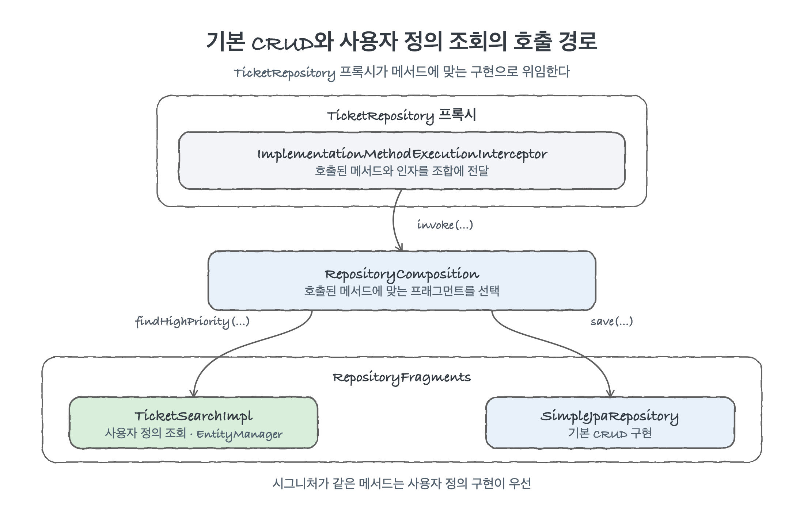

# Spring Data JPA Repository Extensions

기본 리포지토리에 복합 조회를 추가할 때는 프래그먼트를 조합한다. 생성·수정 시각은 엔티티 감사 기능으로 관리하고, 웹 계층에서는 Spring Data가 제공하는 페이징 바인딩을 사용할 수 있다.

## 1. 사용자 정의 리포지토리 프래그먼트

아래 인터페이스와 구현을 같은 리포지토리 탐색 범위에 둔다. 구현 클래스는 프래그먼트 이름인 `TicketSearch`에 기본 접미사 `Impl`을 붙인다. `TicketRepository`는 `JpaRepository<Ticket, Long>`과 `TicketSearch`를 상속한다. [Spring Data JPA 3.5 · 사용자 정의 리포지토리 구현](https://docs.spring.io/spring-data/jpa/reference/3.5/repositories/custom-implementations.html)

```java
public interface TicketSearch {
    List<Ticket> findHighPriority(TicketState state, int minPriority);
}
```

```java
@Transactional(readOnly = true)
public class TicketSearchImpl implements TicketSearch {
    private final EntityManager em;

    public TicketSearchImpl(EntityManager em) {
        this.em = em;
    }

    @Override
    public List<Ticket> findHighPriority(TicketState state, int minPriority) {
        return em.createQuery("""
                select t from Ticket t
                where t.state = :state and t.priority >= :min
                order by t.priority desc, t.id
                """, Ticket.class)
            .setParameter("state", state)
            .setParameter("min", minPriority)
            .getResultList();
    }
}
```

프래그먼트에는 `EntityManager`, Querydsl 등 필요한 쿼리 도구를 주입할 수 있다. 동일한 구현을 여러 리포지토리에서 조합할 수 있으며, 독립적인 조회 빈으로 분리하는 방법도 있다. [Spring Data JPA 3.5 · 프래그먼트 구성](https://docs.spring.io/spring-data/jpa/reference/3.5/repositories/custom-implementations.html)



그림의 구현 근거 · [Spring Data Commons 3.5 · 프록시와 구현 호출 인터셉터](https://raw.githubusercontent.com/spring-projects/spring-data-commons/3.5.x/src/main/java/org/springframework/data/repository/core/support/RepositoryFactorySupport.java) · [Spring Data Commons 3.5.13 · 프래그먼트 선택과 실행](https://raw.githubusercontent.com/spring-projects/spring-data-commons/3.5.13/src/main/java/org/springframework/data/repository/core/support/RepositoryComposition.java)

## 2. 생성·수정 정보를 Auditing으로 기록

`@EnableJpaAuditing`이 붙은 설정 클래스를 등록하고, 감사할 엔티티에 `AuditingEntityListener`를 적용한다. 아래 클래스를 상속한 엔티티의 테이블에는 생성·수정 시각을 저장할 컬럼이 추가된다. 스키마를 마이그레이션으로 관리한다면 컬럼도 함께 추가한다. [Spring Data JPA 3.5 · Auditing 설정](https://docs.spring.io/spring-data/jpa/reference/3.5/auditing.html)

```java
@Configuration
@EnableJpaAuditing
class AuditConfig {}
```

```java
@MappedSuperclass
@EntityListeners(AuditingEntityListener.class)
public abstract class AuditedRecord {
    @CreatedDate
    @Column(updatable = false)
    private Instant createdAt;

    @LastModifiedDate
    private Instant updatedAt;
}
```

생성자·수정자도 저장한다면 `@CreatedBy`, `@LastModifiedBy`와 같은 타입의 `AuditorAware<T>` 빈을 둔다. 시간만 기록할 때는 사용자 조회 빈이 필요하지 않다. 감사 리스너를 사용하려면 클래스패스의 `spring-aspects`를 확인한다. JPQL 벌크 갱신은 개별 엔티티의 생명주기 콜백을 거치지 않으므로 같은 작업에서 감사 값도 갱신해야 한다면 쿼리에 포함한다. [Spring Data JPA 3.5 · 감사 필드와 AuditorAware](https://docs.spring.io/spring-data/jpa/reference/3.5/auditing.html) · [Jakarta Persistence 3.1 · 벌크 갱신](https://jakarta.ee/specifications/persistence/3.1/jakarta-persistence-spec-3.1#a5636)

## 3. 웹 요청에서 ID·페이징 받기

`DomainClassConverter`를 사용할 수 있는 MVC 환경에서는 `@PathVariable Ticket ticket`이 URI의 ID를 변환하고 해당 리포지토리의 `findById()`로 엔티티를 조회한다. 접근 권한이나 팀 범위가 필요한 조회는 ID를 받아 서비스에서 범위 조건과 함께 처리한다. [Spring Data JPA 3.5 · 웹 지원과 DomainClassConverter](https://docs.spring.io/spring-data/jpa/reference/3.5/repositories/core-extensions.html#core.web)

```java
@GetMapping("/tickets")
public PagedModel<TicketSummary> list(
        @PageableDefault(size = 20, sort = "id") Pageable pageable) {
    Page<TicketSummary> page = ticketRepository.findAll(pageable)
        .map(ticket -> new TicketSummary(ticket.getId(), ticket.getTitle()));
    return new PagedModel<>(page);
}
```

`page=0&size=20&sort=id,desc`처럼 페이지 번호, 크기, 정렬을 지정할 수 있다. API는 요청 가능한 정렬 필드와 최대 크기를 정해 둘 수 있다. `org.springframework.data.web.PagedModel`은 `Page`를 `content`와 `page` 메타데이터로 감싸므로 응답 형식을 `PageImpl`의 내부 표현에 맡기지 않는다. [Spring Data JPA 3.5 · 웹 페이징과 정렬](https://docs.spring.io/spring-data/jpa/reference/3.5/repositories/core-extensions.html#core.web.basic.paging-and-sorting) · [Spring Data Commons 3.5 · PagedModel](https://docs.spring.io/spring-data/jpa/reference/data-commons/3.5/api/java/org/springframework/data/web/PagedModel.html)
