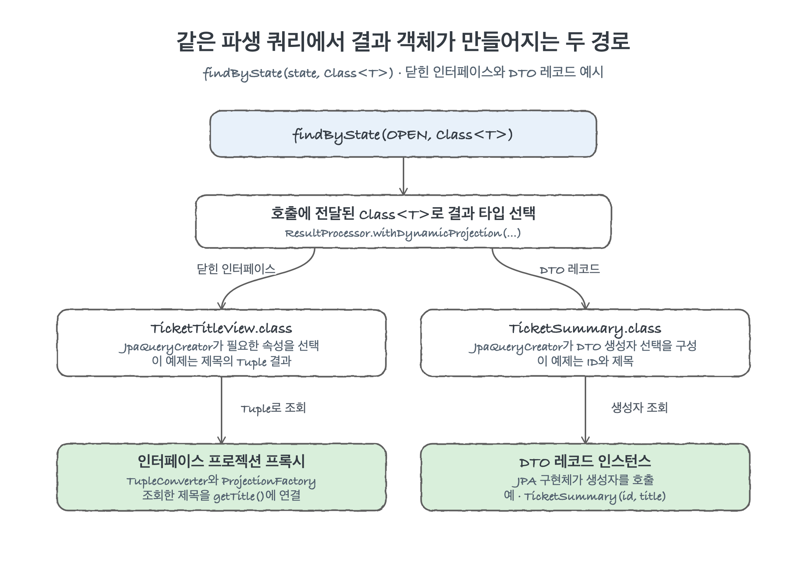

# Spring Data JPA Specifications, Projections, and Native Queries

검색의 입력 모양과 반환 형식에 따라 쿼리 방식을 고를 수 있다. 조건을 조합할 때는 `Specification`, 예시 객체에서 조건을 만들 때는 Query by Example, 필요한 값만 반환할 때는 프로젝션을 사용한다. SQL 고유 기능을 사용해야 하면 네이티브 쿼리를 작성한다.

## 1. Specification으로 검색 조건 조합

`TicketRepository`에 `JpaSpecificationExecutor<Ticket>`를 추가한다. `Specification`은 Criteria API의 조건식을 반환하며, `and()`와 `or()`로 여러 조건을 결합할 수 있다. [Spring Data JPA 3.5 · Specifications](https://docs.spring.io/spring-data/jpa/reference/3.5/jpa/specifications.html)

```java
Specification<Ticket> open =
    (root, query, cb) -> cb.equal(root.get("state"), TicketState.OPEN);

Specification<Ticket> highPriority =
    (root, query, cb) -> cb.ge(root.<Integer>get("priority"), 5);

List<Ticket> tickets = ticketRepository.findAll(
    open.and(highPriority), Sort.by("id"));
```

문자열 속성명은 오타가 있는지 실행 전에 확인하기 어렵다. JPA 정적 메타모델을 생성하는 프로젝트는 `Ticket_.priority`처럼 타입이 있는 속성 경로를 사용할 수 있다. 같은 조합은 페이징 조회에도 전달할 수 있다. [Spring Data JPA 3.5 · JpaSpecificationExecutor](https://docs.spring.io/spring-data/jpa/reference/3.5/api/java/org/springframework/data/jpa/repository/JpaSpecificationExecutor.html)

## 2. Query by Example

검색할 값을 넣은 probe와 매칭 규칙을 정의한 `ExampleMatcher`로 `Example<Ticket>`을 만든다. 기본 설정에서는 null 속성을 건너뛰고, 값이 있는 속성을 조건으로 사용한다. [Spring Data JPA 3.5 · Query by Example](https://docs.spring.io/spring-data/jpa/reference/3.5/repositories/query-by-example.html)

```java
Ticket probe = new Ticket();
probe.rename("sync");

ExampleMatcher matcher = ExampleMatcher.matching()
    .withMatcher("title",
        ExampleMatcher.GenericPropertyMatchers.contains().ignoreCase());

List<Ticket> results = ticketRepository.findAll(
    Example.of(probe, matcher), Sort.by("id"));
```

예제는 `Ticket`과 같은 패키지에서 실행한다. 기본값이 있는 필드나 기본형 속성은 의도치 않게 검색 조건에 들어갈 수 있어서 `withIgnorePaths()`로 제외 대상을 명시할 수 있다. 문자열의 포함·접두사 같은 매칭은 지원 범위를 확인한다. 범위 비교나 `A OR (B AND C)`처럼 조건을 그룹으로 묶으려면 `Specification`이나 명시적 쿼리를 사용할 수 있다. [Spring Data JPA 3.5 · ExampleMatcher와 지원 범위](https://docs.spring.io/spring-data/jpa/reference/3.5/repositories/query-by-example.html)

## 3. 인터페이스·DTO·동적 프로젝션

```java
public interface TicketTitleView {
    String getTitle();
}
```

```java
<T> List<T> findByState(TicketState state, Class<T> projection);
```

메서드의 `Class<T>`에 `TicketTitleView.class` 또는 [02번 문서](02_spring_data_jpa_query_methods_and_pagination.md)의 `TicketSummary.class`를 전달한다. 닫힌 인터페이스 프로젝션은 엔티티 속성과 일치하는 접근자를 선언한다. `@Value`로 표현식을 평가하는 열린 프로젝션은 어떤 속성이 필요한지 미리 좁히기 어렵다. DTO 프로젝션은 값을 받을 생성자가 필요하며, JPQL에서는 생성자 식으로 명시할 수 있다. [Spring Data JPA 3.5 · 프로젝션](https://docs.spring.io/spring-data/jpa/reference/3.5/repositories/projections.html)



그림의 구현 근거 · [PartTreeJpaQuery](https://github.com/spring-projects/spring-data-jpa/blob/3.5.13/spring-data-jpa/src/main/java/org/springframework/data/jpa/repository/query/PartTreeJpaQuery.java) · [JpaQueryCreator](https://github.com/spring-projects/spring-data-jpa/blob/3.5.13/spring-data-jpa/src/main/java/org/springframework/data/jpa/repository/query/JpaQueryCreator.java) · [AbstractJpaQuery](https://github.com/spring-projects/spring-data-jpa/blob/3.5.13/spring-data-jpa/src/main/java/org/springframework/data/jpa/repository/query/AbstractJpaQuery.java)

## 4. 네이티브 SQL과 결과 매핑

```java
@NativeQuery(
    value = "select t.title as title from tickets t where t.state = :state order by t.id",
    countQuery = "select count(*) from tickets t where t.state = :state"
)
Page<TicketTitleView> findNativePageByState(
    @Param("state") String state, Pageable pageable);
```

JPQL과 달리 실제 테이블·컬럼 이름을 사용한다. 위 쿼리는 상태가 문자열로 저장된 [01번의 매핑](01_spring_data_jpa_repository_interfaces.md)에 맞춰 `TicketState.OPEN.name()` 같은 값을 바인딩한다. 인터페이스 접근자에 대응하는 SQL 별칭을 지정하고, 페이징 시 전체 개수를 세는 조건도 확인한다. DB 함수나 복잡한 SQL에 의존하는 쿼리는 대상 DB에서 검증한다. [Spring Data JPA 3.5 · 네이티브 쿼리](https://docs.spring.io/spring-data/jpa/reference/3.5/jpa/query-methods.html#jpa.query-methods.at-query.native)

DTO의 생성자 순서와 타입에 결과가 맞으면 별도 결과 매핑 없이 반환할 수 있다. 변환 규칙이 필요하면 `@SqlResultSetMapping`을 정의하고 `@NativeQuery(sqlResultSetMapping = "...")`에 연결할 수 있다. [Spring Data JPA 3.5 · 네이티브 DTO 프로젝션](https://docs.spring.io/spring-data/jpa/reference/3.5/repositories/projections.html) · [Spring Data JPA 3.5 · NativeQuery API](https://docs.spring.io/spring-data/jpa/reference/3.5/api/java/org/springframework/data/jpa/repository/NativeQuery.html)
