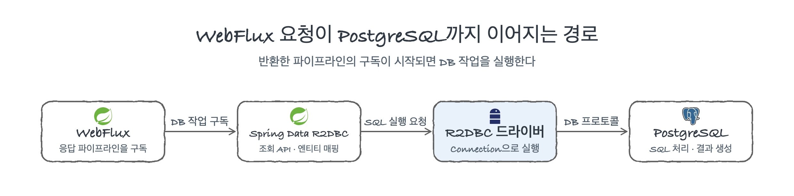

# Setting Up Reactive PostgreSQL Access

Spring Data R2DBC는 R2DBC 드라이버 위에서 관계형 DB에 접근하는 리포지토리와 객체 매핑을 제공한다. 이 문서 묶음은 Spring Boot 3.5, Spring Data Relational 3.5, Spring Framework 6.2를 기준으로 한다. [Spring Data 3.5 R2DBC](https://docs.spring.io/spring-data/relational/reference/3.5/r2dbc.html) · [Spring Boot 3.5 R2DBC 설정](https://docs.spring.io/spring-boot/3.5/reference/data/sql.html#data.sql.r2dbc)

## 1. 요청이 DB까지 이어지는 경로

WebFlux 핸들러가 반환한 리액티브 파이프라인에서 리포지토리나 템플릿을 호출한다. SQL은 구독이 시작될 때 전송되고, 드라이버는 `ConnectionFactory`에서 얻은 연결로 DB와 통신한다. [Spring Framework 6.2 WebFlux](https://docs.spring.io/spring-framework/reference/6.2/web/webflux/new-framework.html) · [Spring Data 3.5 Persisting Entities](https://docs.spring.io/spring-data/relational/reference/3.5/r2dbc/entity-persistence.html) · [Spring Boot 3.5 R2DBC 설정](https://docs.spring.io/spring-boot/3.5/reference/data/sql.html#data.sql.r2dbc)



그림의 근거 · [Spring Framework 6.2 WebFlux](https://docs.spring.io/spring-framework/reference/6.2/web/webflux/new-framework.html) · [Spring Data 3.5 Persisting Entities](https://docs.spring.io/spring-data/relational/reference/3.5/r2dbc/entity-persistence.html) · [Spring Boot 3.5 R2DBC 설정](https://docs.spring.io/spring-boot/3.5/reference/data/sql.html#data.sql.r2dbc)

## 2. PostgreSQL 드라이버와 연결 설정

Spring Boot가 의존성 버전을 관리하는 Gradle 프로젝트에 Spring Data R2DBC 스타터와 PostgreSQL R2DBC 드라이버를 추가한다. [Spring Boot 3.5 Starters](https://docs.spring.io/spring-boot/3.5/reference/using/build-systems.html#using.build-systems.starters) · [PostgreSQL R2DBC Driver](https://github.com/pgjdbc/r2dbc-postgresql)

```groovy
dependencies {
    implementation 'org.springframework.boot:spring-boot-starter-data-r2dbc'
    runtimeOnly 'org.postgresql:r2dbc-postgresql'
}
```

Boot는 `spring.r2dbc.*` 설정과 URL에 해당하는 드라이버를 사용해 `ConnectionFactory`를 구성한다. 예제는 로컬 PostgreSQL의 `app` 데이터베이스를 가정하며 인증 값은 환경 변수로 받는다. [Spring Boot 3.5 R2DBC 설정](https://docs.spring.io/spring-boot/3.5/reference/data/sql.html#data.sql.r2dbc)

```yaml
spring:
  r2dbc:
    url: r2dbc:postgresql://localhost:5432/app
    username: ${DB_USER}
    password: ${DB_PASSWORD}
```

## 3. WebFlux 요청에서 구독 경계를 유지하기

핸들러와 서비스는 `Mono` 또는 `Flux`를 연결해 응답 경로에 반환한다. 서비스에서 직접 `subscribe()`를 호출하거나 I/O 결과를 얻기 위해 `block()`으로 기다리는 코드는 피한다. 조회에 사용할 API는 [02번 문서](02_choosing_r2dbc_query_apis.md)에서 비교한다. [Spring Framework 6.2 WebFlux](https://docs.spring.io/spring-framework/reference/6.2/web/webflux/new-framework.html) · [Spring Data 3.5 Persisting Entities](https://docs.spring.io/spring-data/relational/reference/3.5/r2dbc/entity-persistence.html) · [Project Reactor Mono API](https://projectreactor.io/docs/core/3.7.x/api/reactor/core/publisher/Mono.html)
