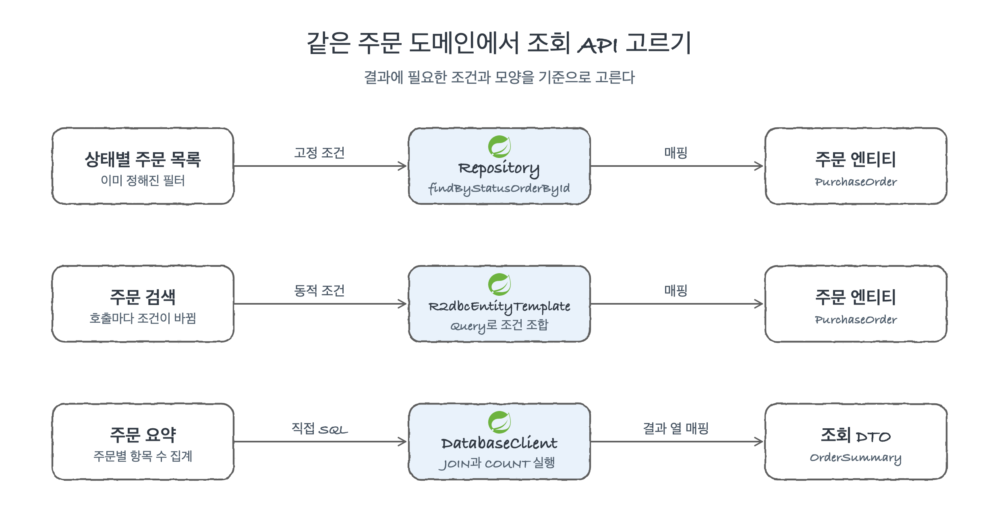

# Choosing R2DBC Query APIs

단순 CRUD와 고정 조회 조건은 Repository, 호출마다 달라지는 엔티티 조회 조건은 R2dbcEntityTemplate, 직접 제어할 SQL과 결과 매핑은 DatabaseClient로 다룬다. [Spring Data 3.5 R2DBC](https://docs.spring.io/spring-data/relational/reference/3.5/r2dbc.html) · [Spring Data 3.5 Persisting Entities](https://docs.spring.io/spring-data/relational/reference/3.5/r2dbc/entity-persistence.html) · [Spring Framework 6.2 DatabaseClient](https://docs.spring.io/spring-framework/reference/6.2/data-access/r2dbc.html#r2dbc-DatabaseClient)

## 1. Repository로 고정된 조건 조회하기

`ReactiveCrudRepository`는 기본 CRUD를 제공한다. 아래 파생 쿼리는 [03번 문서](03_mapping_and_saving_r2dbc_entities.md)의 주문 엔티티를 사용하며, 상태를 조건으로 ID 순서대로 조회한다. `Pageable`로 DB에 적용할 조회 범위를 전달할 수 있다. [ReactiveCrudRepository.save](https://docs.spring.io/spring-data/commons/docs/3.5.x/api/org/springframework/data/repository/reactive/ReactiveCrudRepository.html) · [Spring Data 3.5 Query Methods](https://docs.spring.io/spring-data/relational/reference/3.5/r2dbc/query-methods.html)

```java
import org.springframework.data.domain.Pageable;
import org.springframework.data.repository.reactive.ReactiveCrudRepository;
import reactor.core.publisher.Flux;

interface OrderRepository extends ReactiveCrudRepository<PurchaseOrder, Long> {
    Flux<PurchaseOrder> findByStatusOrderById(String status, Pageable page);
}
```

## 2. Template으로 엔티티 조회 조건 조합하기

`R2dbcEntityTemplate.select(...)`에 조건, 정렬, 조회 한도를 담은 `Query`를 전달한다. SQL 방언과 엔티티 매핑은 Spring Data가 처리한다. 검색 조건을 호출마다 조합하되 동일 엔티티로 읽을 때 쓴다. [Spring Data 3.5 Persisting Entities](https://docs.spring.io/spring-data/relational/reference/3.5/r2dbc/entity-persistence.html) · [Spring Data 3.5 R2DBC](https://docs.spring.io/spring-data/relational/reference/3.5/r2dbc.html)

## 3. SQL과 DTO를 직접 제어하기

주문과 주문 항목을 JOIN해 수량을 집계할 때는 SQL에서 결과 컬럼을 정하고 DTO로 매핑한다. 고정 SQL이면 Repository의 `@Query`로 DTO에 직접 매핑할 수 있다. 문자열 `@Query`에 조회 한도를 적용할 때는 SQL에 직접 조건을 넣고 값을 바인딩한다. [Spring Data 3.5 R2DBC Repositories](https://docs.spring.io/spring-data/relational/reference/3.5/r2dbc/repositories.html) · [Spring Data 3.5 Query Methods](https://docs.spring.io/spring-data/relational/reference/3.5/r2dbc/query-methods.html)

아래 코드는 `order_line.order_id`가 `purchase_order.id`를 참조한다고 가정한다. `DatabaseClient`에서 상태를 파라미터로 바인딩하고, 집계 결과를 주문 요약 DTO로 변환한다. [Spring Framework 6.2 DatabaseClient](https://docs.spring.io/spring-framework/reference/6.2/data-access/r2dbc.html#r2dbc-DatabaseClient)

```java
record OrderSummary(Long orderId, Long lineCount) {}

Flux<OrderSummary> summarizeByStatus(DatabaseClient client, String status) {
    return client.sql("""
            SELECT o.id AS order_id, COUNT(l.id) AS line_count
            FROM purchase_order o
            LEFT JOIN order_line l ON l.order_id = o.id
            WHERE o.order_status = :status
            GROUP BY o.id
            ORDER BY o.id
            """)
            .bind("status", status)
            .map((row, metadata) -> new OrderSummary(
                    row.get("order_id", Long.class),
                    row.get("line_count", Long.class)))
            .all();
}
```



그림의 근거 · [Spring Data 3.5 R2DBC](https://docs.spring.io/spring-data/relational/reference/3.5/r2dbc.html) · [Spring Data 3.5 Persisting Entities](https://docs.spring.io/spring-data/relational/reference/3.5/r2dbc/entity-persistence.html) · [Spring Framework 6.2 DatabaseClient](https://docs.spring.io/spring-framework/reference/6.2/data-access/r2dbc.html#r2dbc-DatabaseClient) · [ReactiveCrudRepository.save](https://docs.spring.io/spring-data/commons/docs/3.5.x/api/org/springframework/data/repository/reactive/ReactiveCrudRepository.html) · [Spring Data 3.5 Query Methods](https://docs.spring.io/spring-data/relational/reference/3.5/r2dbc/query-methods.html)
