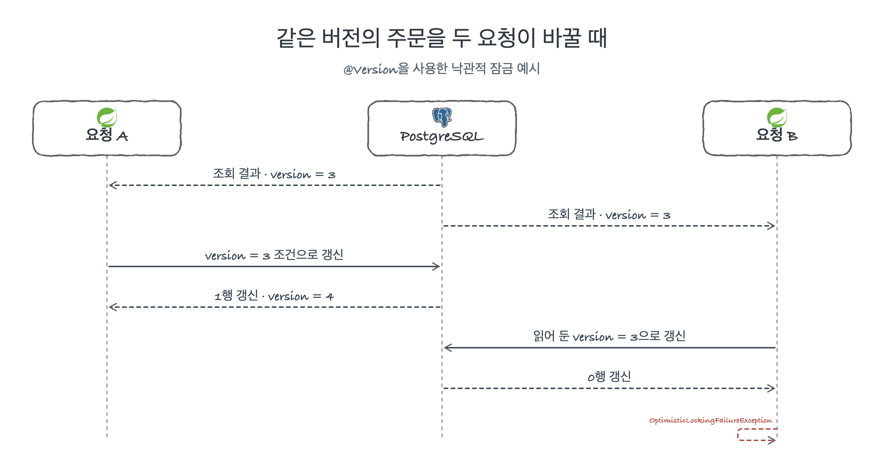

# Mapping and Saving R2DBC Entities

Spring Data의 매핑 애너테이션으로 테이블, 기본 키, 컬럼을 지정한다. 엔티티 변경은 Repository의 save 또는 Template의 update를 호출하는 위치에 드러낸다. [Spring Data 3.5 R2DBC Mapping](https://docs.spring.io/spring-data/relational/reference/3.5/r2dbc/mapping.html) · [Spring Data 3.5 Persisting Entities](https://docs.spring.io/spring-data/relational/reference/3.5/r2dbc/entity-persistence.html) · [ReactiveCrudRepository.save](https://docs.spring.io/spring-data/commons/docs/3.5.x/api/org/springframework/data/repository/reactive/ReactiveCrudRepository.html)

## 1. 테이블과 기본 키를 매핑하기

아래 주문 예제는 `purchase_order` 테이블의 `id`를 DB가 생성하는 숫자 키로 가정한다. `@Id`는 Spring Data의 애너테이션을 사용하고, 자바 속성명과 DB 컬럼명이 다른 `status`에는 `@Column`을 지정한다. [Spring Data 3.5 R2DBC Mapping](https://docs.spring.io/spring-data/relational/reference/3.5/r2dbc/mapping.html) · [Spring Data 3.5 Persisting Entities](https://docs.spring.io/spring-data/relational/reference/3.5/r2dbc/entity-persistence.html)

```java
import org.springframework.data.annotation.Id;
import org.springframework.data.annotation.Version;
import org.springframework.data.relational.core.mapping.Column;
import org.springframework.data.relational.core.mapping.Table;

@Table("purchase_order")
record PurchaseOrder(
        @Id Long id,
        @Column("order_status") String status,
        @Version Long version
) {}
```

## 2. 새 엔티티와 기존 엔티티 저장하기

이 모델로 새 주문을 만들 때는 `id`와 `version`을 `null`로 두고 `save`한다. INSERT 뒤에는 생성된 ID와 초기화된 버전을 후속 작업에 전달할 수 있도록 `save`가 내보낸 엔티티를 사용한다. [Spring Data 3.5 Persisting Entities](https://docs.spring.io/spring-data/relational/reference/3.5/r2dbc/entity-persistence.html) · [Spring Data 3.5 Optimistic Locking](https://docs.spring.io/spring-data/relational/reference/3.5/r2dbc/entity-persistence.html#r2dbc.entity-persistence.optimistic-locking) · [ReactiveCrudRepository.save](https://docs.spring.io/spring-data/commons/docs/3.5.x/api/org/springframework/data/repository/reactive/ReactiveCrudRepository.html)

상태를 바꿀 때는 조회한 주문의 ID와 버전을 유지한 새 값을 만들어 `save`로 넘긴다. 호출부가 삽입과 갱신을 직접 구분하고 싶다면 Template의 `insert`와 `update`를 사용한다. [Spring Data 3.5 Persisting Entities](https://docs.spring.io/spring-data/relational/reference/3.5/r2dbc/entity-persistence.html) · [Spring Data 3.5 Optimistic Locking](https://docs.spring.io/spring-data/relational/reference/3.5/r2dbc/entity-persistence.html#r2dbc.entity-persistence.optimistic-locking)

```java
Mono<PurchaseOrder> markPaid(OrderRepository orders, long id) {
    return orders.findById(id)
            .flatMap(order -> orders.save(
                    new PurchaseOrder(order.id(), "PAID", order.version())));
}
```

## 3. 동시 갱신에서 버전 충돌 처리하기

`@Version`이 있으면 갱신 조건에 읽어 온 버전이 들어간다. 같은 버전을 읽은 요청 두 개 중 하나가 먼저 저장하면 DB 버전이 증가한다. 뒤이은 저장은 `OptimisticLockingFailureException`을 전달하므로, 재시도가 필요하면 최신 상태를 읽어 업무 조건을 다시 판단한다. [Spring Data 3.5 Optimistic Locking](https://docs.spring.io/spring-data/relational/reference/3.5/r2dbc/entity-persistence.html#r2dbc.entity-persistence.optimistic-locking)



그림의 근거 · [Spring Data 3.5 Optimistic Locking](https://docs.spring.io/spring-data/relational/reference/3.5/r2dbc/entity-persistence.html#r2dbc.entity-persistence.optimistic-locking)
