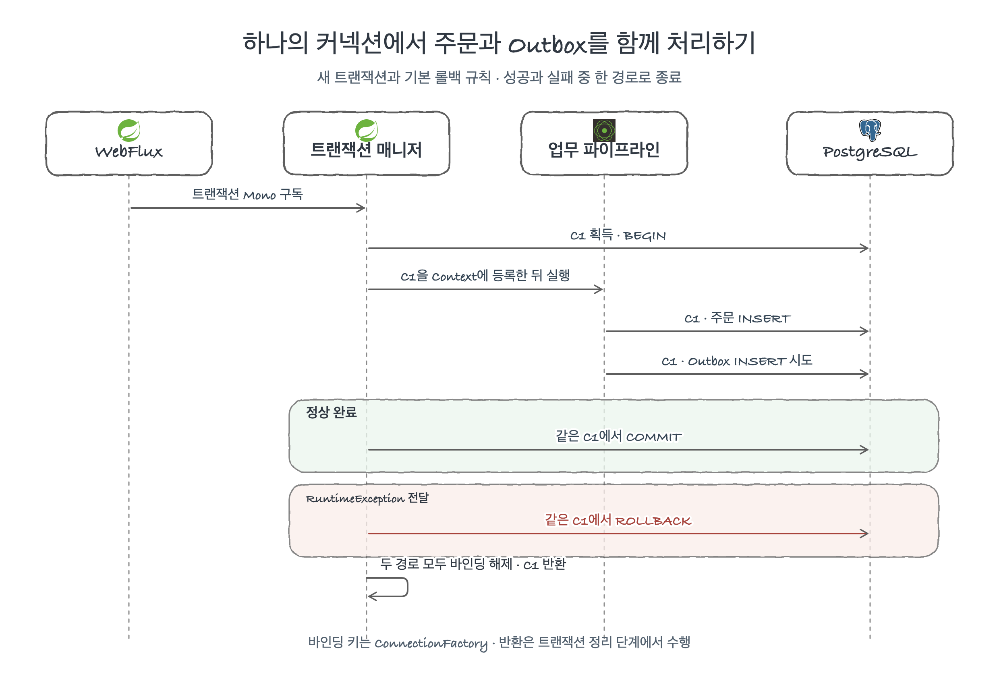
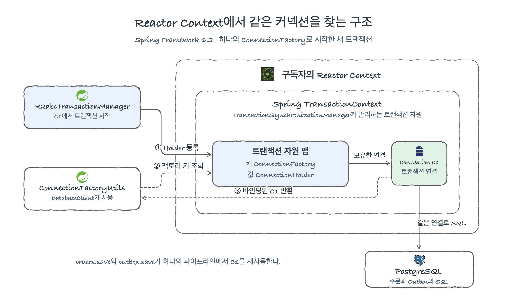

# Managing Reactive R2DBC Transactions

R2dbcTransactionManager는 한 ConnectionFactory에서 얻은 DB 연결을 구독자의 Reactor Context에 묶는다. 같은 트랜잭션에 참여할 작업은 같은 파이프라인에서 실행한다. [Spring Framework 6.2 R2dbcTransactionManager](https://docs.spring.io/spring-framework/reference/6.2/data-access/r2dbc.html#r2dbc-R2dbcTransactionManager) · [Spring Framework 6.2 리액티브 트랜잭션](https://docs.spring.io/spring-framework/reference/6.2/data-access/transaction/declarative/tx-decl-explained.html)

## 1. 한 서비스 메서드에서 쓰기를 순서대로 연결하기

주문을 저장하고 Outbox 행을 함께 기록하려면 두 리포지토리가 같은 `ConnectionFactory`를 사용하게 구성한다. Spring이 관리하는 서비스의 `@Transactional` 메서드에서 주문 저장 결과를 받은 후 Outbox를 저장하고, 전체 흐름을 `Mono`로 반환한다. 예제의 `OrderPlaced.from`은 저장된 주문으로 Outbox 행을 만드는 애플리케이션 메서드다. [Spring Framework 6.2 R2dbcTransactionManager](https://docs.spring.io/spring-framework/reference/6.2/data-access/r2dbc.html#r2dbc-R2dbcTransactionManager) · [Spring Framework 6.2 리액티브 트랜잭션](https://docs.spring.io/spring-framework/reference/6.2/data-access/transaction/declarative/tx-decl-explained.html) · [Spring Framework 6.2 @Transactional](https://docs.spring.io/spring-framework/reference/6.2/data-access/transaction/declarative/annotations.html) · [Project Reactor Mono API](https://projectreactor.io/docs/core/3.7.x/api/reactor/core/publisher/Mono.html)

```java
@Transactional
public Mono<PurchaseOrder> place(PurchaseOrder order) {
    return orders.save(order)
            .flatMap(saved -> outbox.save(OrderPlaced.from(saved))
                    .thenReturn(saved));
}
```

두 INSERT가 정상적으로 완료되면 Spring은 커밋한다. 기본 롤백 규칙에서 Outbox 저장이 RuntimeException을 전달하면 롤백한다. 새 트랜잭션이 끝나면 매니저는 자원 맵에서 팩토리 키의 바인딩을 제거하고 연결을 반환한다. [Spring 6.2.19 R2dbcTransactionManager 소스](https://raw.githubusercontent.com/spring-projects/spring-framework/v6.2.19/spring-r2dbc/src/main/java/org/springframework/r2dbc/connection/R2dbcTransactionManager.java) · [Spring 6.2 선언적 롤백 규칙](https://docs.spring.io/spring-framework/reference/6.2/data-access/transaction/declarative/rolling-back.html) · [Spring 6.2.19 트랜잭션 인터셉터 소스](https://raw.githubusercontent.com/spring-projects/spring-framework/v6.2.19/spring-tx/src/main/java/org/springframework/transaction/interceptor/TransactionAspectSupport.java)



그림의 근거 · [Spring Framework 6.2 R2dbcTransactionManager](https://docs.spring.io/spring-framework/reference/6.2/data-access/r2dbc.html#r2dbc-R2dbcTransactionManager) · [Spring Framework 6.2 리액티브 트랜잭션](https://docs.spring.io/spring-framework/reference/6.2/data-access/transaction/declarative/tx-decl-explained.html) · [Spring Framework 6.2 @Transactional](https://docs.spring.io/spring-framework/reference/6.2/data-access/transaction/declarative/annotations.html) · [Project Reactor Mono API](https://projectreactor.io/docs/core/3.7.x/api/reactor/core/publisher/Mono.html) · [Spring 6.2.19 R2dbcTransactionManager 소스](https://raw.githubusercontent.com/spring-projects/spring-framework/v6.2.19/spring-r2dbc/src/main/java/org/springframework/r2dbc/connection/R2dbcTransactionManager.java) · [Spring 6.2 선언적 롤백 규칙](https://docs.spring.io/spring-framework/reference/6.2/data-access/transaction/declarative/rolling-back.html) · [Spring 6.2.19 트랜잭션 인터셉터 소스](https://raw.githubusercontent.com/spring-projects/spring-framework/v6.2.19/spring-tx/src/main/java/org/springframework/transaction/interceptor/TransactionAspectSupport.java)

## 2. 트랜잭션 참여 경계 확인하기

서비스 내부에서 별도로 `subscribe()`를 호출한 쓰기는 반환한 파이프라인과 구독 경계가 달라진다. 기본 프록시 모드에서는 같은 객체 안에서 직접 호출한 `@Transactional` 메서드에도 새 트랜잭션 경계가 적용되지 않는다. 트랜잭션이 시작되는 호출과 실제로 반환하는 파이프라인을 함께 확인한다. [Spring Framework 6.2 리액티브 트랜잭션](https://docs.spring.io/spring-framework/reference/6.2/data-access/transaction/declarative/tx-decl-explained.html) · [Spring Framework 6.2 @Transactional](https://docs.spring.io/spring-framework/reference/6.2/data-access/transaction/declarative/annotations.html) · [Project Reactor Mono API](https://projectreactor.io/docs/core/3.7.x/api/reactor/core/publisher/Mono.html)

Spring Framework 6.2.19에서 같은 ConnectionFactory의 새 트랜잭션을 시작하면, 구독자의 Reactor Context가 참조하는 TransactionContext 자원 맵에 ConnectionHolder가 등록된다. DatabaseClient는 ConnectionFactoryUtils를 통해 이 팩토리 키를 조회해 같은 연결을 얻는다. [Spring 6.2.19 R2dbcTransactionManager 소스](https://raw.githubusercontent.com/spring-projects/spring-framework/v6.2.19/spring-r2dbc/src/main/java/org/springframework/r2dbc/connection/R2dbcTransactionManager.java) · [Spring 6.2 TransactionContext API](https://docs.spring.io/spring-framework/docs/6.2.x/javadoc-api/org/springframework/transaction/reactive/TransactionContext.html) · [Spring 6.2.19 ConnectionFactoryUtils 소스](https://raw.githubusercontent.com/spring-projects/spring-framework/v6.2.19/spring-r2dbc/src/main/java/org/springframework/r2dbc/connection/ConnectionFactoryUtils.java) · [Spring 6.2.19 DefaultDatabaseClient 소스](https://raw.githubusercontent.com/spring-projects/spring-framework/v6.2.19/spring-r2dbc/src/main/java/org/springframework/r2dbc/core/DefaultDatabaseClient.java)



그림의 근거 · [Spring Framework 6.2 R2dbcTransactionManager](https://docs.spring.io/spring-framework/reference/6.2/data-access/r2dbc.html#r2dbc-R2dbcTransactionManager) · [Spring Framework 6.2 리액티브 트랜잭션](https://docs.spring.io/spring-framework/reference/6.2/data-access/transaction/declarative/tx-decl-explained.html) · [Spring 6.2.19 R2dbcTransactionManager 소스](https://raw.githubusercontent.com/spring-projects/spring-framework/v6.2.19/spring-r2dbc/src/main/java/org/springframework/r2dbc/connection/R2dbcTransactionManager.java) · [Spring 6.2 TransactionContext API](https://docs.spring.io/spring-framework/docs/6.2.x/javadoc-api/org/springframework/transaction/reactive/TransactionContext.html) · [Spring 6.2.19 ConnectionFactoryUtils 소스](https://raw.githubusercontent.com/spring-projects/spring-framework/v6.2.19/spring-r2dbc/src/main/java/org/springframework/r2dbc/connection/ConnectionFactoryUtils.java) · [Spring 6.2.19 DefaultDatabaseClient 소스](https://raw.githubusercontent.com/spring-projects/spring-framework/v6.2.19/spring-r2dbc/src/main/java/org/springframework/r2dbc/core/DefaultDatabaseClient.java)

## 3. 파이프라인 일부에 경계 두기

메서드 전체보다 좁은 구간을 묶을 때는 `TransactionalOperator`의 `transactional(...)`을 사용할 수 있다. 트랜잭션을 감싼 Publisher에 `take`나 `timeout`으로 취소가 전달되면 롤백되므로, 다중 값을 반환하는 흐름에서는 끝까지 소비하는 조건도 확인한다. [Spring Framework 6.2 TransactionalOperator](https://docs.spring.io/spring-framework/reference/6.2/data-access/transaction/programmatic.html)
