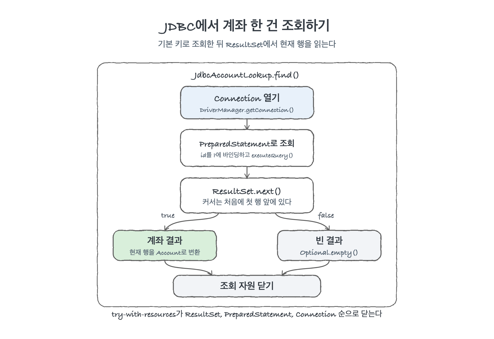

# JDBC Fundamentals and CRUD

## 1. Java에서 데이터베이스에 연결하기

JDBC는 Java 코드에서 데이터베이스 연결, SQL 실행, 결과 조회에 사용하는 API다. 애플리케이션은 `java.sql` 인터페이스를 호출하고, 클래스패스에 있는 데이터베이스별 JDBC 드라이버가 연결과 통신을 담당한다. `DriverManager.getConnection(...)`은 JDBC URL을 처리할 드라이버를 찾아 연결한다. JDBC API가 공통이어도 SQL 문법이나 지원 기능은 데이터베이스에 따라 달라질 수 있다. [Java 17 · DriverManager](https://docs.oracle.com/en/java/javase/17/docs/api/java.sql/java/sql/DriverManager.html) · [Java 17 · Connection](https://docs.oracle.com/en/java/javase/17/docs/api/java.sql/java/sql/Connection.html)

| 구성 요소 | 역할 |
| --- | --- |
| `Connection` | SQL을 실행하는 JDBC 연결. 자동 커밋과 트랜잭션을 제어한다. |
| `PreparedStatement` | SQL의 `?`에 값을 바인딩하고 문장을 실행한다. |
| `ResultSet` | 조회 결과의 행을 순회하고 열 값을 읽는다. |

Spring의 `JdbcTemplate`은 JDBC 작업의 자원 정리와 예외 변환을 맡는다. JPA는 JDBC 기반 관계형 데이터베이스를 사용하는 일반적인 구성에서 엔티티와 테이블의 매핑을 담당하고, 실제 SQL 실행은 JDBC 드라이버를 거친다. [Spring Framework 6.2 · JDBC Core](https://docs.spring.io/spring-framework/reference/6.2/data-access/jdbc/core.html) · [Spring Boot 3.5 · SQL Databases](https://docs.spring.io/spring-boot/3.5/reference/data/sql.html)

## 2. 예제 테이블과 CRUD 방식

아래 계좌 테이블을 다섯 문서에서 사용한다. Java 런타임에 H2 JDBC 드라이버를 추가하면 `jdbc:h2:mem:accounts;DB_CLOSE_DELAY=-1`로 같은 JVM 내의 메모리 데이터베이스를 열 수 있다. 이 설정에서는 마지막 연결을 닫아도 JVM이 실행 중인 동안 데이터베이스를 유지한다. [H2 · In-Memory Databases](https://h2database.com/html/features.html#in_memory_databases)

```sql
CREATE TABLE account (
    id BIGINT PRIMARY KEY,
    label VARCHAR(100) NOT NULL,
    balance_cents BIGINT NOT NULL CHECK (balance_cents >= 0)
);
```

| 작업 | SQL 예 | 실행 메서드 |
| --- | --- | --- |
| 등록 | `INSERT INTO account (id, label, balance_cents) VALUES (?, ?, ?)` | `executeUpdate()` |
| 조회 | `SELECT id, label, balance_cents FROM account WHERE id = ?` | `executeQuery()` |
| 수정 | `UPDATE account SET label = ? WHERE id = ?` | `executeUpdate()` |
| 삭제 | `DELETE FROM account WHERE id = ?` | `executeUpdate()` |

`executeUpdate()`의 반환값으로 변경된 행 수를 확인한다. 예를 들어 기본 키로 삭제할 때 결과가 `0`이면 지울 행이 없다는 뜻이다. `?`는 값의 자리에 사용한다. 열 이름이나 정렬 방향을 동적으로 고를 때는 허용된 SQL 조각 중에서 선택한다. [Java 17 · PreparedStatement](https://docs.oracle.com/en/java/javase/17/docs/api/java.sql/java/sql/PreparedStatement.html)

## 3. 조회와 자원 해제

`ResultSet`은 처음에 첫 행 앞에 있다. `next()`가 `true`일 때만 현재 행의 열을 읽을 수 있다. 아래 예제는 없는 계좌를 `Optional.empty()`로 표현하고, 모든 JDBC 자원을 `try-with-resources`로 닫는다. [Java 17 · ResultSet](https://docs.oracle.com/en/java/javase/17/docs/api/java.sql/java/sql/ResultSet.html) · [Java 17 · Connection](https://docs.oracle.com/en/java/javase/17/docs/api/java.sql/java/sql/Connection.html)



```java
import java.sql.Connection;
import java.sql.DriverManager;
import java.sql.PreparedStatement;
import java.sql.ResultSet;
import java.sql.SQLException;
import java.util.Optional;

public class JdbcAccountLookup {

    public static Optional<Account> find(String url, String user, String password, long id)
            throws SQLException {
        String sql = "SELECT id, label, balance_cents FROM account WHERE id = ?";
        try (Connection connection = DriverManager.getConnection(url, user, password);
             PreparedStatement statement = connection.prepareStatement(sql)) {
            statement.setLong(1, id);
            try (ResultSet rows = statement.executeQuery()) {
                if (!rows.next()) {
                    return Optional.empty();
                }
                return Optional.of(new Account(
                        rows.getLong("id"), rows.getString("label"), rows.getLong("balance_cents")));
            }
        }
    }

    public record Account(long id, String label, long balanceCents) {
    }
}
```

연결을 여는 방법을 저장소 외부로 옮기면 같은 SQL 코드에 [DataSource와 커넥션 풀](02_connection_pooling_and_data_sources.md)을 적용할 수 있다.
