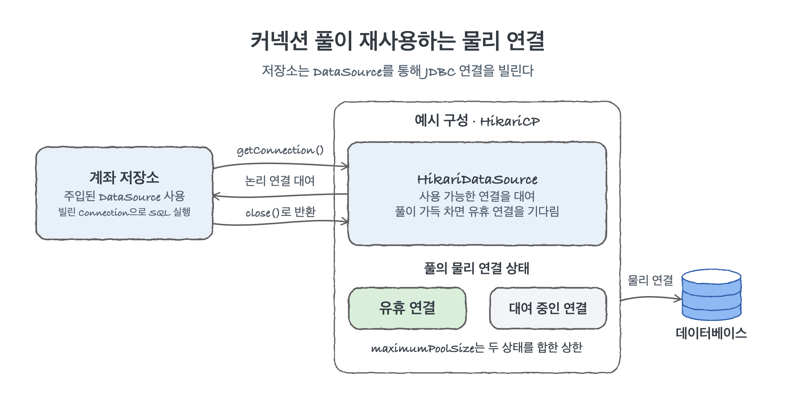

# Connection Pooling and Data Sources

## 1. 연결 생성과 대여

원격 데이터베이스에 새 물리 연결을 만들 때는 네트워크 연결, 인증, 서버 세션 설정이 필요하다. 커넥션 풀은 물리 연결을 보관하고 재사용한다. 애플리케이션이 받은 연결에 `close()`를 호출하면 일반적인 풀에서는 논리 연결이 닫히고 물리 연결은 다시 대여할 수 있게 된다. 서비스 중 연결을 사용한 코드는 `try-with-resources`로 반환하고, 풀 자체는 애플리케이션 종료 시 닫는다. [Java 17 · DataSource](https://docs.oracle.com/en/java/javase/17/docs/api/java.sql/javax/sql/DataSource.html) · [HikariCP · 설정](https://github.com/brettwooldridge/HikariCP#configuration)



| 연결을 얻는 방식 | 동작 |
| --- | --- |
| `DriverManager.getConnection(...)` | 호출자가 URL과 연결 속성을 전달한다. |
| `DriverManagerDataSource` | Spring의 `DataSource` 구현체. 요청마다 새 연결을 만든다. |
| `HikariDataSource` | 풀에서 사용할 수 있는 연결을 빌리거나 대기한다. |

`DataSource`는 연결을 얻는 표준 인터페이스다. 저장소가 생성자로 `DataSource`를 받으면 연결 URL이나 풀 설정을 구성 코드에서 관리할 수 있다. 실제 풀링 여부는 주입한 구현체가 결정한다. [Java 17 · DataSource](https://docs.oracle.com/en/java/javase/17/docs/api/java.sql/javax/sql/DataSource.html) · [Spring Framework 6.2 · JDBC 연결 관리](https://docs.spring.io/spring-framework/reference/6.2/data-access/jdbc/connections.html)

## 2. HikariCP 설정 읽기

| 설정 | 의미 |
| --- | --- |
| `maximumPoolSize` | 대여 중인 연결과 유휴 연결을 포함한 풀의 전체 상한 |
| `minimumIdle` | 풀이 유지하려는 유휴 연결 수 |
| `connectionTimeout` | 사용할 수 있는 연결이 생길 때까지 기다리는 최대 시간 |
| `maxLifetime` | 연결을 교체하는 수명 기준. 사용 중인 연결은 반환된 뒤에 교체할 수 있다. |

대여 대기 시간과 SQL 실행 시간은 따로 측정한다. 풀이 바쁜 경우에는 DB의 전체 연결 한도, 애플리케이션 인스턴스 수, 트랜잭션이 연결을 얼마나 오래 점유하는지를 함께 확인한다. 풀의 대여 타임아웃과 JDBC 문장의 쿼리 타임아웃은 각각 대기와 실행에 적용된다. [HikariCP · 설정과 풀 크기](https://github.com/brettwooldridge/HikariCP#configuration) · [Java 17 · Statement](https://docs.oracle.com/en/java/javase/17/docs/api/java.sql/java/sql/Statement.html)

```java
import com.zaxxer.hikari.HikariConfig;
import com.zaxxer.hikari.HikariDataSource;

public class JdbcPoolFactory {

    public static HikariDataSource create(String url, String user, String password) {
        HikariConfig config = new HikariConfig();
        config.setJdbcUrl(url);
        config.setUsername(user);
        config.setPassword(password);
        config.setMaximumPoolSize(8);
        config.setConnectionTimeout(1500);
        return new HikariDataSource(config);
    }
}
```

위 숫자는 설정 예시다. Spring Boot에서 자동 구성한 HikariCP를 사용한다면 `spring.datasource.url`과 `spring.datasource.hikari.maximum-pool-size`처럼 속성으로 설정할 수 있다. Spring 관리 트랜잭션 안에서 연결을 얻는 방식은 [트랜잭션 동기화 문서](04_spring_jdbc_transaction_management.md)에서 다룬다. [Spring Boot 3.5 · DataSource 구성](https://docs.spring.io/spring-boot/3.5/reference/data/sql.html)
