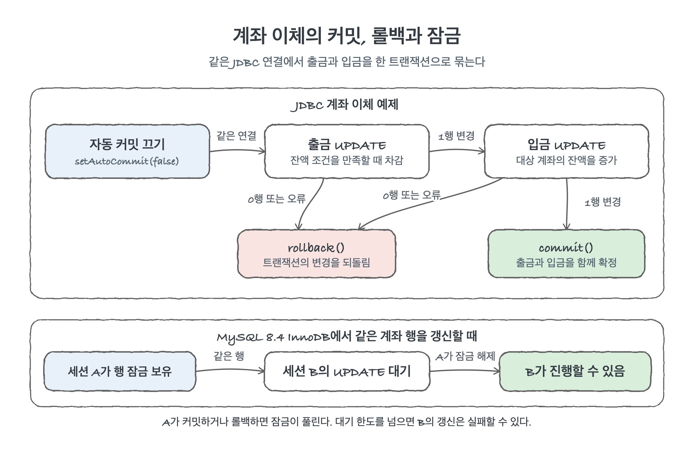

# Database Transactions and Locking

## 1. 커밋과 롤백의 경계

계좌 사이에서 금액을 옮기려면 출금과 입금이 한 작업 단위로 완료되어야 한다. 트랜잭션에서는 두 SQL이 모두 성공하면 커밋하고, 중간에 실패하면 롤백한다. JDBC의 새 연결은 기본적으로 자동 커밋 모드다. 여러 문장을 같은 로컬 트랜잭션에 포함하려면 같은 `Connection`에서 `setAutoCommit(false)`를 호출하고 `commit()` 또는 `rollback()`을 명시한다. 진행 중인 트랜잭션에서 자동 커밋 모드를 변경하면 트랜잭션이 커밋될 수 있다. [Java 17 · Connection](https://docs.oracle.com/en/java/javase/17/docs/api/java.sql/java/sql/Connection.html) · [MySQL 8.4 · InnoDB 커밋과 롤백](https://dev.mysql.com/doc/refman/8.4/en/innodb-autocommit-commit-rollback.html)



| ACID 속성 | 계좌 이체에서의 의미 |
| --- | --- |
| 원자성 | 출금과 입금을 하나의 완료 단위로 묶는다. |
| 일관성 | 저장 후에도 잔액 제약과 같은 규칙이 성립한다. |
| 격리성 | 동시 작업에서 무엇을 읽고 수정할 수 있는지 격리 수준과 잠금이 결정한다. |
| 지속성 | 커밋한 변경이 장애 이후에도 유지되도록 데이터베이스가 관리한다. |

다른 연결에서 미커밋 변경을 볼 수 있는지, 같은 조회가 같은 결과를 돌려주는지는 격리 수준과 데이터베이스 구현에 따라 달라진다. InnoDB의 일반 조회는 `READ COMMITTED`에서 문장마다 새 스냅샷을 읽고, `REPEATABLE READ`에서는 같은 트랜잭션의 첫 일관 읽기에서 만든 스냅샷을 재사용한다. MySQL에서는 일부 DDL이 암묵적으로 커밋을 일으키므로 아래 이체 트랜잭션은 행을 변경하는 SQL만 포함한다. [MySQL 8.4 · InnoDB 트랜잭션 격리 수준](https://dev.mysql.com/doc/refman/8.4/en/innodb-transaction-isolation-levels.html) · [MySQL 8.4 · 암묵적 커밋](https://dev.mysql.com/doc/refman/8.4/en/implicit-commit.html)

## 2. 잠금으로 동시 변경 제어하기

InnoDB에서 `UPDATE`는 변경 대상에 잠금을 건다. 조회 결과를 토대로 같은 행을 변경할 예정이라면 트랜잭션 내에서 `SELECT ... FOR UPDATE`로 잠금 읽기를 할 수 있다. 세션 A가 계좌 행을 잠근 상태에서 세션 B가 같은 행을 갱신하면, B는 A의 커밋이나 롤백으로 잠금이 풀릴 때까지 기다릴 수 있다. 대기 시간이 한도를 넘으면 B의 갱신은 실패할 수 있다. [MySQL 8.4 · InnoDB 잠금 읽기](https://dev.mysql.com/doc/refman/8.4/en/innodb-locking-reads.html) · [MySQL 8.4 · InnoDB 트랜잭션 격리 수준](https://dev.mysql.com/doc/refman/8.4/en/innodb-transaction-isolation-levels.html)

아래 출금 SQL은 잔액 조건과 차감 연산을 한 문장에 넣는다. 결과가 `0`이면 계좌가 없거나 잔액이 부족하다. 여러 방향의 이체가 동시에 발생하면 잠금 대기나 데드락이 생길 수 있다. 같은 자원을 여러 개 잠그는 로직에서는 잠금 순서를 일정하게 유지하고, 실패 처리 시 롤백 범위를 확인한다. [MySQL 8.4 · InnoDB 잠금 읽기](https://dev.mysql.com/doc/refman/8.4/en/innodb-locking-reads.html) · [MySQL 8.4 · InnoDB Deadlocks](https://dev.mysql.com/doc/refman/8.4/en/innodb-deadlocks.html)

## 3. JDBC로 두 작업을 한 트랜잭션에 묶기

[JDBC 계좌 테이블](01_jdbc_fundamentals_and_crud.md)을 사용한다. 출금 성공 후 입금 대상이 없으면 예외를 발생시키고 출금까지 롤백한다. 롤백도 실패하면 원래 실패를 유지하고 롤백 실패를 추가 정보로 남긴다.

```java
import java.sql.Connection;
import java.sql.PreparedStatement;
import java.sql.SQLException;
import javax.sql.DataSource;

public class JdbcAccountTransfers {

    public static void transfer(DataSource dataSource, long fromId, long toId, long cents)
            throws SQLException {
        if (cents <= 0 || fromId == toId) {
            throw new IllegalArgumentException("Use a positive amount and different accounts.");
        }

        try (Connection connection = dataSource.getConnection()) {
            connection.setAutoCommit(false);
            try {
                try (PreparedStatement debit = connection.prepareStatement("""
                        UPDATE account SET balance_cents = balance_cents - ?
                        WHERE id = ? AND balance_cents >= ?
                        """);
                     PreparedStatement credit = connection.prepareStatement("""
                        UPDATE account SET balance_cents = balance_cents + ? WHERE id = ?
                        """)) {
                    debit.setLong(1, cents);
                    debit.setLong(2, fromId);
                    debit.setLong(3, cents);
                    if (debit.executeUpdate() != 1) {
                        throw new IllegalStateException("Source account is missing or has insufficient funds.");
                    }

                    credit.setLong(1, cents);
                    credit.setLong(2, toId);
                    if (credit.executeUpdate() != 1) {
                        throw new IllegalStateException("Destination account is missing.");
                    }
                }
                connection.commit();
            } catch (SQLException | RuntimeException | Error failure) {
                try {
                    connection.rollback();
                } catch (SQLException rollbackFailure) {
                    failure.addSuppressed(rollbackFailure);
                }
                throw failure;
            }
        }
    }
}
```

이 메서드는 연결을 직접 빌려 트랜잭션을 시작하고 종료한다. 여러 저장소 호출에 같은 연결을 공유하려면 [Spring JDBC 트랜잭션 관리](04_spring_jdbc_transaction_management.md)를 사용할 수 있다.
