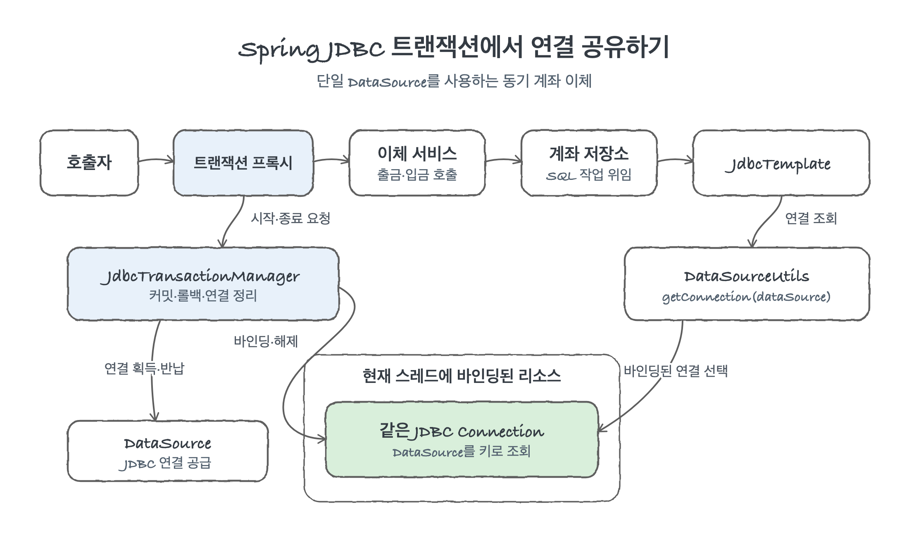

# Spring JDBC Transaction Management

## 1. 서비스가 작업 경계를 정하고 매니저가 연결을 관리한다

서비스 계층은 출금과 입금을 한 작업으로 묶는다. `PlatformTransactionManager`는 트랜잭션 시작, 커밋, 롤백을 공통 인터페이스로 제공한다. 단일 JDBC `DataSource`를 사용하는 경우 `DataSourceTransactionManager`가 현재 스레드에 연결을 바인딩한다. `JdbcTransactionManager`는 JDBC용 구현을 확장해 커밋이나 롤백 과정의 SQL 예외도 Spring 데이터 접근 예외로 변환할 수 있다. [Spring Framework 6.2 · JDBC 연결과 트랜잭션 매니저](https://docs.spring.io/spring-framework/reference/6.2/data-access/jdbc/connections.html)

```text
호출자 → 트랜잭션 프록시 → 서비스 → 저장소 → JdbcTemplate
                         시작된 트랜잭션의 JDBC 연결을 공유
```

직접 JDBC를 처리하는 저장소는 `DataSourceUtils.getConnection(dataSource)`로 연결을 얻고 `finally`에서 `DataSourceUtils.releaseConnection(connection, dataSource)`으로 반납한다. 트랜잭션에 연결된 경우 최종 반납은 매니저가 처리한다. `JdbcTemplate`은 이 흐름을 내부에서 사용하므로 매니저와 같은 `DataSource`를 쓰면 저장소에 `Connection`을 매개변수로 전달하지 않아도 된다. 이 연결의 바인딩 범위는 현재 스레드이며, 별도로 시작한 스레드에는 그대로 전달되지 않는다. [Spring Framework 6.2 · DataSourceUtils](https://docs.spring.io/spring-framework/reference/6.2/data-access/jdbc/connections.html) · [Spring Framework 6.2 · @Transactional](https://docs.spring.io/spring-framework/reference/6.2/data-access/transaction/declarative/annotations.html)



## 2. 트랜잭션 경계 표현하기

| 방식 | 사용 방법 |
| --- | --- |
| `PlatformTransactionManager` 직접 호출 | 트랜잭션 상태를 얻고 성공 또는 실패에 따라 명시적으로 종료한다. |
| `TransactionTemplate` | 콜백 범위를 트랜잭션으로 묶는다. 작업 도중 경계를 코드로 표현해야 할 때 사용한다. |
| `@Transactional` | 빈의 메서드에 경계를 선언하고 프록시가 호출 전후를 처리한다. |

기본 프록시 모드에서는 스프링이 관리하는 빈을 외부에서 프록시를 통해 호출해야 한다. 같은 객체 내부에서 `this.transfer(...)`로 호출하면 그 호출에 대한 트랜잭션 어드바이스를 거치지 않는다. 기본 롤백 규칙은 메서드 밖으로 나온 `RuntimeException`과 `Error`를 대상으로 한다. 체크 예외에서도 롤백하길 원하면 `rollbackFor` 등의 규칙을 선언한다. 예외를 잡아 정상 반환하면 프록시는 그 예외를 볼 수 없다. [Spring Framework 6.2 · 프로그래밍 방식 트랜잭션](https://docs.spring.io/spring-framework/reference/6.2/data-access/transaction/programmatic.html) · [Spring Framework 6.2 · 선언적 트랜잭션](https://docs.spring.io/spring-framework/reference/6.2/data-access/transaction/declarative/annotations.html) · [Spring Framework 6.2 · 롤백 규칙](https://docs.spring.io/spring-framework/reference/6.2/data-access/transaction/declarative/rolling-back.html)

## 3. 계좌 이체에 선언적 트랜잭션 적용하기

다음 서비스를 빈으로 등록하고 [JdbcTemplate 저장소](05_spring_jdbc_exception_translation_and_jdbc_template.md)를 주입한다. 입금 계좌가 없어 예외가 나오면 같은 트랜잭션에서 수행한 출금도 롤백된다.

```java
import org.springframework.transaction.annotation.Transactional;

public class SpringAccountTransfers {

    private final Accounts accounts;

    public SpringAccountTransfers(Accounts accounts) {
        this.accounts = accounts;
    }

    @Transactional
    public void transfer(long fromId, long toId, long cents) {
        if (cents <= 0 || fromId == toId) {
            throw new IllegalArgumentException("Use a positive amount and different accounts.");
        }
        if (accounts.debit(fromId, cents) != 1) {
            throw new IllegalStateException("Source account is missing or has insufficient funds.");
        }
        if (accounts.credit(toId, cents) != 1) {
            throw new IllegalStateException("Destination account is missing.");
        }
    }

    public interface Accounts {
        int debit(long id, long cents);
        int credit(long id, long cents);
    }
}
```

일반 Spring 구성에서는 `@EnableTransactionManagement`를 적용하고 `new JdbcTransactionManager(dataSource)`를 트랜잭션 매니저 빈으로 등록할 수 있다. Spring Boot에서는 JDBC 의존성과 설정에 따라 `DataSource`, `JdbcTemplate`, JDBC 트랜잭션 매니저가 자동 구성된다. 여러 `DataSource`를 사용한다면 각 저장소와 트랜잭션 매니저가 같은 대상을 가리키도록 설정한다. [Spring Framework 6.2 · @Transactional 활성화](https://docs.spring.io/spring-framework/reference/6.2/data-access/transaction/declarative/annotations.html) · [Spring Boot 3.5 · SQL Databases](https://docs.spring.io/spring-boot/3.5/reference/data/sql.html) · [Spring Boot 3.5 API · JDBC 트랜잭션 매니저 자동 구성](https://docs.spring.io/spring-boot/3.5/api/java/org/springframework/boot/autoconfigure/jdbc/DataSourceTransactionManagerAutoConfiguration.html)
