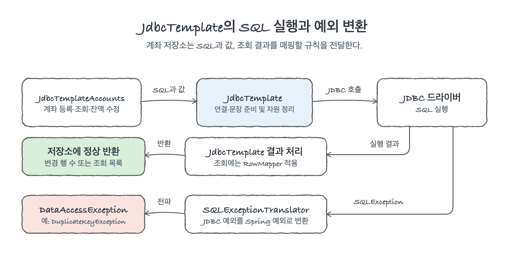

# Spring JDBC Exception Translation and JdbcTemplate

## 1. SQL 예외를 저장소 경계에서 변환하기

직접 JDBC를 사용하면 `SQLException`의 `getSQLState()`와 `getErrorCode()`로 오류를 구분할 수 있다. 서비스가 JDBC 오류 코드를 알 필요가 없다면 저장소에서 처리할 의미를 가진 예외로 바꾸고, 원래 예외는 원인으로 연결한다. 저장소 인터페이스가 `SQLException`을 선언하면 그 인터페이스를 호출하는 코드도 JDBC의 체크 예외 처리 규약을 따라야 한다. [Java 17 · SQLException](https://docs.oracle.com/en/java/javase/17/docs/api/java.sql/java/sql/SQLException.html) · [Spring Framework 6.2 · SQLExceptionTranslator](https://docs.spring.io/spring-framework/reference/6.2/data-access/jdbc/core.html)

Spring의 `SQLExceptionTranslator`는 JDBC 예외를 공통 `DataAccessException` 계층으로 변환한다. Spring Framework 6.2의 기본 `SQLExceptionSubclassTranslator`는 JDBC가 반환한 예외 타입과 일부 오류 코드를 살펴보고, 필요한 경우 SQLState 기반 변환기로 넘어간다. 데이터베이스별 오류 코드 매핑을 구성하려면 `SQLErrorCodeSQLExceptionTranslator`를 사용할 수 있다. [Spring Framework 6.2 · SQLExceptionTranslator](https://docs.spring.io/spring-framework/reference/6.2/data-access/jdbc/core.html)

| 예외 | 처리의 기준 |
| --- | --- |
| `DuplicateKeyException` | 키 중복으로 분류된 경우다. 필요하면 서비스에서 중복 등록 응답으로 바꾼다. |
| `DataIntegrityViolationException` | 무결성 제약 위반이다. 중복 키 예외도 이 계층에 포함된다. |
| `DataAccessException` | 데이터 접근 실패를 표현하는 상위 타입이다. 처리할 수 있는 원인이 정해졌을 때 구체적인 타입을 사용한다. |

## 2. JdbcTemplate에 반복 작업 맡기기

`JdbcTemplate`은 연결과 문장을 준비하고 실행한 뒤 JDBC 자원을 정리한다. 애플리케이션은 SQL, 바인딩 값, 행을 객체로 변환할 규칙을 전달한다. 아래 저장소는 [계좌 테이블](01_jdbc_fundamentals_and_crud.md)과 [트랜잭션 서비스](04_spring_jdbc_transaction_management.md)에 연결한다. `update()`는 영향받은 행 수를, `query()`는 `RowMapper`가 변환한 결과 목록을 반환한다. [Spring Framework 6.2 · JdbcTemplate](https://docs.spring.io/spring-framework/reference/6.2/data-access/jdbc/core.html)



```java
import java.util.Optional;

import org.springframework.jdbc.core.JdbcTemplate;

public class JdbcTemplateAccounts implements SpringAccountTransfers.Accounts {

    private final JdbcTemplate jdbc;

    public JdbcTemplateAccounts(JdbcTemplate jdbc) {
        this.jdbc = jdbc;
    }

    public void create(long id, String label, long openingBalanceCents) {
        jdbc.update("INSERT INTO account (id, label, balance_cents) VALUES (?, ?, ?)",
                id, label, openingBalanceCents);
    }

    public Optional<Long> findBalance(long id) {
        return jdbc.query("SELECT balance_cents FROM account WHERE id = ?",
                (row, number) -> row.getLong("balance_cents"), id).stream().findFirst();
    }

    @Override
    public int debit(long id, long cents) {
        return jdbc.update("""
                UPDATE account SET balance_cents = balance_cents - ?
                WHERE id = ? AND balance_cents >= ?
                """, cents, id, cents);
    }

    @Override
    public int credit(long id, long cents) {
        return jdbc.update("""
                UPDATE account SET balance_cents = balance_cents + ? WHERE id = ?
                """, cents, id);
    }
}
```

기본 키 조회에는 최대 한 행만 있으므로 결과 목록이 비어 있으면 계좌가 없는 경우다. 한 행 반환이 계약이라면 `queryForObject()`를 사용할 수 있다. 이 메서드는 행이 없거나 둘 이상이면 결과 크기 오류를 발생시킨다. [Spring Framework 6.2 API · JdbcTemplate](https://docs.spring.io/spring-framework/docs/6.2.x/javadoc-api/org/springframework/jdbc/core/JdbcTemplate.html)

## 3. 예외 변환과 트랜잭션을 함께 적용하기

같은 `DataSource`를 사용하는 `JdbcTemplate` 호출은 Spring이 열어 둔 트랜잭션에 참여한다. 변환된 `DataAccessException`은 런타임 예외이므로 서비스 메서드 밖으로 전달되면 기본 규칙에 따라 롤백을 일으킨다. 오류를 API 응답으로 바꾸는 코드는 트랜잭션 경계를 벗어난 곳에 두면 롤백 여부를 명확히 할 수 있다. [Spring Framework 6.2 · JDBC 연결 관리](https://docs.spring.io/spring-framework/reference/6.2/data-access/jdbc/connections.html) · [Spring Framework 6.2 · 롤백 규칙](https://docs.spring.io/spring-framework/reference/6.2/data-access/transaction/declarative/rolling-back.html)
