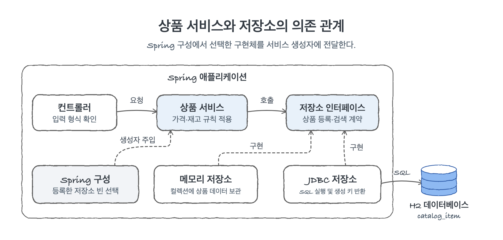

# Data Access Architecture and Repository Design

## 1. 저장소가 제공할 계약부터 정하기

상품 목록에서는 이름과 최대 가격으로 상품을 검색한다. 상품 등록에서는 이름, 가격, 재고를 받고 생성한 식별자를 반환한다. 서비스는 이런 동작을 저장소 인터페이스로 호출하고, 구현체는 메모리 컬렉션이나 데이터베이스에서 데이터를 관리한다. 저장소를 Spring 빈으로 등록하면 서비스 생성자에 사용할 구현체를 주입할 수 있다. [Spring Framework 6.2 · 생성자 의존성 주입](https://docs.spring.io/spring-framework/reference/6.2/core/beans/dependencies/factory-collaborators.html)



| 구성 | 상품 등록 예 |
| --- | --- |
| 컨트롤러 | 요청을 받고 입력 형식을 확인한다. |
| 서비스 | 가격과 재고에 대한 업무 규칙을 적용하고 저장소를 호출한다. |
| 저장소 구현체 | 상품 데이터를 저장하고 생성된 키를 반환한다. |
| 구성 코드 | 서비스에 연결할 저장소와 데이터베이스를 결정한다. |

메모리 구현으로 먼저 저장·조회·수정 계약을 검증할 수 있다. SQL 구현을 연결한 뒤에는 제약 조건, 생성 키, 정렬, 롤백처럼 데이터베이스에 따라 결과가 달라지는 동작을 통합 테스트로 확인한다. [Spring Boot 3.5 · 데이터 접근 테스트](https://docs.spring.io/spring-boot/3.5/reference/testing/spring-boot-applications.html)

## 2. 상품 테이블 준비하기

이후 예제는 H2의 `catalog_item` 테이블을 사용한다. `price_cents`는 정수로 표현한 금액이고 `stock`은 재고 수량이다. 스키마를 `schema.sql`로 두면 Spring Boot의 SQL 초기화 기능으로 실행할 수 있다. 운영 환경에서 스키마를 관리할 때는 초기화 방식 또는 마이그레이션 도구를 한 가지 기준으로 정한다. [Spring Boot 3.5 · 데이터베이스 초기화](https://docs.spring.io/spring-boot/3.5/how-to/data-initialization.html) · [H2 · CREATE TABLE](https://h2database.com/html/commands.html#create_table)

```sql
CREATE TABLE catalog_item (
    id BIGINT GENERATED BY DEFAULT AS IDENTITY PRIMARY KEY,
    name VARCHAR(100) NOT NULL,
    price_cents BIGINT NOT NULL CHECK (price_cents >= 0),
    stock INTEGER NOT NULL CHECK (stock >= 0)
);
```

SQL 기반 조회의 결과 타입으로 다음 레코드를 사용한다. [JPA 저장소](10_jpa_entity_mapping_and_repository_operations.md)는 같은 테이블을 엔티티에 매핑한다.

```java
public record CatalogItem(long id, String name, long priceCents, int stock) {
}
```

## 3. 구현 기술에 따라 맡는 부분 확인하기

| 방식 | 애플리케이션에서 정의하는 부분 |
| --- | --- |
| `JdbcTemplate` | SQL, 바인딩 값, 행을 읽는 로직 |
| MyBatis | 매퍼 메서드, SQL 문, 결과 매핑 |
| JPA | 객체와 테이블의 매핑, 엔티티 저장 및 JPQL |
| Spring Data JPA | JPA 저장소 인터페이스와 조회 계약 |
| Querydsl JPA | 생성된 Q 타입을 조합한 조회 조건과 정렬 |

`JdbcTemplate`과 MyBatis는 SQL 작성과 결과 매핑을 중심으로 사용한다. JPA는 엔티티의 영속 상태를 다루고, Spring Data JPA와 Querydsl은 각각 저장소 구현과 조회 구성을 지원한다. [Spring Framework 6.2 · JDBC Core](https://docs.spring.io/spring-framework/reference/6.2/data-access/jdbc/core.html) · [MyBatis 3 · Mapper XML](https://mybatis.org/mybatis-3/sqlmap-xml.html) · [Spring Data JPA 3.5 · Query Methods](https://docs.spring.io/spring-data/jpa/reference/3.5/jpa/query-methods.html) · [Querydsl 5.0 · JPAQueryFactory](https://github.com/querydsl/querydsl/blob/QUERYDSL_5_0_0/querydsl-jpa/src/main/java/com/querydsl/jpa/impl/JPAQueryFactory.java)
