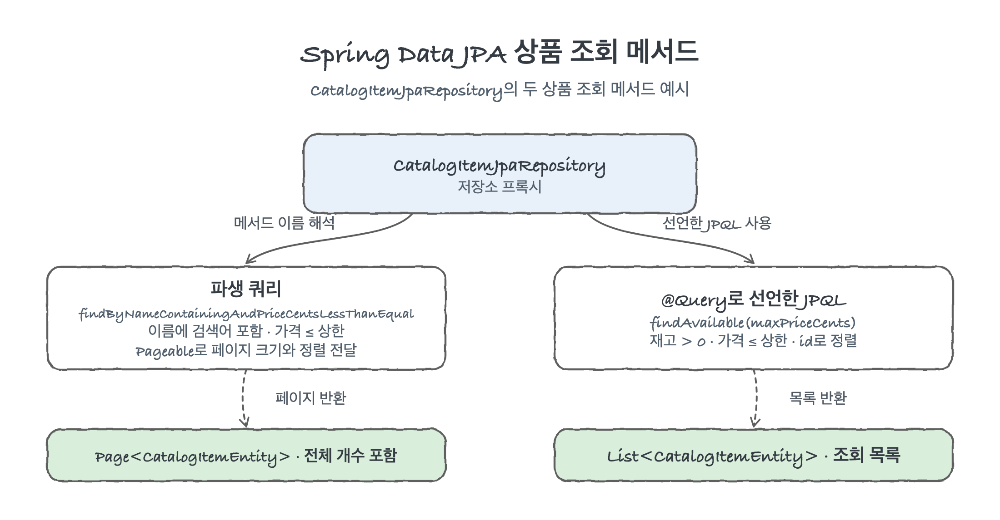

# Spring Data JPA Repositories and Queries

## 1. 저장소 인터페이스로 공통 CRUD 사용하기

Spring Data JPA는 저장소 인터페이스의 프록시를 구성한다. `JpaRepository<엔티티, ID 타입>`를 상속하면 저장, 기본 키 조회, 삭제, 페이징 같은 메서드를 사용할 수 있다. 저장소를 애플리케이션의 스캔 범위에 두거나 `@EnableJpaRepositories`로 범위를 설정한다. [Spring Data JPA · 저장소 인터페이스](../spring-data-jpa/01_spring_data_jpa_repository_interfaces.md) · [Spring Boot 3.5 · Spring Data JPA Repositories](https://docs.spring.io/spring-boot/3.5/reference/data/sql.html)

`save()`는 새 엔티티에 `persist()`를, 기존 엔티티로 판정한 경우에는 `merge()`를 호출한다. `merge()`가 반환한 객체는 입력 객체와 별개일 수 있으므로 이후 로직에서는 `save()`가 반환한 값을 사용한다. [Spring Data JPA 3.5 · Persisting Entities](https://docs.spring.io/spring-data/jpa/reference/3.5/jpa/entity-persistence.html)

## 2. 메서드 이름 또는 JPQL로 검색 선언하기

[상품 엔티티](10_jpa_entity_mapping_and_repository_operations.md)를 조회하는 예제다. 파생 쿼리는 이름과 최대 가격 두 조건을 적용하고, JPQL은 재고가 있는 상품만 조회한다.

```java
import java.util.List;

import org.springframework.data.domain.Page;
import org.springframework.data.domain.Pageable;
import org.springframework.data.jpa.repository.JpaRepository;
import org.springframework.data.jpa.repository.Query;
import org.springframework.data.repository.query.Param;

public interface CatalogItemJpaRepository extends JpaRepository<CatalogItemEntity, Long> {

    Page<CatalogItemEntity> findByNameContainingAndPriceCentsLessThanEqual(
            String keyword, long maxPriceCents, Pageable pageable);

    @Query("""
            select item from CatalogItemEntity item
            where item.stock > 0 and item.priceCents <= :maxPrice
            order by item.id
            """)
    List<CatalogItemEntity> findAvailable(@Param("maxPrice") long maxPriceCents);
}
```

메서드 이름의 속성은 매핑된 엔티티 속성과 일치해야 한다. `Pageable`에는 페이지 크기와 정렬을 전달할 수 있다. 결과에 전체 개수가 필요하면 `Page`를 사용하며, 다음 페이지 유무만 필요하면 `Slice`를 고려한다. 선택 필터 조합이 많다면 [Querydsl 조건 조립](12_querydsl_dynamic_jpa_queries.md)처럼 조건을 코드로 구성할 수 있다. [Spring Data JPA 3.5 · Query Methods](https://docs.spring.io/spring-data/jpa/reference/3.5/jpa/query-methods.html) · [Spring Data JPA 3.5 · 쿼리 메서드와 페이징](../spring-data-jpa/02_spring_data_jpa_query_methods_and_pagination.md)



## 3. 서비스에서 트랜잭션 범위 정하기

기본 구현에서 상속한 읽기 CRUD 메서드는 `readOnly`를 사용하고, 변경 메서드는 일반 트랜잭션으로 실행된다. 직접 선언한 쿼리 메서드는 기본적으로 별도 트랜잭션 설정을 받지 않는다. 여러 저장소 작업을 함께 처리한다면 서비스 메서드에서 경계를 선언한다. 같은 트랜잭션에 참여하는 저장소 호출은 바깥 서비스가 시작한 작업에 포함된다. [Spring Data JPA 3.5 · Transactionality](https://docs.spring.io/spring-data/jpa/reference/3.5/jpa/transactions.html)
