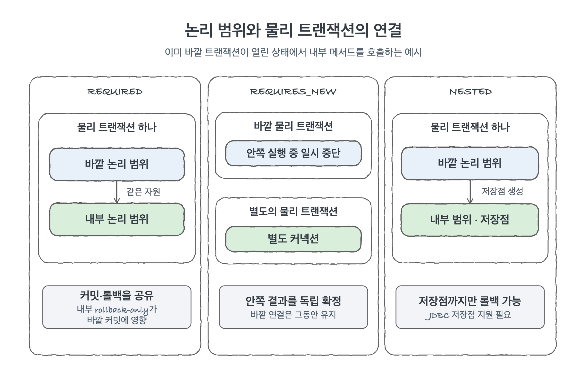

# Spring Transaction Propagation Modes

## 1. 논리 범위와 물리 트랜잭션

서비스와 저장소가 각자 `@Transactional`로 선언하면 호출마다 논리 범위가 생길 수 있다. 물리 트랜잭션은 실제 DB 연결이 커밋하거나 롤백하는 단위다. 기본값인 `REQUIRED`로 내부 메서드를 호출하면 두 논리 범위가 같은 물리 트랜잭션에 참여하며, 마지막 커밋은 처음 시작한 바깥 경계에서 일어난다. [Spring Framework 6.2 · 트랜잭션 전파](https://docs.spring.io/spring-framework/reference/6.2/data-access/transaction/declarative/tx-propagation.html)

| 전파 | 기존 트랜잭션이 있을 때 | 기존 트랜잭션이 없을 때 |
| --- | --- | --- |
| `REQUIRED` | 참여 | 시작 |
| `REQUIRES_NEW` | 바깥 작업을 일시 중단하고 새 트랜잭션 시작 | 시작 |
| `NESTED` | 매니저가 지원하면 저장점으로 중첩 범위 실행 | 시작 |
| `SUPPORTS` | 참여 | 물리 트랜잭션 없이 실행 |
| `MANDATORY` | 참여 | 예외 |
| `NOT_SUPPORTED` | 바깥 작업을 일시 중단하고 물리 트랜잭션 없이 실행 | 물리 트랜잭션 없이 실행 |
| `NEVER` | 예외 | 물리 트랜잭션 없이 실행 |

중첩 실행과 일시 중단은 사용하는 트랜잭션 매니저의 지원 범위를 확인한다. [Spring Framework 6.2 API · Propagation](https://docs.spring.io/spring-framework/docs/6.2.x/javadoc-api/org/springframework/transaction/annotation/Propagation.html)

## 2. REQUIRED에서 내부 작업이 실패할 때

`REQUIRED`로 참여한 내부 메서드가 롤백 대상 예외로 종료되면, 기본 동작에서는 공유 트랜잭션이 롤백 전용으로 표시된다. 바깥 메서드가 예외를 잡고 정상 반환하면 프록시는 커밋을 시도하지만, 실제로는 롤백되고 호출자는 `UnexpectedRollbackException`을 받는다. 내부 메서드가 정상 종료한 뒤 바깥에서 실패해도 같은 물리 트랜잭션에 포함된 변경은 함께 롤백된다. [Spring Framework 6.2 · REQUIRED와 UnexpectedRollbackException](https://docs.spring.io/spring-framework/reference/6.2/data-access/transaction/declarative/tx-propagation.html)

독립 트랜잭션을 순서대로 두 번 시작하면 첫 번째 작업이 이미 커밋된 뒤 두 번째가 롤백되어도 첫 번째 변경은 유지된다. 두 작업을 같이 확정해야 한다면 하나의 바깥 경계 안에서 `REQUIRED`로 참여하게 한다. [Spring Framework 6.2 · 트랜잭션 전파](https://docs.spring.io/spring-framework/reference/6.2/data-access/transaction/declarative/tx-propagation.html)

## 3. REQUIRES_NEW와 NESTED의 경계

`REQUIRES_NEW`는 바깥쪽 연결을 보유한 상태에서 내부 DB 작업에 다른 연결을 사용할 수 있다. 내부 작업은 독립적으로 커밋하거나 롤백한다. 여러 요청이 바깥 연결을 잡은 채 내부 연결을 기다릴 수 있으므로 풀의 여유와 잠금 대기를 함께 확인한다. [Spring Framework 6.2 · REQUIRES_NEW와 커넥션 풀](https://docs.spring.io/spring-framework/reference/6.2/data-access/transaction/declarative/tx-propagation.html)

`NESTED`는 지원되는 JDBC 구성에서 같은 물리 트랜잭션 안에 저장점을 둔다. 내부 작업만 저장점까지 되돌릴 수 있고, 바깥 트랜잭션이 롤백되면 남은 변경도 함께 롤백된다. `JpaTransactionManager`의 저장점 지원은 JDBC 연결에 해당하며 JPA 영속성 컨텍스트의 객체 상태까지 되돌리는 기능은 제공하지 않는다. [Spring Framework 6.2 · NESTED](https://docs.spring.io/spring-framework/reference/6.2/data-access/transaction/declarative/tx-propagation.html) · [Spring Framework 6.2 API · JpaTransactionManager](https://docs.spring.io/spring-framework/docs/6.2.x/javadoc-api/org/springframework/orm/jpa/JpaTransactionManager.html)
