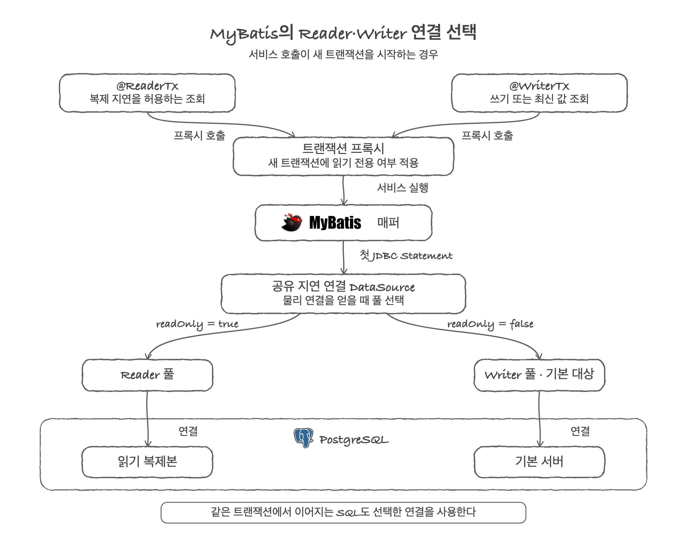

# MyBatis와 선언적 트랜잭션으로 Reader·Writer 라우팅하기

Spring Boot 3.5, Spring Framework 6.2, MyBatis-Spring Boot Starter 3.0.5를 사용하는 PostgreSQL 예제다. 서비스 메서드의 트랜잭션 선언에 따라 Writer 또는 Reader에서 JDBC 연결을 얻는다. [MyBatis Starter 호환성](https://mybatis.org/spring-boot-starter/mybatis-spring-boot-autoconfigure/) · [Starter 3.0.5 릴리스](https://github.com/mybatis/spring-boot-starter/releases/tag/mybatis-spring-boot-3.0.5) · [Spring JDBC 지연 연결](https://docs.spring.io/spring-framework/docs/6.2.x/javadoc-api/org/springframework/jdbc/datasource/LazyConnectionDataSourceProxy.html)

## 1. 읽기 전용 트랜잭션에서 Reader 연결 얻기

`@ReaderTx`는 `@Transactional(readOnly = true)`를, `@WriterTx`는 기본 읽기·쓰기 `@Transactional`을 나타내는 합성 어노테이션이다. 외부 호출이 Spring 트랜잭션 프록시를 통과하면 새 트랜잭션에 읽기 전용 여부가 적용된다. 같은 빈의 `this`를 통한 호출은 프록시를 거치지 않으므로, 별도 경계가 필요한 작업은 다른 빈의 메서드를 호출한다. [Spring의 합성 어노테이션과 프록시 모드](https://docs.spring.io/spring-framework/reference/6.2/data-access/transaction/declarative/annotations.html)

`LazyConnectionDataSourceProxy`는 첫 JDBC `Statement`를 만들 때까지 물리 연결 획득을 미룬다. Spring 6.1.2부터 `setReadOnlyDataSource(...)`로 읽기 전용 연결의 대상을 지정할 수 있다. 예제에서는 새 읽기 전용 트랜잭션의 첫 SQL은 Reader에, 새 읽기·쓰기 트랜잭션과 트랜잭션 없는 호출의 첫 SQL은 기본 대상인 Writer에 연결된다. MyBatis 매퍼는 현재 Spring 트랜잭션에 연결된 `SqlSession`을 사용하므로 같은 트랜잭션의 후속 SQL도 같은 연결에서 실행한다. [Spring JDBC 지연 연결](https://docs.spring.io/spring-framework/docs/6.2.x/javadoc-api/org/springframework/jdbc/datasource/LazyConnectionDataSourceProxy.html) · [MyBatis-Spring SqlSessionTemplate](https://mybatis.org/spring/sqlsession.html)



그림 근거 · [Spring 선언적 트랜잭션](https://docs.spring.io/spring-framework/reference/6.2/data-access/transaction/declarative/annotations.html) · [Reader 연결 선택](https://docs.spring.io/spring-framework/docs/6.2.x/javadoc-api/org/springframework/jdbc/datasource/LazyConnectionDataSourceProxy.html) · [MyBatis-Spring 트랜잭션](https://mybatis.org/spring/transactions.html)

## 2. 두 커넥션 풀을 하나의 DataSource로 노출하기

Spring Boot의 의존성 관리를 쓰는 프로젝트에 다음 의존성을 추가한다. `jdbc-url`에는 각각 Writer와 Reader의 JDBC 엔드포인트를 지정한다. 두 서버에 같은 업무 스키마가 있어야 하며 Reader 계정에는 필요한 읽기 권한만 부여한다. [MyBatis Starter 설치](https://mybatis.org/spring-boot-starter/mybatis-spring-boot-autoconfigure/) · [Spring Boot의 Hikari DataSource 설정](https://docs.spring.io/spring-boot/3.5/how-to/data-access.html) · [PostgreSQL 객체 권한](https://www.postgresql.org/docs/18/ddl-priv.html)

```kotlin
dependencies {
    implementation("org.mybatis.spring.boot:mybatis-spring-boot-starter:3.0.5")
    runtimeOnly("org.postgresql:postgresql")
}
```

```yaml
app:
  datasource:
    writer:
      jdbc-url: ${DB_WRITER_JDBC_URL}
      username: ${DB_WRITER_USERNAME}
      password: ${DB_WRITER_PASSWORD}
    reader:
      jdbc-url: ${DB_READER_JDBC_URL}
      username: ${DB_READER_USERNAME}
      password: ${DB_READER_PASSWORD}
```

트랜잭션 매니저와 `SqlSessionFactoryBean`에는 동일한 지연 연결 `DataSource` 빈을 주입한다. 지연 프록시는 Reader 연결의 `Connection.setReadOnly(...)`를 호출하지 않으므로 Reader 풀에 읽기 전용 기본값을 설정한다. 두 풀과 프록시의 기본 자동 커밋 및 격리 수준도 일치시킨다. 예제는 명시한 기본값을 사용해 프록시가 초기 연결 속성을 확인하러 Writer 연결을 먼저 빌리는 일을 피한다. [MyBatis-Spring의 동일 DataSource 조건](https://mybatis.org/spring/transactions.html) · [Spring 지연 연결의 기본 속성](https://docs.spring.io/spring-framework/docs/6.2.x/javadoc-api/org/springframework/jdbc/datasource/LazyConnectionDataSourceProxy.html) · [HikariCP 풀 속성](https://github.com/brettwooldridge/HikariCP/tree/HikariCP-6.3.3)

```java
package example.routing;

import java.sql.Connection;
import javax.sql.DataSource;

import com.zaxxer.hikari.HikariDataSource;
import org.apache.ibatis.annotations.Mapper;
import org.apache.ibatis.session.SqlSessionFactory;
import org.mybatis.spring.SqlSessionFactoryBean;
import org.mybatis.spring.annotation.MapperScan;
import org.springframework.beans.factory.annotation.Qualifier;
import org.springframework.boot.context.properties.ConfigurationProperties;
import org.springframework.context.annotation.Bean;
import org.springframework.context.annotation.Configuration;
import org.springframework.context.annotation.Primary;
import org.springframework.jdbc.datasource.DataSourceTransactionManager;
import org.springframework.jdbc.datasource.LazyConnectionDataSourceProxy;
import org.springframework.transaction.annotation.EnableTransactionManagement;

@Configuration(proxyBeanMethods = false)
@EnableTransactionManagement
@MapperScan(basePackageClasses = CatalogMapper.class, annotationClass = Mapper.class,
        sqlSessionFactoryRef = "catalogSqlSessionFactory")
public class CatalogDataSourceConfiguration {
    @Bean
    @ConfigurationProperties("app.datasource.writer")
    HikariDataSource writerDataSource() {
        return createPool(false);
    }

    @Bean
    @ConfigurationProperties("app.datasource.reader")
    HikariDataSource readerDataSource() {
        return createPool(true);
    }

    @Bean
    @Primary
    DataSource dataSource(@Qualifier("writerDataSource") DataSource writer,
                          @Qualifier("readerDataSource") DataSource reader) {
        var proxy = new LazyConnectionDataSourceProxy(writer);
        proxy.setReadOnlyDataSource(reader);
        proxy.setDefaultAutoCommit(true);
        proxy.setDefaultTransactionIsolation(Connection.TRANSACTION_READ_COMMITTED);
        return proxy;
    }

    @Bean
    SqlSessionFactory catalogSqlSessionFactory(@Qualifier("dataSource") DataSource dataSource)
            throws Exception {
        var factory = new SqlSessionFactoryBean();
        factory.setDataSource(dataSource);
        return factory.getObject();
    }

    @Bean
    DataSourceTransactionManager transactionManager(@Qualifier("dataSource") DataSource dataSource) {
        var manager = new DataSourceTransactionManager(dataSource);
        manager.setValidateExistingTransaction(true);
        return manager;
    }

    private HikariDataSource createPool(boolean readOnly) {
        var pool = new HikariDataSource();
        pool.setReadOnly(readOnly);
        pool.setAutoCommit(true);
        pool.setTransactionIsolation("TRANSACTION_READ_COMMITTED");
        return pool;
    }
}
```

## 3. 서비스 경계에 Reader·Writer 의도 선언하기

설정과 서비스는 `@SpringBootApplication`의 컴포넌트 스캔 범위에 두고, 두 합성 어노테이션을 서비스와 같은 `example.routing` 패키지에 둔다. 두 어노테이션의 기본 전파 방식은 `REQUIRED`다. 트랜잭션 시작과 커밋·롤백은 Spring이 관리하므로 서비스에서 MyBatis의 `commit()`이나 `rollback()`을 직접 호출하지 않는다. [Spring Boot의 패키지 구조](https://docs.spring.io/spring-boot/3.5/reference/using/structuring-your-code.html) · [Spring 합성 어노테이션과 기본값](https://docs.spring.io/spring-framework/reference/6.2/data-access/transaction/declarative/annotations.html) · [MyBatis-Spring 트랜잭션](https://mybatis.org/spring/transactions.html)

```java
package example.routing;

import java.lang.annotation.ElementType;
import java.lang.annotation.Retention;
import java.lang.annotation.RetentionPolicy;
import java.lang.annotation.Target;
import org.springframework.transaction.annotation.Transactional;

@Target(ElementType.METHOD)
@Retention(RetentionPolicy.RUNTIME)
@Transactional(readOnly = true)
@interface ReaderTx {}

@Target(ElementType.METHOD)
@Retention(RetentionPolicy.RUNTIME)
@Transactional
@interface WriterTx {}
```

예제는 `catalog_item(id bigint PRIMARY KEY, name text NOT NULL)` 테이블을 사용한다. `findName`과 `findFreshName`은 같은 매퍼 SQL을 호출한다. 새 트랜잭션이면 서비스 어노테이션에 따라 연결 대상이 달라진다. `createAndRead`가 다른 빈의 `findName`을 호출하면 바깥 Writer 트랜잭션에 참여하므로 같은 트랜잭션에서 방금 삽입한 값을 읽을 수 있다. [Spring REQUIRED 전파](https://docs.spring.io/spring-framework/reference/6.2/data-access/transaction/declarative/tx-propagation.html) · [PostgreSQL Read Committed](https://www.postgresql.org/docs/18/transaction-iso.html#XACT-READ-COMMITTED)

```java
package example.routing;

import org.apache.ibatis.annotations.Insert;
import org.apache.ibatis.annotations.Mapper;
import org.apache.ibatis.annotations.Param;
import org.apache.ibatis.annotations.Select;
import org.springframework.stereotype.Service;

@Mapper
interface CatalogMapper {
    @Select("SELECT name FROM catalog_item WHERE id = #{id}")
    String findName(@Param("id") long id);

    @Insert("INSERT INTO catalog_item (id, name) VALUES (#{id}, #{name})")
    void insert(@Param("id") long id, @Param("name") String name);
}

@Service
class CatalogQueryService {
    private final CatalogMapper mapper;

    CatalogQueryService(CatalogMapper mapper) {
        this.mapper = mapper;
    }

    @ReaderTx
    public String findName(long id) {
        return mapper.findName(id);
    }

    @WriterTx
    public String findFreshName(long id) {
        return mapper.findName(id);
    }
}

@Service
class CatalogCommandService {
    private final CatalogMapper mapper;
    private final CatalogQueryService queries;

    CatalogCommandService(CatalogMapper mapper, CatalogQueryService queries) {
        this.mapper = mapper;
        this.queries = queries;
    }

    @WriterTx
    public String createAndRead(long id, String name) {
        mapper.insert(id, name);
        return queries.findName(id);
    }
}
```

## 4. 복제 지연과 전파 경계 확인하기

- PostgreSQL 복제본에 커밋이 반영되기까지 시간이 걸릴 수 있다. 쓰기 직후 다른 요청에서 방금 커밋한 값이 필요하면 그 조회의 트랜잭션을 Writer에서 시작한다. Reader는 복제 지연을 허용하는 조회에 사용한다. [PostgreSQL Hot Standby](https://www.postgresql.org/docs/18/hot-standby.html)
- 기존 Reader 트랜잭션에서 `@WriterTx`의 `REQUIRED` 메서드를 호출해도 새 연결을 선택하지 않는다. 예제의 `setValidateExistingTransaction(true)`는 읽기 전용 바깥 트랜잭션에 읽기·쓰기 메서드가 참여하려는 경우를 예외로 거부한다. `REQUIRES_NEW`는 별도 연결과 커밋 경계를 만들며 PostgreSQL의 새 트랜잭션은 바깥 트랜잭션의 미커밋 쓰기를 볼 수 없다. [Spring 트랜잭션 전파](https://docs.spring.io/spring-framework/reference/6.2/data-access/transaction/declarative/tx-propagation.html) · [PostgreSQL Read Committed](https://www.postgresql.org/docs/18/transaction-iso.html#XACT-READ-COMMITTED)
- 실제 라우팅은 진단 SQL을 매퍼에 임시로 추가한 뒤 서비스 프록시를 통해 호출해 확인한다. PostgreSQL 물리 복제에서는 `pg_is_in_recovery()`가 `true`면 복구 중인 서버다. Aurora를 사용한다면 Reader 엔드포인트는 쿼리별로 분산하지 않고 연결을 분산하며, 복제본이 없으면 기본 인스턴스에 연결한다. [PostgreSQL 복구 상태 함수](https://www.postgresql.org/docs/18/functions-admin.html#FUNCTIONS-RECOVERY-INFO-TABLE) · [Aurora Reader 엔드포인트](https://docs.aws.amazon.com/AmazonRDS/latest/AuroraUserGuide/Aurora.Endpoints.Reader.html)

```sql
SELECT current_database(), inet_server_addr(), pg_is_in_recovery();
```
