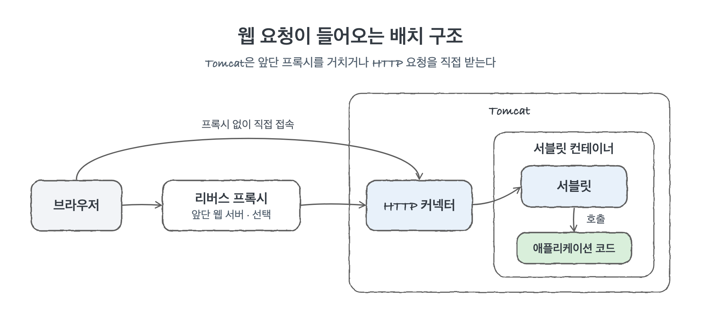

# Web Application Architecture

## 1. 웹 서버와 웹 애플리케이션 서버

웹 서버는 정적 파일을 제공하거나 리버스 프록시로 요청을 전달할 수 있다. 웹 애플리케이션 서버는 애플리케이션 코드를 실행해 요청을 처리한다. Tomcat은 HTTP 커넥터와 서블릿 컨테이너를 포함하므로 HTTP 요청을 직접 받을 수도 있다. 앞단에 별도 웹 서버를 두는 구성에서는 정적 파일 제공, TLS 종료, 요청 분산을 앞단에 맡길 수 있다. [Apache Tomcat 10.1 · HTTP Connector](https://tomcat.apache.org/tomcat-10.1-doc/config/http.html) · [NGINX 리버스 프록시와 부하 분산](../nginx/04_nginx_reverse_proxy_load_balancing_and_https.md)



```text
브라우저 → 리버스 프록시(선택) → Tomcat HTTP 커넥터 → 서블릿 → 애플리케이션 코드
```

## 2. 서블릿과 동시 요청

서블릿 컨테이너는 HTTP 요청을 `HttpServletRequest`로 전달하고, `HttpServletResponse`에 기록된 상태 코드, 헤더, 본문을 클라이언트에게 보낸다. 동기 처리에서는 애플리케이션의 호출이 반환될 때까지 컨테이너 스레드가 해당 요청을 처리한다. Tomcat의 `maxThreads`는 커넥터가 요청 처리에 사용하는 스레드의 상한을 설정한다. 공유 `Executor`를 지정했다면 스레드 풀의 설정을 그곳에서 관리한다. 유휴 연결과 동시에 처리 중인 요청 수는 각각 별도의 지표로 본다. [Jakarta Servlet 6.0 · 서블릿과 요청·응답](https://jakarta.ee/specifications/servlet/6.0/jakarta-servlet-spec-6.0) · [Apache Tomcat 10.1 · HTTP Connector](https://tomcat.apache.org/tomcat-10.1-doc/config/http.html)

같은 서블릿 인스턴스에 여러 요청이 동시에 들어올 수 있다. 사용자 ID나 폼 값처럼 요청별 데이터는 메서드 지역 변수나 요청 속성에 둔다. 스레드 풀의 사용량을 분석할 때는 오래 걸리는 DB 호출과 외부 API 호출도 함께 확인한다. 서블릿 비동기 처리를 시작한 뒤 요청 처리가 반환되면 컨테이너 스레드를 돌려줄 수 있다. 이후에 실행되는 블로킹 작업은 그 작업을 실행하는 스레드를 계속 사용한다. [Jakarta Servlet 6.0 · 동시 실행과 비동기 처리](https://jakarta.ee/specifications/servlet/6.0/jakarta-servlet-spec-6.0)

## 3. HTML과 HTTP API

| 응답 방식 | 처리 흐름 |
| --- | --- |
| 서버 사이드 렌더링(SSR) | 서버가 데이터를 HTML에 반영하고 브라우저가 받은 HTML을 렌더링한다. |
| 클라이언트 사이드 렌더링(CSR) | 브라우저가 JavaScript를 실행해 화면을 만들고 필요할 때 API에서 데이터를 가져온다. |
| HTTP API | 서버가 JSON 등의 표현을 반환하고 웹, 모바일 앱 또는 다른 서버가 사용한다. |

한 서비스에서 첫 화면은 서버가 HTML로 렌더링하고, 이후 검색이나 목록 갱신은 브라우저가 API를 호출하도록 구성할 수 있다. 응답의 종류는 HTTP의 `Content-Type` 헤더로 표현한다. [HTTP 메시지 구조](../http/03_http_fundamentals_and_message_structure.md) · [Spring Framework 6.2 · @ResponseBody](https://docs.spring.io/spring-framework/reference/6.2/web/webmvc/mvc-controller/ann-methods/responsebody.html)

## 4. 서블릿에서 Spring MVC까지

서블릿은 Java 웹 요청의 처리 계약을 제공하고, JSP는 서버에서 HTML을 생성한다. 컨트롤러와 화면 템플릿을 나누면 업무 흐름과 화면 표현을 각각 수정할 수 있다. Spring MVC는 서블릿 기반 프레임워크로, `DispatcherServlet`이 요청을 받아 적절한 컨트롤러로 전달한다. [Jakarta Pages 3.1](https://jakarta.ee/specifications/pages/3.1/) · [Spring Framework 6.2 · DispatcherServlet](https://docs.spring.io/spring-framework/reference/6.2/web/webmvc/mvc-servlet.html)
