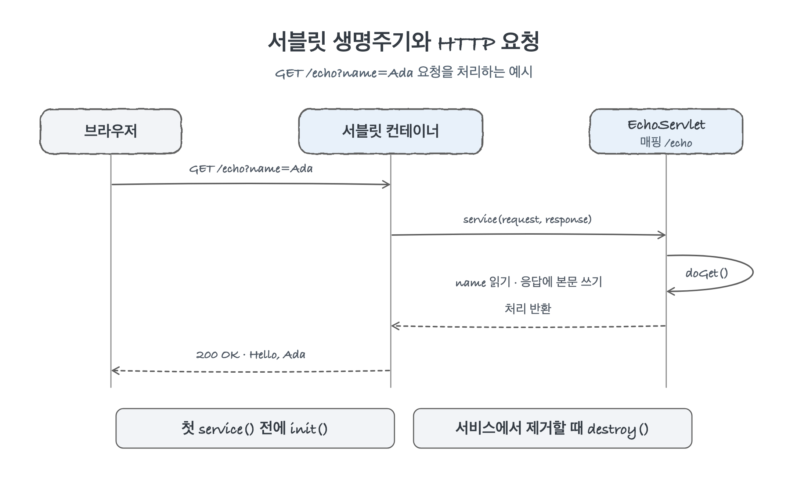

# Jakarta Servlets and HTTP Messages

## 1. 매핑과 생명주기

이 문서에서는 Jakarta Servlet 6.0의 `jakarta.servlet` API를 사용한다. `@WebServlet("/echo")`로 URL을 매핑하면 컨테이너가 요청에 맞는 서블릿을 찾아 호출한다. 컨테이너는 인스턴스별로 `init()`을 실행한 뒤 요청마다 `service()`를 호출한다. `HttpServlet`의 `service()`는 GET, POST 등을 `doGet()`, `doPost()` 같은 메서드로 분기한다. 인스턴스를 서비스에서 제거할 때는 `destroy()`를 호출한다. 인스턴스가 여러 요청을 동시에 처리할 수 있으므로 요청 상태는 지역 변수나 요청 객체에 둔다. [Jakarta Servlet 6.0 · 서블릿 생명주기와 매핑](https://jakarta.ee/specifications/servlet/6.0/jakarta-servlet-spec-6.0)



## 2. 요청 데이터 읽기

| 요청 데이터 | 서블릿 API |
| --- | --- |
| HTTP 메서드와 요청 경로 | `getMethod()`, `getRequestURI()` |
| 헤더와 쿠키 | `getHeader()`, `getHeaders()`, `getCookies()` |
| GET 쿼리 문자열 | `getQueryString()`으로 원문, `getParameter()`로 특정 값 |
| URL 인코딩 폼 POST | `getParameter()`, 반복되는 이름은 `getParameterValues()` |
| 텍스트 본문 | `getReader()` |
| JSON 또는 바이너리 본문 | `getInputStream()`과 해당 형식을 해석하는 코드 |

폼 본문의 문자 인코딩을 지정해야 한다면 `getParameter()`로 본문이 파싱되기 전에 `setCharacterEncoding()`을 호출한다. URI 경로와 쿼리 문자열의 디코딩 설정은 커넥터에서 관리한다. 요청 본문은 `getReader()` 또는 `getInputStream()` 중 하나로 읽으며, JSON은 파서로 DTO에 변환할 수 있다. [Jakarta Servlet 6.0 · 요청 파라미터와 인코딩](https://jakarta.ee/specifications/servlet/6.0/jakarta-servlet-spec-6.0) · [Apache Tomcat 10.1 · URIEncoding](https://tomcat.apache.org/tomcat-10.1-doc/config/http.html)

## 3. 응답 작성하기

상태 코드와 헤더는 응답이 커밋되기 전에 정한다. 텍스트나 HTML 응답에서는 `getWriter()`를 호출하기 전에 콘텐츠 타입과 문자 인코딩을 지정한다. JSON은 직렬화한 결과를 `application/json`으로 전송한다. 요청을 다른 URL로 보낼 때 Jakarta Servlet 6.0의 `sendRedirect()`는 `302 Found`를 사용한다. [Jakarta Servlet 6.0 · 응답과 리다이렉트](https://jakarta.ee/specifications/servlet/6.0/jakarta-servlet-spec-6.0) · [HTTP 상태 코드와 리다이렉트](../http/06_http_status_codes_and_redirects.md)

아래 서블릿은 `GET /echo?name=Ada`를 처리한다. 경로는 애플리케이션의 컨텍스트 경로를 기준으로 한다.

```java
import java.io.IOException;

import jakarta.servlet.annotation.WebServlet;
import jakarta.servlet.http.HttpServlet;
import jakarta.servlet.http.HttpServletRequest;
import jakarta.servlet.http.HttpServletResponse;

@WebServlet("/echo")
public class EchoServlet extends HttpServlet {

    @Override
    protected void doGet(HttpServletRequest request, HttpServletResponse response)
            throws IOException {
        String name = request.getParameter("name");
        if (name == null || name.isBlank()) {
            response.sendError(HttpServletResponse.SC_BAD_REQUEST, "name is required");
            return;
        }

        response.setContentType("text/plain;charset=UTF-8");
        response.getWriter().write("Hello, " + name);
    }
}
```
