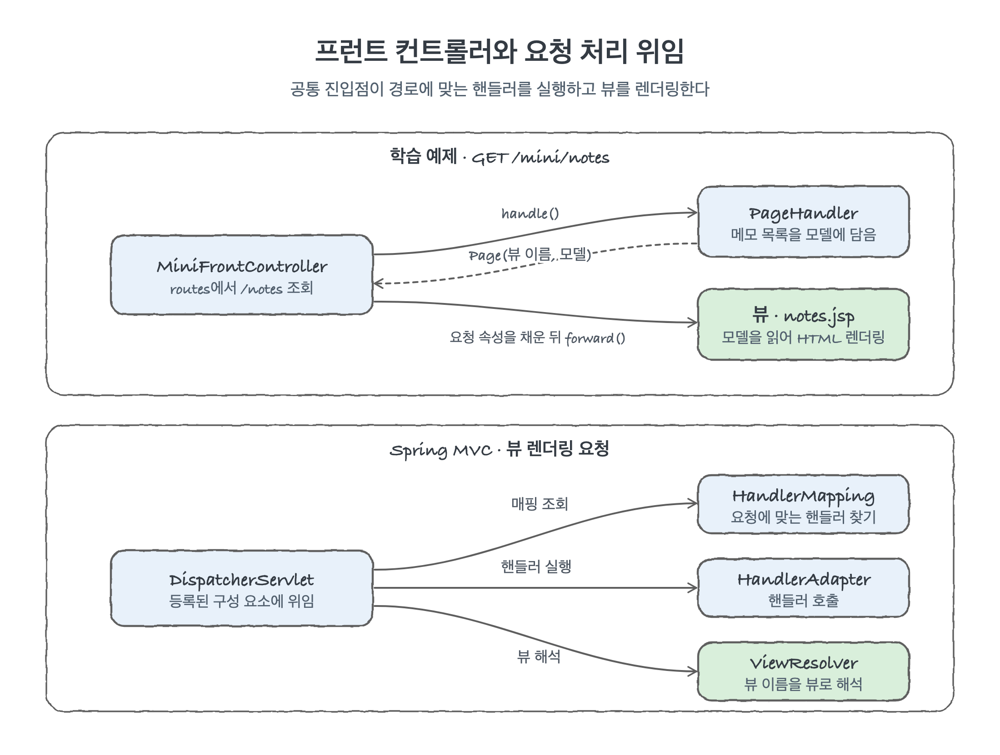

# Building a Front Controller Framework

## 1. 공통 요청 처리 모으기

프런트 컨트롤러는 여러 URL의 공통 진입점이다. 요청을 받아 경로에 맞는 핸들러를 찾고, 핸들러가 반환한 결과로 뷰를 렌더링한다. 라우팅, 모델 전달, 뷰 경로 결정이 공통 코드가 되고, 개별 핸들러는 화면에 필요한 데이터를 결정한다. Spring MVC의 `DispatcherServlet`도 같은 패턴을 사용한다. [Spring Framework 6.2 · DispatcherServlet](https://docs.spring.io/spring-framework/reference/6.2/web/webmvc/mvc-servlet.html)



| 단계 | 공통화하는 부분 |
| --- | --- |
| 프런트 컨트롤러 | URL 매핑과 핸들러 실행을 하나의 서블릿에서 처리한다. |
| 뷰 객체 | 모델을 요청 속성에 넣고 템플릿을 호출하는 렌더링 절차를 묶는다. |
| 모델과 논리 뷰 이름 | 핸들러가 일반 Java 객체에 데이터를 채우고 `notes` 같은 이름을 반환할 수 있게 한다. |
| 간단한 핸들러 계약 | 프런트 컨트롤러가 모델을 인자로 전달하고 핸들러는 뷰 이름을 반환한다. |
| 핸들러 어댑터 | 서로 다른 호출 규약을 가진 핸들러의 결과를 공통 형식으로 변환한다. |

## 2. 경로를 모델과 뷰로 연결하기

아래 예제는 서블릿 컨테이너에서 `GET /mini/notes`를 받는다. `PageHandler`는 서블릿 요청 객체 없이 호출되고, 프런트 컨트롤러가 모델과 뷰 이름을 사용해 [메모 JSP](03_servlets_jsp_and_mvc_pattern.md)로 포워드한다. 뷰 이름은 등록된 핸들러가 반환한다. [Jakarta Servlet 6.0 · URL 매핑과 RequestDispatcher](https://jakarta.ee/specifications/servlet/6.0/jakarta-servlet-spec-6.0)

```java
import java.io.IOException;
import java.util.List;
import java.util.Map;

import jakarta.servlet.ServletException;
import jakarta.servlet.annotation.WebServlet;
import jakarta.servlet.http.HttpServlet;
import jakarta.servlet.http.HttpServletRequest;
import jakarta.servlet.http.HttpServletResponse;

@WebServlet("/mini/*")
public class MiniFrontController extends HttpServlet {

    private final Map<String, PageHandler> routes = Map.of(
            "/notes", () -> new Page("notes", Map.of("notes", List.of("Read HTTP", "Review MVC")))
    );

    @Override
    protected void doGet(HttpServletRequest request, HttpServletResponse response)
            throws ServletException, IOException {
        String path = request.getPathInfo();
        PageHandler handler = path == null ? null : routes.get(path);
        if (handler == null) {
            response.sendError(HttpServletResponse.SC_NOT_FOUND);
            return;
        }

        Page page = handler.handle();
        page.model().forEach(request::setAttribute);
        request.getRequestDispatcher("/WEB-INF/views/" + page.viewName() + ".jsp")
                .forward(request, response);
    }

    private interface PageHandler {
        Page handle();
    }

    private record Page(String viewName, Map<String, Object> model) {
    }
}
```

## 3. 호출 규약이 늘어나면 어댑터 두기

예제의 핸들러는 하나의 인터페이스를 사용한다. 기존 서블릿 인자를 받는 핸들러와 논리 뷰 이름만 반환하는 핸들러를 함께 지원해야 한다면 타입별 어댑터를 둘 수 있다. 각 어댑터는 `supports(handler)`로 지원 여부를 판단하고, `handle(...)`에서 해당 규약에 맞게 호출해 결과를 공통 형식으로 전달한다. 공통 진입점은 어댑터 선택과 결과 처리만 맡는다. [Spring Framework 6.2 · HandlerAdapter와 특수 빈](https://docs.spring.io/spring-framework/reference/6.2/web/webmvc/mvc-servlet/special-bean-types.html)
