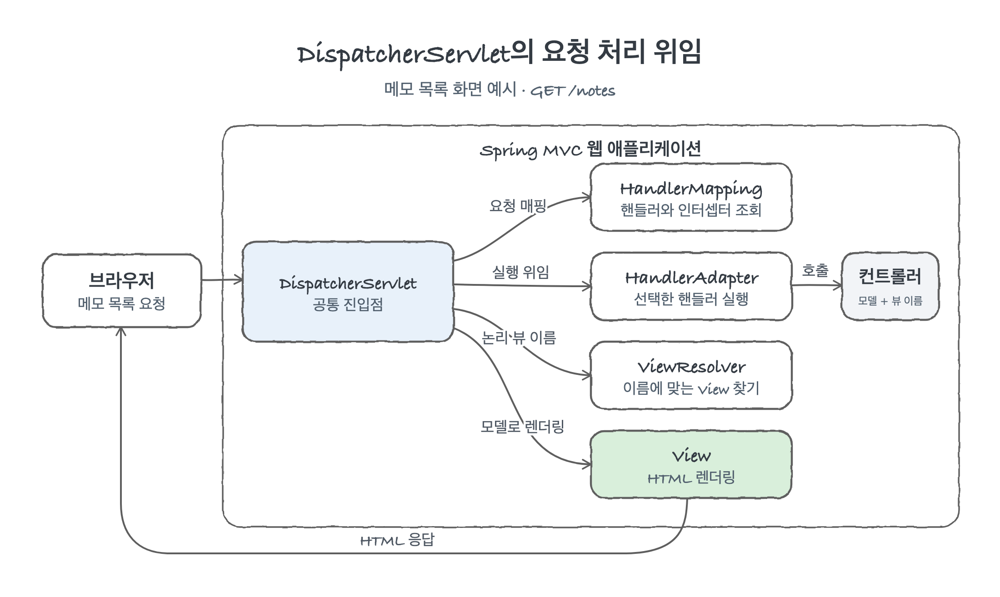

# Spring MVC Request Dispatch and View Resolution

## 1. DispatcherServlet의 요청 처리 흐름

`DispatcherServlet`은 Spring MVC의 프런트 컨트롤러다. 요청이 들어오면 다음 컴포넌트에 역할을 위임한다. [Spring Framework 6.2 · 처리 순서](https://docs.spring.io/spring-framework/reference/6.2/web/webmvc/mvc-servlet/sequence.html) · [Spring Framework 6.2 · 특수 빈](https://docs.spring.io/spring-framework/reference/6.2/web/webmvc/mvc-servlet/special-bean-types.html)



| 순서 | 컴포넌트 | 역할 |
| --- | --- | --- |
| 1 | `HandlerMapping` | 요청에 맞는 핸들러와 적용할 인터셉터를 찾는다. |
| 2 | `HandlerAdapter` | 해당 핸들러의 호출 방식에 맞춰 실행한다. |
| 3 | `ViewResolver` | 컨트롤러가 논리 뷰 이름을 반환한 경우 렌더링할 `View`를 찾는다. |
| 4 | `View` | 모델을 템플릿에 전달하고 결과를 응답에 기록한다. |

`@ResponseBody`가 적용된 반환값은 메시지 컨버터가 응답 본문에 기록한다. 요청 처리 중 발생한 예외는 `HandlerExceptionResolver` 체인이 HTTP 응답이나 오류 뷰로 처리할 수 있다. [Spring Framework 6.2 · @ResponseBody](https://docs.spring.io/spring-framework/reference/6.2/web/webmvc/mvc-controller/ann-methods/responsebody.html) · [Spring Framework 6.2 · 특수 빈](https://docs.spring.io/spring-framework/reference/6.2/web/webmvc/mvc-servlet/special-bean-types.html)

## 2. 핸들러 매핑과 호출 방식

애너테이션 기반 컨트롤러의 경우 `RequestMappingHandlerMapping`이 `@RequestMapping`, `@GetMapping` 등의 선언을 읽어 핸들러 메서드를 등록한다. `RequestMappingHandlerAdapter`는 요청의 값을 메서드 인자로 변환하고 실행 결과를 처리한다. 기존 인터페이스를 사용하는 애플리케이션에서는 `BeanNameUrlHandlerMapping`이 URL 형태의 빈 이름으로 핸들러를 찾을 수 있다. `Controller`는 `SimpleControllerHandlerAdapter`, `HttpRequestHandler`는 `HttpRequestHandlerAdapter`로 호출할 수 있다. [Spring Framework 6.2 · 요청 매핑](https://docs.spring.io/spring-framework/reference/6.2/web/webmvc/mvc-controller/ann-requestmapping.html) · [Spring Framework 6.2 · HandlerMapping과 HandlerAdapter](https://docs.spring.io/spring-framework/reference/6.2/web/webmvc/mvc-servlet/special-bean-types.html)

## 3. 모델과 뷰 이름 반환하기

`@Controller`에서 `Model`에 화면 데이터를 넣고 논리 뷰 이름을 반환한다. JSP용 `InternalResourceViewResolver`의 접두사가 `/WEB-INF/views/`이고 접미사가 `.jsp`이면 `notes`가 `/WEB-INF/views/notes.jsp`로 해석된다. 모델과 뷰를 하나의 객체에 담아 반환하려면 `ModelAndView`를 사용할 수 있다. [Spring Framework 6.2 · 뷰 해석](https://docs.spring.io/spring-framework/reference/6.2/web/webmvc/mvc-servlet/viewresolver.html) · [Spring Framework 6.2 · 반환 타입](https://docs.spring.io/spring-framework/reference/6.2/web/webmvc/mvc-controller/ann-methods/return-types.html)

```java
import java.util.List;

import org.springframework.stereotype.Controller;
import org.springframework.ui.Model;
import org.springframework.web.bind.annotation.GetMapping;
import org.springframework.web.bind.annotation.RequestMapping;

@Controller
@RequestMapping("/notes")
public class NotePageController {

    @GetMapping
    public String list(Model model) {
        model.addAttribute("notes", List.of("Read HTTP", "Review MVC"));
        return "notes";
    }
}
```

메모 목록은 [JSP 뷰](03_servlets_jsp_and_mvc_pattern.md)로 렌더링한다. 화면 요청은 `/notes`에, JSON API는 [`/api/notes`](06_spring_mvc_request_binding_and_http_responses.md)에 두어 URL에서도 역할을 구분한다.
