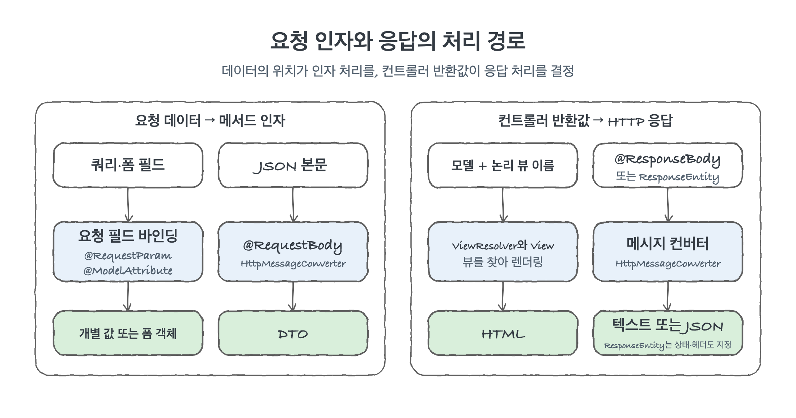

# Spring MVC Request Binding and HTTP Responses

## 1. 요청 매핑과 데이터 위치

Spring MVC는 URL과 HTTP 메서드에 더해 파라미터, 헤더, 미디어 타입으로 핸들러를 선택할 수 있다. `consumes`는 요청의 `Content-Type`을, `produces`는 클라이언트의 `Accept`와 서버가 제공하는 응답 형식의 호환성을 확인한다. 다른 매핑이 없는 경우 지원하지 않는 요청 형식은 `415 Unsupported Media Type`, 제공할 수 없는 응답 형식은 `406 Not Acceptable`로 이어질 수 있다. [Spring Framework 6.2 · 요청 매핑](https://docs.spring.io/spring-framework/reference/6.2/web/webmvc/mvc-controller/ann-requestmapping.html)

| 요청 데이터 | 메서드 매개변수 | 예 |
| --- | --- | --- |
| URL 경로의 일부 | `@PathVariable` | `/api/notes/3`의 `3` |
| 쿼리와 폼 필드의 단일 값 | `@RequestParam` | `?page=2`의 `2` |
| 여러 요청 값을 받는 폼 객체 | `@ModelAttribute` | `title`과 `body`를 받는 폼 DTO |
| HTTP 헤더 | `@RequestHeader` | `Accept-Language` |
| 텍스트 또는 JSON 본문 | `@RequestBody` | `String` 또는 `CreateNoteRequest` |
| 헤더와 본문 | `HttpEntity<T>` | `HttpEntity<CreateNoteRequest>` |

인자 리졸버가 매개변수에 맞는 값을 준비한다. `@ModelAttribute`에는 제출을 허용할 필드를 담은 폼 객체를 사용한다. `@RequestBody`는 `HttpMessageConverter`에 본문 읽기를 위임하며, JSON 컨버터가 등록된 경우 JSON을 DTO로 역직렬화한다. URL 인코딩 폼 필드는 `@RequestParam`이나 `@ModelAttribute`로 받는다. [Spring Framework 6.2 · 메서드 인자](https://docs.spring.io/spring-framework/reference/6.2/web/webmvc/mvc-controller/ann-methods/arguments.html) · [Spring Framework 6.2 · @ModelAttribute](https://docs.spring.io/spring-framework/reference/6.2/web/webmvc/mvc-controller/ann-methods/modelattrib-method-args.html) · [Spring Framework 6.2 · @RequestBody](https://docs.spring.io/spring-framework/reference/6.2/web/webmvc/mvc-controller/ann-methods/requestbody.html)

## 2. 응답 처리 방식

| 응답 | 처리 방식 |
| --- | --- |
| 정적 파일 | Spring Boot는 기본 설정에서 클래스패스의 `/static` 등으로부터 정적 리소스를 제공한다. |
| 서버 렌더링 HTML | `@Controller`가 모델과 논리 뷰 이름을 전달한다. |
| 텍스트나 JSON 본문 | `@ResponseBody` 또는 `@RestController`의 반환값을 메시지 컨버터가 쓴다. |
| 상태 코드, 헤더, 본문 | `ResponseEntity<T>`로 각각 지정하고 본문은 메시지 컨버터가 쓴다. |

반환값 핸들러는 반환 타입과 애너테이션을 보고 처리 방식을 결정한다. 메시지 컨버터는 본문을 읽거나 쓸 때 대상 Java 타입과 미디어 타입을 확인한다. [Spring Boot 3.5 · 정적 콘텐츠](https://docs.spring.io/spring-boot/3.5/reference/web/servlet.html#web.servlet.spring-mvc.static-content) · [Spring Framework 6.2 · 반환 타입](https://docs.spring.io/spring-framework/reference/6.2/web/webmvc/mvc-controller/ann-methods/return-types.html) · [Spring Framework 6.2 · ResponseEntity](https://docs.spring.io/spring-framework/reference/6.2/web/webmvc/mvc-controller/ann-methods/responseentity.html)



## 3. JSON으로 메모 생성하고 조회하기

`POST /api/notes`에 `{"title":"Read HTTP"}`와 `Content-Type: application/json`을 보내면 서버는 `201 Created`, 새 메모의 `Location`, JSON 본문을 반환한다. `Location`으로 GET을 요청하면 생성한 메모를 조회할 수 있다. 예제는 실행 중에만 유지되는 메모리 저장소를 사용한다. [RFC 9110 · 201 Created](https://www.rfc-editor.org/rfc/rfc9110.html#section-15.3.2)

```java
import java.net.URI;
import java.util.concurrent.ConcurrentHashMap;
import java.util.concurrent.ConcurrentMap;
import java.util.concurrent.atomic.AtomicLong;

import org.springframework.http.HttpStatus;
import org.springframework.http.MediaType;
import org.springframework.http.ResponseEntity;
import org.springframework.web.bind.annotation.GetMapping;
import org.springframework.web.bind.annotation.PathVariable;
import org.springframework.web.bind.annotation.PostMapping;
import org.springframework.web.bind.annotation.RequestBody;
import org.springframework.web.bind.annotation.RequestMapping;
import org.springframework.web.bind.annotation.RestController;
import org.springframework.web.server.ResponseStatusException;
import org.springframework.web.servlet.support.ServletUriComponentsBuilder;

@RestController
@RequestMapping(path = "/api/notes", produces = MediaType.APPLICATION_JSON_VALUE)
public class NotesApi {

    private final AtomicLong ids = new AtomicLong();
    private final ConcurrentMap<Long, NoteResponse> notes = new ConcurrentHashMap<>();

    @PostMapping(consumes = MediaType.APPLICATION_JSON_VALUE)
    public ResponseEntity<NoteResponse> create(@RequestBody CreateNoteRequest request) {
        if (request.title() == null || request.title().isBlank()) {
            throw new ResponseStatusException(HttpStatus.BAD_REQUEST, "title is required");
        }

        long id = ids.incrementAndGet();
        NoteResponse note = new NoteResponse(id, request.title());
        notes.put(id, note);

        URI location = ServletUriComponentsBuilder.fromCurrentRequestUri()
                .path("/{id}")
                .buildAndExpand(id)
                .toUri();
        return ResponseEntity.created(location).body(note);
    }

    @GetMapping("/{id}")
    public NoteResponse get(@PathVariable("id") long id) {
        NoteResponse note = notes.get(id);
        if (note == null) {
            throw new ResponseStatusException(HttpStatus.NOT_FOUND);
        }
        return note;
    }

    public record CreateNoteRequest(String title) {
    }

    public record NoteResponse(long id, String title) {
    }
}
```

## 4. 요청 처리 경로 확인하기

매핑이 의도대로 선택되는지 확인할 때는 HTTP 메서드, 경로, `Content-Type`, `Accept`를 비교한다. 애플리케이션 로그는 SLF4J 등 로깅 API로 남기고, Spring Boot에서는 `logging.level.<logger-name>`으로 로거의 레벨을 조정할 수 있다. 요청을 추적할 때는 메서드와 경로 같은 진단에 필요한 값만 남긴다. [Spring Boot 3.5 · 로깅](https://docs.spring.io/spring-boot/3.5/reference/features/logging.html)
