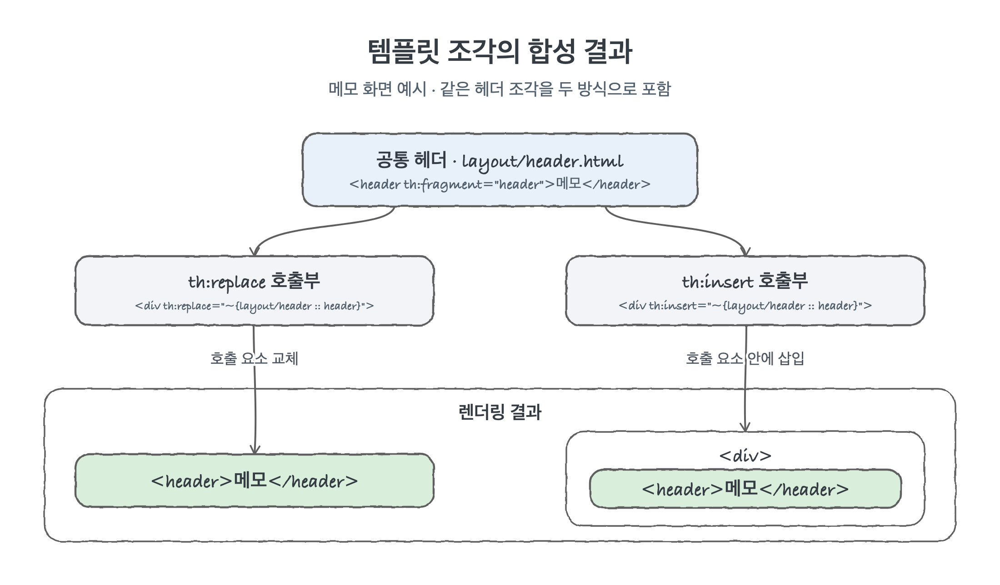

# Thymeleaf Template Fundamentals

## 1. 모델 값을 HTML로 렌더링하기

Spring MVC 컨트롤러가 모델과 뷰 이름을 반환하면 Thymeleaf가 템플릿의 표현식을 평가해 HTML을 생성한다. 템플릿에 넣은 기본 텍스트와 링크는 브라우저에서 파일을 바로 열 때 미리보기에 쓸 수 있다. 서버가 렌더링할 때는 `th:*` 속성이 해당 내용을 바꾼다. [Thymeleaf 3.1 · 표준 표현식](https://www.thymeleaf.org/doc/tutorials/3.1/usingthymeleaf.html#standard-expression-syntax) · [Thymeleaf 3.1 · Spring 통합](https://www.thymeleaf.org/doc/tutorials/3.1/thymeleafspring.html)

| 표현식 | 용도 | 예 |
| --- | --- | --- |
| `${...}` | 모델 변수 읽기 | `${note.title}` |
| `*{...}` | `th:object`로 선택한 객체의 속성 읽기 | `*{title}` |
| `#{...}` | 메시지 코드 해석 | `#{notes.title}` |
| `@{...}` | 컨텍스트 경로와 파라미터를 고려해 URL 만들기 | `@{/notes/{id}(id=${note.id})}` |
| `~{...}` | 다른 템플릿의 조각 참조 | `~{layout/header :: header}` |

Spring 통합에서는 변수 평가에 SpringEL을 사용한다. `#strings`나 `#temporals` 같은 유틸리티 객체로 표시를 조정하고, HTML 속성 값은 `th:href`나 `th:classappend` 등으로 설정할 수 있다. `th:classappend`는 원래 클래스에 값을 추가한다. [Thymeleaf 3.1 · 속성 설정과 표현식 유틸리티](https://www.thymeleaf.org/doc/tutorials/3.1/usingthymeleaf.html)

## 2. 반복과 조건

`notes`가 메모 목록이고 각 항목에 숫자 ID와 제목이 있을 때 목록과 빈 상태를 아래처럼 렌더링할 수 있다. `th:each`의 두 번째 변수로 반복 순서를 받을 수 있다. `th:switch`와 `th:case`는 여러 상태에서 서로 다른 조각을 보여 줄 때 사용한다. [Thymeleaf 3.1 · 반복과 조건](https://www.thymeleaf.org/doc/tutorials/3.1/usingthymeleaf.html)

```html
<p th:if="${#lists.isEmpty(notes)}">No notes yet.</p>
<ul th:unless="${#lists.isEmpty(notes)}">
  <li th:each="note, row : ${notes}">
    <span th:text="${row.count}">1</span>
    <a href="/notes/1" th:href="@{/notes/{id}(id=${note.id})}"
       th:text="${note.title}">Sample note</a>
  </li>
</ul>
```

`th:text`와 `[[...]]`는 HTML 텍스트에 맞게 이스케이프한다. `th:utext`와 `[(...)]`는 HTML을 그대로 출력하므로 사용자 입력을 화면에 표시할 때는 이스케이프되는 방식을 사용한다. JavaScript 값을 넣을 때는 `th:inline="javascript"` 안에서 `[[...]]`를 사용하면 문자열의 따옴표와 이스케이프를 처리한 리터럴이 생성된다. [Thymeleaf 3.1 · 텍스트 출력과 JavaScript 인라인](https://www.thymeleaf.org/doc/tutorials/3.1/usingthymeleaf.html)

## 3. 템플릿 조각과 레이아웃

`th:fragment="header"`로 공통 헤더를 정의하고, `th:replace="~{layout/header :: header}"`로 호출 위치 전체를 헤더로 바꾼다. `th:insert`는 호출 요소 안에 조각을 삽입한다. 제목이나 본문 영역이 페이지마다 다르면 레이아웃 조각의 인자로 다른 조각을 넘길 수 있다. `th:block`은 최종 HTML에 자체 요소를 남기지 않고 여러 요소에 한 번에 반복이나 조건을 적용한다. [Thymeleaf 3.1 · 템플릿 레이아웃](https://www.thymeleaf.org/doc/tutorials/3.1/usingthymeleaf.html#template-layout)


