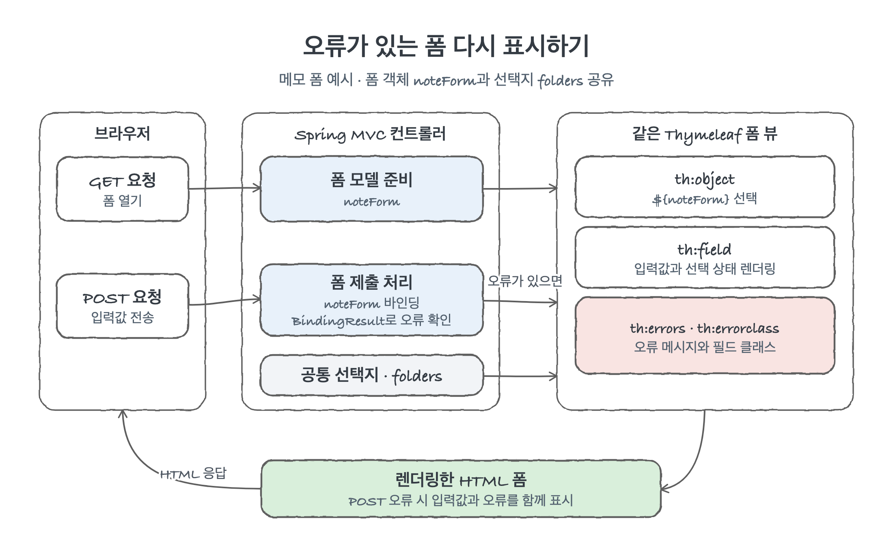

# Thymeleaf Spring Integration and Form Binding

## 1. 폼 모델 연결하기

GET 컨트롤러가 폼 객체를 `noteForm`이라는 모델 속성으로 제공하고, POST 컨트롤러가 동일한 이름으로 데이터를 바인딩한다. `th:object`는 모델 속성을 선택한다. `th:field`는 선택한 객체의 프로퍼티에 맞춰 입력 요소의 이름, ID, 값 또는 선택 상태를 렌더링한다. 텍스트 필드 표시에는 Spring의 변환 서비스가 적용될 수 있다. [Thymeleaf 3.1 · Spring 폼 통합](https://www.thymeleaf.org/doc/tutorials/3.1/thymeleafspring.html#creating-a-form)

```html
<form method="post" th:action="@{/notes}" th:object="${noteForm}">
  <label for="title">Title</label>
  <input type="text" th:field="*{title}" th:errorclass="field-error">
  <p th:errors="*{title}">Invalid title</p>

  <label for="pinned">Pinned</label>
  <input type="checkbox" th:field="*{pinned}">

  <label for="folder">Folder</label>
  <select th:field="*{folder}">
    <option value="">Select a folder</option>
    <option th:each="folder : ${folders}" th:value="${folder.code}"
            th:text="${folder.label}">Inbox</option>
  </select>

  <button type="submit">Save</button>
</form>
```

## 2. 체크박스와 선택 입력

| 입력 | 바인딩 방식 |
| --- | --- |
| 단일 체크박스 | 불리언 프로퍼티에 `th:field`를 연결한다. |
| 체크박스 그룹 | 컬렉션 프로퍼티에 같은 `th:field`를 사용하고 각 항목의 값을 `th:value`로 정한다. |
| 라디오 버튼 | 동일한 프로퍼티에 연결하고 버튼마다 값을 지정한다. |
| 셀렉트 박스 | `select`에 `th:field`를, 각 `option`에 선택 가능한 값을 둔다. |

체크를 해제한 입력은 브라우저가 필드 값을 보내지 않는다. Thymeleaf의 Spring 폼 통합은 필드 마커를 담은 숨은 입력을 생성해 Spring이 체크 해제를 반영하도록 돕는다. 컬렉션 입력처럼 여러 요소에 같은 필드가 연결되면 `#ids.prev(...)` 또는 `#ids.next(...)`로 라벨의 `for`와 실제 ID를 맞출 수 있다. [Thymeleaf 3.1 · 체크박스, 라디오 버튼, 드롭다운](https://www.thymeleaf.org/doc/tutorials/3.1/thymeleafspring.html#creating-a-form)

## 3. 오류가 있는 폼 다시 표시하기

POST에서 오류가 생기면 같은 폼 뷰를 반환한다. GET과 POST에서 모두 필요한 선택지 `folders`는 모델을 만드는 공통 메서드에 둔다. `th:errors`가 필드 오류 메시지를 출력하고 `th:errorclass`가 해당 입력에 CSS 클래스를 붙인다. 입력값과 오류를 같은 화면에서 유지하는 처리 흐름은 [폼 검증 문서](10_spring_mvc_form_validation_and_binding_errors.md)에서 이어진다. [Thymeleaf 3.1 · 검증과 오류 메시지](https://www.thymeleaf.org/doc/tutorials/3.1/thymeleafspring.html#validation-and-error-messages) · [Spring Framework 6.2 · @ModelAttribute 인자](https://docs.spring.io/spring-framework/reference/6.2/web/webmvc/mvc-controller/ann-methods/modelattrib-method-args.html)


