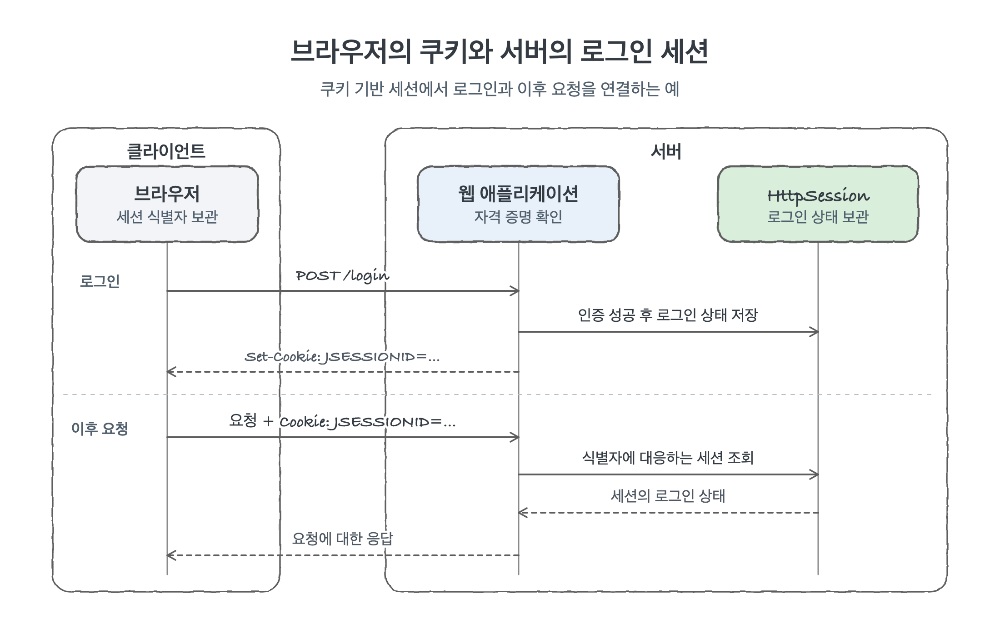

# Login with Cookies and HTTP Sessions

## 1. 쿠키와 서버 세션의 역할

쿠키는 브라우저가 보관하고 범위가 맞는 요청에 포함하는 값이다. 로그인 세션을 사용하면 브라우저는 보통 `JSESSIONID` 같은 세션 식별자를 보내고, 서버는 해당 식별자로 로그인 상태를 찾는다. 쿠키에는 임의 변경이 가능한 사용자 ID나 권한을 인증 근거로 저장하지 않는다. 세션에 로그인 상태를 저장할 때는 이후 요청에 필요한 최소 정보만 유지한다. [Jakarta Servlet 6.0 · 세션](https://jakarta.ee/specifications/servlet/6.0/jakarta-servlet-spec-6.0) · [Spring Security 6.5 · 인증과 세션 관리](https://docs.spring.io/spring-security/reference/6.5/servlet/authentication/session-management.html)

| 단계 | 처리 |
| --- | --- |
| 로그인 | 자격 증명을 확인한 뒤 필요한 세션을 만들고, 기존 세션을 계속 사용할 경우 식별자를 바꾼다. |
| 이후 요청 | 쿠키로 받은 식별자에 대응하는 세션에서 로그인 상태를 확인한다. |
| 로그아웃 | 서버의 세션을 무효화하고 필요하면 브라우저의 쿠키를 정리한다. |
| 만료 | 세션의 최대 비활성 시간을 넘기면 서버가 세션을 만료시킨다. |

서블릿 API에서는 `request.getSession(false)`로 기존 세션만 조회하고, `request.getSession()`으로 필요할 때 생성한다. 기존 세션의 식별자는 `request.changeSessionId()`로 바꿀 수 있다. Spring Security에서 로그인할 때는 자격 증명 확인과 세션 고정 보호를 제공하는 인증 흐름을 사용한다. [Jakarta Servlet 6.0 · 세션 API](https://jakarta.ee/specifications/servlet/6.0/jakarta-servlet-spec-6.0) · [Spring Security 6.5 · 세션 고정 보호](https://docs.spring.io/spring-security/reference/6.5/servlet/authentication/session-management.html)

## 2. 쿠키 수명과 세션 타임아웃

쿠키의 `Max-Age`는 브라우저가 쿠키를 보관하는 기간이고, 세션의 최대 비활성 시간은 서버가 세션을 유지하는 기준이다. Spring Boot에서는 `server.servlet.session.timeout=30m`처럼 세션 타임아웃을 지정할 수 있다. 쿠키를 지울 때는 설정할 때와 같은 이름, 경로, 도메인이 적용되도록 한다. [Spring Boot 3.5 · 애플리케이션 속성](https://docs.spring.io/spring-boot/3.5/appendix/application-properties/index.html) · [HTTP 헤더와 쿠키](../http/07_http_headers_content_negotiation_and_cookies.md)

세션 쿠키에 `HttpOnly`를 적용하면 브라우저 스크립트에서 읽는 것을 제한하고, `Secure`를 적용하면 HTTPS를 사용하는 요청에서 전송한다. `SameSite`는 사이트 간 요청에서 쿠키가 전송되는 범위를 제한한다. 쿠키 기반 로그인에서는 로그아웃을 포함한 상태 변경 요청에 CSRF 보호를 적용한다. [Spring Security 6.5 · CSRF 보호](https://docs.spring.io/spring-security/reference/6.5/servlet/exploits/csrf.html) · [Jakarta Servlet 6.0 · 쿠키](https://jakarta.ee/specifications/servlet/6.0/jakarta-servlet-spec-6.0)

## 3. 세션 정보의 범위

`getCreationTime()`과 `getLastAccessedTime()`으로 세션의 생성 및 접근 시점을 확인할 수 있다. 애플리케이션 서버가 여러 대라면 노드 간 세션 공유 또는 요청이 같은 노드에 도착하도록 하는 라우팅 구성을 고려한다. 세션 식별자는 로그인 상태를 확인하는 데 사용되므로 진단 로그에 그대로 남기지 않는다. [Jakarta Servlet 6.0 · 세션](https://jakarta.ee/specifications/servlet/6.0/jakarta-servlet-spec-6.0) · [Spring Security 6.5 · 세션 관리](https://docs.spring.io/spring-security/reference/6.5/servlet/authentication/session-management.html)
