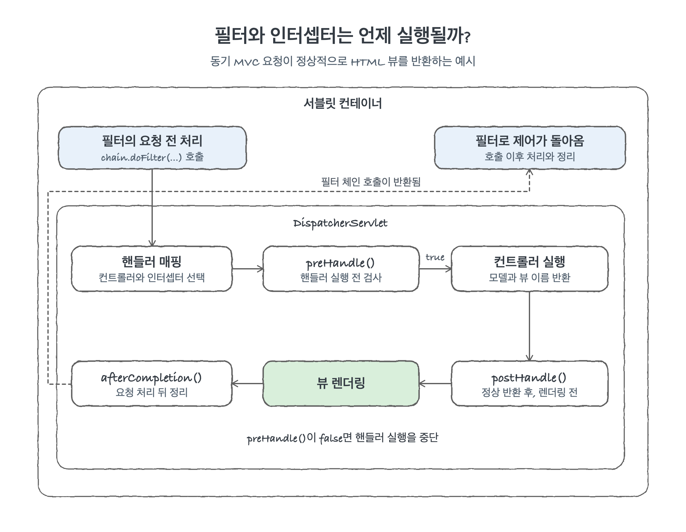

# Servlet Filters and Spring MVC Interceptors

## 1. 요청 흐름에서 실행되는 위치

서블릿 필터는 컨테이너의 필터 체인에서 실행된다. 필터는 `chain.doFilter(...)`를 호출해 다음 필터나 서블릿으로 요청을 보내고, 반환된 뒤에도 처리를 수행할 수 있다. 경로와 디스패치 유형은 필터 등록에서 결정한다. Spring MVC 인터셉터는 `DispatcherServlet`이 핸들러를 찾은 후에 실행되므로 선택된 핸들러 정보에 접근할 수 있다. [Jakarta Servlet 6.0 · 필터](https://jakarta.ee/specifications/servlet/6.0/jakarta-servlet-spec-6.0) · [Spring Framework 6.2 · 핸들러 인터셉터](https://docs.spring.io/spring-framework/reference/6.2/web/webmvc/mvc-servlet/handlermapping-interceptor.html)



```text
HTTP 요청 → 서블릿 필터 체인 → DispatcherServlet → 핸들러 매핑 → 인터셉터 → 컨트롤러
```

| 인터셉터 메서드 | 실행 시점 |
| --- | --- |
| `preHandle()` | 핸들러 실행 전. `false`를 반환하면 이후 실행을 중단한다. |
| `postHandle()` | 핸들러가 정상 반환한 뒤 뷰 렌더링 전. |
| `afterCompletion()` | 요청 처리 완료 뒤. 해당 인터셉터의 `preHandle()`이 성공한 경우 정리 작업에 사용한다. |

`@ResponseBody`나 `ResponseEntity`의 본문은 `HandlerAdapter`가 반환하기 전에 작성될 수 있다. 이 응답의 본문에 공통 처리를 적용하려면 `ResponseBodyAdvice`를 사용할 수 있다. [Spring Framework 6.2 · 핸들러 인터셉터](https://docs.spring.io/spring-framework/reference/6.2/web/webmvc/mvc-servlet/handlermapping-interceptor.html)

## 2. 공통 처리의 적용 범위 정하기

요청 전체의 소요 시간을 측정하려면 필터에서 체인을 호출하기 전과 `finally`에서 경과 시간을 기록할 수 있다. 어떤 컨트롤러가 선택됐는지 기록하려면 인터셉터의 `preHandle()`에서 `handler instanceof HandlerMethod`를 확인한 뒤 핸들러 정보를 사용한다. 한 요청에서 만든 로그 컨텍스트는 해당 요청의 작업이 끝나면 정리한다. [Jakarta Servlet 6.0 · 필터](https://jakarta.ee/specifications/servlet/6.0/jakarta-servlet-spec-6.0) · [Spring Framework 6.2 · 인터셉터 등록](https://docs.spring.io/spring-framework/reference/6.2/web/webmvc/mvc-config/interceptors.html)

`WebMvcConfigurer#addInterceptors`에서 인터셉터 경로를 지정할 수 있다. 예를 들어 `/notes/**`에 메모 관련 로그 컨텍스트를 추가할 수 있다. 인증과 인가를 적용할 때는 Spring Security의 필터 체인에서 로그인 경로, 공개 경로, 인증이 필요한 경로를 정의한다. Spring MVC의 인터셉터 경로와 애너테이션 기반 컨트롤러 매핑은 일치 여부를 판정하는 과정이 다를 수 있다. [Spring Framework 6.2 · 인터셉터와 보안 처리](https://docs.spring.io/spring-framework/reference/6.2/web/webmvc/mvc-config/interceptors.html) · [Spring Security 6.5 · 서블릿 아키텍처](https://docs.spring.io/spring-security/reference/6.5/servlet/architecture.html)

## 3. 요청 속성과 재디스패치

필터는 `REQUEST`, `ERROR`, `ASYNC` 등의 디스패치 유형에 따라 다시 실행될 수 있다. `ASYNC`에서는 작업이 다른 스레드나 디스패치에 걸쳐 진행될 수 있으므로 동기 호출의 `finally`만으로 전체 비동기 작업 시간을 측정하기 어렵다. [오류 디스패치 문서](14_servlet_exception_dispatch_and_error_pages.md)에서 오류 처리 시의 적용 범위를 이어서 다룬다. [Jakarta Servlet 6.0 · 디스패치 유형과 비동기 처리](https://jakarta.ee/specifications/servlet/6.0/jakarta-servlet-spec-6.0)

컨트롤러에 공통 값을 넘길 때는 필터나 인터셉터가 요청 속성에 값을 넣고 `@RequestAttribute`로 받을 수 있다. 별도의 인자 이름이나 타입을 컨트롤러 시그니처에 일관되게 도입하려면 `HandlerMethodArgumentResolver`를 등록한다. [Spring Framework 6.2 · 컨트롤러 메서드 인자](https://docs.spring.io/spring-framework/reference/6.2/web/webmvc/mvc-controller/ann-methods/arguments.html)
