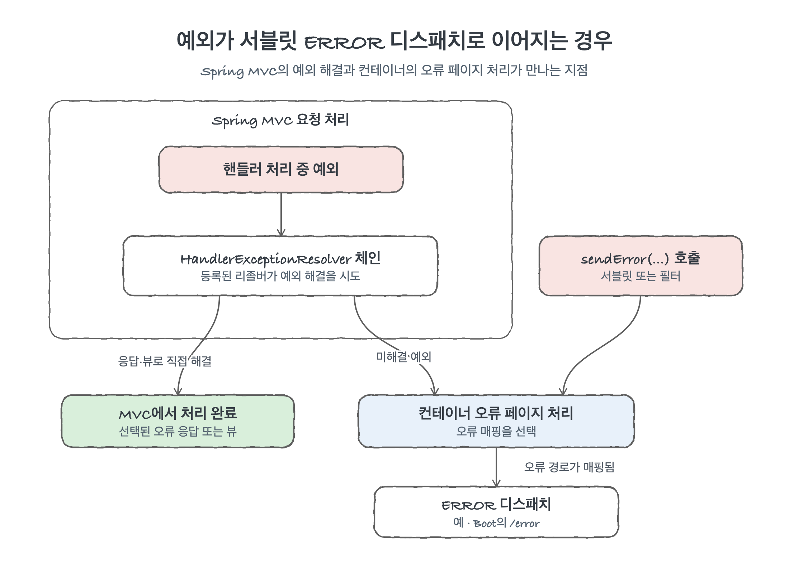

# Servlet Exception Dispatch and Error Pages

## 1. 오류가 컨테이너까지 전달되는 경우

Spring MVC는 처리 중 예외가 생기면 먼저 등록된 `HandlerExceptionResolver`에 해결을 요청한다. 미해결 예외가 컨테이너에 전달되거나 애플리케이션이 `sendError()`를 호출하면 서블릿 컨테이너의 오류 페이지 처리 경로로 이어질 수 있다. `setStatus()`는 응답 상태 코드만 지정한다. 오류 화면을 생성하려면 오류 페이지 매핑을 사용하거나 애플리케이션에서 본문을 직접 작성한다. [Spring Framework 6.2 · 예외 처리](https://docs.spring.io/spring-framework/reference/6.2/web/webmvc/mvc-servlet/exceptionhandlers.html) · [Jakarta Servlet 6.0 · 오류 처리](https://jakarta.ee/specifications/servlet/6.0/jakarta-servlet-spec-6.0)



```text
원래 요청 → 컨트롤러에서 미해결 예외 발생
          → 컨테이너의 ERROR 디스패치 → 오류 처리 경로 → 오류 응답
```

오류 처리기는 `RequestDispatcher.ERROR_STATUS_CODE`와 `ERROR_REQUEST_URI` 등의 요청 속성으로 원래 상태 코드와 경로를 확인할 수 있다. 응답이 이미 커밋된 뒤에는 상태 코드나 헤더를 바꿀 수 없으므로 오류 화면으로 전환하는 데 제약이 있다. [Jakarta Servlet 6.0 · 오류 요청 속성과 응답 커밋](https://jakarta.ee/specifications/servlet/6.0/jakarta-servlet-spec-6.0)

## 2. Spring Boot의 오류 화면 연결하기

Spring Boot의 기본 오류 경로는 `/error`다. HTML 클라이언트에 상태 코드별 화면을 제공하려면 템플릿이나 정적 리소스 경로의 `error/404.html`처럼 이름을 붙인다. 상태 코드별 파일을 지정하지 않은 경우에는 `error/4xx.html`이나 `error/5xx.html`처럼 범위를 사용한 페이지도 둘 수 있다. [Spring Boot 3.5 · 오류 처리](https://docs.spring.io/spring-boot/3.5/reference/web/servlet.html#web.servlet.spring-mvc.error-handling)

| 템플릿 예 | 용도 |
| --- | --- |
| `templates/error/404.html` | 요청한 리소스를 찾지 못한 경우 |
| `templates/error/4xx.html` | 상태 코드별 화면이 없는 클라이언트 오류 |
| `templates/error/5xx.html` | 상태 코드별 화면이 없는 서버 오류 |

오류 화면에는 사용자에게 필요한 상태와 이동 링크를 표시한다. 예외 내부 메시지와 스택 트레이스는 서버 로그에서 확인한다. API에 구조화된 오류 본문이 필요하면 [API 예외 처리 문서](15_spring_mvc_api_exception_handling.md)처럼 컨트롤러 예외 매핑을 구성할 수 있다. [Spring Boot 3.5 · 오류 응답](https://docs.spring.io/spring-boot/3.5/reference/web/servlet.html#web.servlet.spring-mvc.error-handling)

## 3. 오류 처리 중 필터와 인터셉터의 실행

서블릿 필터는 등록된 디스패치 유형에 `ERROR`가 포함되면 오류 처리 요청에도 적용된다. 원래 요청의 로그만 필요한 필터에는 `REQUEST` 범위를 지정할 수 있다. 오류 경로가 `DispatcherServlet`의 핸들러로 매핑되면 MVC 인터셉터도 적용될 수 있으므로 `/error` 경로를 포함할지 별도로 정한다. [Jakarta Servlet 6.0 · 필터 디스패치 유형](https://jakarta.ee/specifications/servlet/6.0/jakarta-servlet-spec-6.0) · [Spring Framework 6.2 · 인터셉터 등록](https://docs.spring.io/spring-framework/reference/6.2/web/webmvc/mvc-config/interceptors.html)
