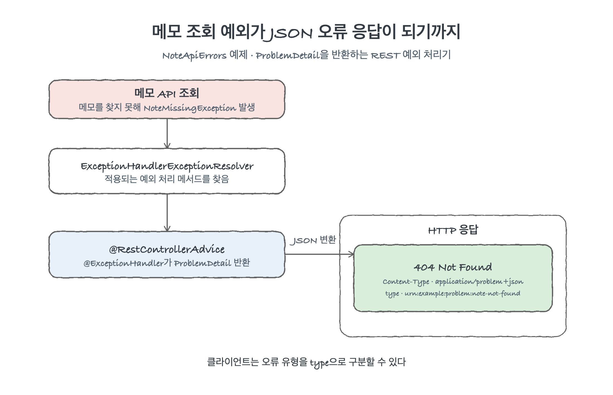

# Spring MVC API Exception Handling

## 1. 예외가 HTTP 응답으로 바뀌는 위치

Spring MVC는 `HandlerExceptionResolver` 체인에 예외를 전달한다. 기본 구성의 각 리졸버는 아래 역할을 맡는다. 처리되지 않은 예외는 [서블릿 컨테이너의 오류 처리](14_servlet_exception_dispatch_and_error_pages.md)로 이어질 수 있다. [Spring Framework 6.2 · 예외 리졸버](https://docs.spring.io/spring-framework/reference/6.2/web/webmvc/mvc-servlet/exceptionhandlers.html)

| 리졸버 | 역할 |
| --- | --- |
| `ExceptionHandlerExceptionResolver` | 컨트롤러 또는 `@ControllerAdvice`의 `@ExceptionHandler` 메서드를 호출한다. |
| `ResponseStatusExceptionResolver` | `@ResponseStatus`나 `ResponseStatusException`에 지정된 상태를 응답에 반영한다. |
| `DefaultHandlerExceptionResolver` | Spring MVC의 표준 예외를 HTTP 상태 코드로 매핑한다. |

`@ExceptionHandler`를 컨트롤러에 두면 해당 컨트롤러에서 처리한다. 여러 REST 컨트롤러에 같은 처리가 필요하면 `@RestControllerAdvice`에 옮긴다. HTML 컨트롤러와 API가 한 애플리케이션에 있으면 적용할 패키지나 컨트롤러 타입을 지정할 수 있다. [Spring Framework 6.2 · @ExceptionHandler](https://docs.spring.io/spring-framework/reference/6.2/web/webmvc/mvc-controller/ann-exceptionhandler.html)

## 2. ProblemDetail로 오류 응답 작성하기

Spring의 `ProblemDetail`은 RFC 9457의 `type`, `title`, `status`, `detail`, `instance`를 표현하고 확장 필드를 추가할 수 있다. JSON 응답 미디어 타입은 `application/problem+json`이다. 클라이언트는 사람이 읽는 `detail` 문구에 의존하지 않고 `type` 같은 식별자로 오류를 구분할 수 있다. [RFC 9457 · Problem Details](https://www.rfc-editor.org/rfc/rfc9457.html) · [Spring Framework 6.2 · 오류 응답](https://docs.spring.io/spring-framework/reference/6.2/web/webmvc/mvc-ann-rest-exceptions.html)



```java
import java.net.URI;

import org.springframework.http.HttpStatus;
import org.springframework.http.ProblemDetail;
import org.springframework.web.bind.annotation.ExceptionHandler;
import org.springframework.web.bind.annotation.RestControllerAdvice;

@RestControllerAdvice
public class NoteApiErrors {

    @ExceptionHandler(NoteMissingException.class)
    public ProblemDetail missingNote() {
        ProblemDetail problem = ProblemDetail.forStatusAndDetail(
                HttpStatus.NOT_FOUND, "The requested note could not be found.");
        problem.setType(URI.create("urn:example:problem:note-not-found"));
        problem.setTitle("Note not found");
        return problem;
    }

    public static class NoteMissingException extends RuntimeException {
    }
}
```

API 핸들러에서 메모를 찾지 못했을 때 `NoteMissingException`을 던지면 이 어드바이스가 `404` 오류 본문을 만든다. 내부 예외 메시지나 사용자 입력 원문은 노출 범위를 검토한 뒤 응답에 넣는다.

## 3. 공통 요청 오류 묶기

Spring MVC의 표준 예외도 같은 형식으로 반환하려면 `ResponseEntityExceptionHandler`를 상속하는 `@ControllerAdvice`를 둘 수 있다. JSON을 읽지 못한 경우, [Bean Validation 제약 위반](11_spring_mvc_bean_validation.md), 리소스를 찾지 못한 경우를 구분하면 클라이언트가 요청을 고치거나 다른 동작을 선택할 수 있다. 미디어 타입과 응답 본문 모양도 HTTP 상태 코드와 함께 검증한다. [Spring Framework 6.2 · ResponseEntityExceptionHandler](https://docs.spring.io/spring-framework/reference/6.2/web/webmvc/mvc-ann-rest-exceptions.html)
