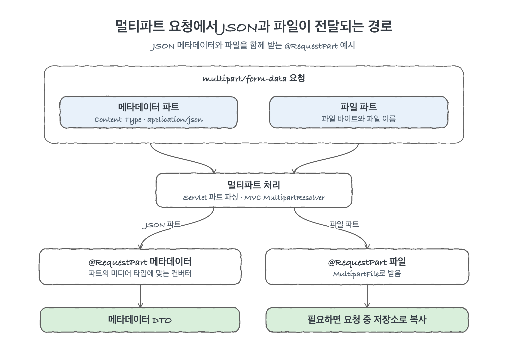

# Spring MVC Multipart File Uploads

## 1. 파일과 폼 데이터를 함께 보내기

파일 입력이 있는 HTML 폼은 `enctype="multipart/form-data"`를 사용한다. 요청의 `Content-Type`에 포함된 경계 문자열이 텍스트 필드와 파일 등 각 파트를 구분한다. 서블릿 API에서는 `Part`로 파트를 읽을 수 있고, Spring MVC에서는 멀티파트 리졸버가 처리한 파일을 `MultipartFile`로 받을 수 있다. [Jakarta Servlet 6.0 · 멀티파트 처리](https://jakarta.ee/specifications/servlet/6.0/jakarta-servlet-spec-6.0) · [Spring Framework 6.2 · Multipart Resolver](https://docs.spring.io/spring-framework/reference/6.2/web/webmvc/mvc-servlet/multipart.html)

```html
<form action="/attachments" method="post" enctype="multipart/form-data">
  <label for="title">Title</label>
  <input id="title" name="title" type="text" required>
  <label for="file">Attachment</label>
  <input id="file" name="file" type="file" required>
  <button type="submit">Upload</button>
</form>
```

| 요청 구성 | Spring MVC에서 받는 방식 |
| --- | --- |
| 텍스트 필드 하나와 파일 하나 | `@RequestParam("title") String title`, `@RequestParam("file") MultipartFile file` |
| 같은 이름으로 제출한 파일 여러 개 | `@RequestParam("files") List<MultipartFile> files` |
| 폼 필드와 파일을 하나의 객체에 바인딩 | `MultipartFile` 속성을 가진 `@ModelAttribute` 폼 객체 |
| JSON 메타데이터와 파일 | JSON 파트는 `@RequestPart`와 `Content-Type: application/json`, 파일 파트는 `MultipartFile` |

`@RequestPart`로 DTO를 받으면 해당 파트의 미디어 타입에 맞는 메시지 컨버터가 값을 읽는다. `MultipartFile`의 임시 데이터는 요청이 끝나면 정리될 수 있으므로 이후에도 필요한 파일은 요청 중 저장소로 옮긴다. [Spring Framework 6.2 · Multipart](https://docs.spring.io/spring-framework/reference/6.2/web/webmvc/mvc-controller/ann-methods/multipart-forms.html) · [Spring Framework 6.2 API · MultipartFile](https://docs.spring.io/spring-framework/docs/6.2.x/javadoc-api/org/springframework/web/multipart/MultipartFile.html)



## 2. 크기 제한과 저장 경로 분리하기

Spring Boot에서 파일 하나의 상한과 멀티파트 요청 전체의 상한을 각각 지정할 수 있다. 아래 예에서는 파일 하나를 최대 5MB로 제한하고, 폼 필드와 멀티파트 형식에 필요한 여유를 포함해 전체를 6MB로 제한한다. 한도를 넘는 요청은 컨트롤러가 호출되기 전에 거부될 수 있다. [Spring Boot 3.5 · 멀티파트 속성](https://docs.spring.io/spring-boot/3.5/appendix/application-properties/index.html#application-properties.web.spring.servlet.multipart.max-file-size)

```properties
spring.servlet.multipart.max-file-size=5MB
spring.servlet.multipart.max-request-size=6MB
```

`getOriginalFilename()`의 값은 클라이언트가 보낸 정보다. 이 이름은 표시용 메타데이터로 다루고 저장 경로에는 서버가 발급한 식별자를 사용한다. `getContentType()`도 클라이언트가 보낸 값이므로 서비스가 허용하는 파일 종류는 실제 내용과 함께 확인한다. 파일 내용을 복사할 때는 `getInputStream()`으로 읽으면 애플리케이션에서 파일 전체를 바이트 배열로 만들 필요가 없다. [Spring Framework 6.2 API · MultipartFile](https://docs.spring.io/spring-framework/docs/6.2.x/javadoc-api/org/springframework/web/multipart/MultipartFile.html)

## 3. 첨부 파일 조회와 다운로드

메모에 첨부 파일을 연결할 때는 저장 식별자, 표시용 파일 이름, 크기, 소유 관계를 함께 기록한다. 다운로드는 `/attachments/{id}`처럼 식별자로 조회한 뒤 접근 권한을 확인하고 파일을 응답으로 보낸다. `Content-Disposition: attachment`는 브라우저에 다운로드 용도와 파일 이름을 전달한다. 화면에서 미리보기를 제공하는 파일은 별도의 응답 경로에서 허용할 콘텐츠 타입을 정한다. [Spring Framework 6.2 · ResponseEntity](https://docs.spring.io/spring-framework/reference/6.2/web/webmvc/mvc-controller/ann-methods/responseentity.html) · [RFC 6266 · Content-Disposition](https://www.rfc-editor.org/rfc/rfc6266.html)
