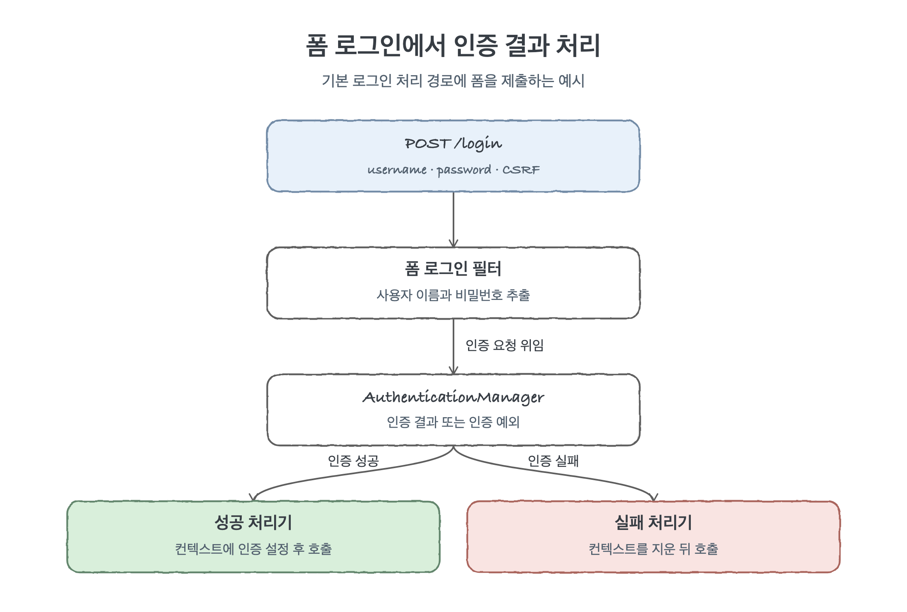

# Spring Security Authentication Flows

## 1. 폼 로그인과 HTTP Basic

폼 로그인에서 사용자가 `POST /login`으로 자격 증명을 제출하면 `UsernamePasswordAuthenticationFilter`가 인증을 요청한다. 인증 결과에 따라 `AuthenticationSuccessHandler` 또는 `AuthenticationFailureHandler`를 호출한다. 기본 폼 요청의 필드 이름은 `username`과 `password`이며, 커스텀 로그인 화면에서는 폼의 URL, 필드 이름, CSRF 토큰을 서버 설정에 맞춘다. [Spring Security 6.5 · Form Login](https://docs.spring.io/spring-security/reference/6.5/servlet/authentication/passwords/form.html)

| 방식 | 요청을 처리하는 필터와 결과 |
| --- | --- |
| 폼 로그인 | `UsernamePasswordAuthenticationFilter`가 로그인 폼을 읽는다. 성공 후 원래 요청이나 지정된 경로로 이동할 수 있다. |
| HTTP Basic | `BasicAuthenticationFilter`가 `Authorization` 헤더를 읽는다. Basic 진입점은 인증이 필요할 때 보통 `401`과 `WWW-Authenticate`를 보낸다. |
| 기억하기 인증 | 현재 인증이 없을 때 `RememberMeAuthenticationFilter`가 기억하기 쿠키를 사용해 인증을 시도한다. |
| 익명 인증 | `AnonymousAuthenticationFilter`가 인증 객체가 비어 있는 경우 익명 토큰을 넣어 공통 인가 처리에 사용할 수 있게 한다. |

HTTP Basic은 자격 증명을 Base64로 표현하므로 전송에는 HTTPS를 사용한다. 기억하기 쿠키로 접근한 사용자에게 결제나 비밀번호 변경 같은 기능을 열 때는 `fullyAuthenticated()` 조건 등으로 재인증을 요구할 수 있다. [Spring Security 6.5 · HTTP Basic](https://docs.spring.io/spring-security/reference/6.5/servlet/authentication/passwords/basic.html) · [Spring Security 6.5 · Remember-Me](https://docs.spring.io/spring-security/reference/6.5/servlet/authentication/rememberme.html) · [Spring Security 6.5 · Anonymous Authentication](https://docs.spring.io/spring-security/reference/6.5/servlet/authentication/anonymous.html)

## 2. 로그인 전 요청 기억하기

브라우저가 인증이 필요한 페이지에 접근하면 `ExceptionTranslationFilter`가 로그인 진입점을 호출하기 전에 `RequestCache`로 원래 요청을 저장할 수 있다. 폼 로그인에 성공하면 `SavedRequestAwareAuthenticationSuccessHandler`가 저장한 URL을 이용해 돌려보낸다. `RequestCacheAwareFilter`는 저장된 요청과 일치하는 현재 요청을 래핑해 뒤쪽 필터와 애플리케이션에 전달할 수 있다. [Spring Security 6.5 · 인증 아키텍처와 SavedRequest](https://docs.spring.io/spring-security/reference/6.5/servlet/authentication/architecture.html) · [Spring Security 6.5 API · RequestCacheAwareFilter](https://docs.spring.io/spring-security/reference/6.5/api/java/org/springframework/security/web/savedrequest/RequestCacheAwareFilter.html)

## 3. 로그아웃에서 정리하는 상태

CSRF 보호를 사용하는 기본 구성에서는 `POST /logout`에 유효한 토큰을 보내 로그아웃을 실행한다. `LogoutFilter`는 로그아웃 핸들러를 호출해 세션과 보안 컨텍스트를 정리하고, 구성돼 있으면 기억하기 상태도 지운다. 이후 `LogoutSuccessHandler`가 리다이렉트나 HTTP 응답을 결정한다. [Spring Security 6.5 · Handling Logouts](https://docs.spring.io/spring-security/reference/6.5/servlet/authentication/logout.html)
