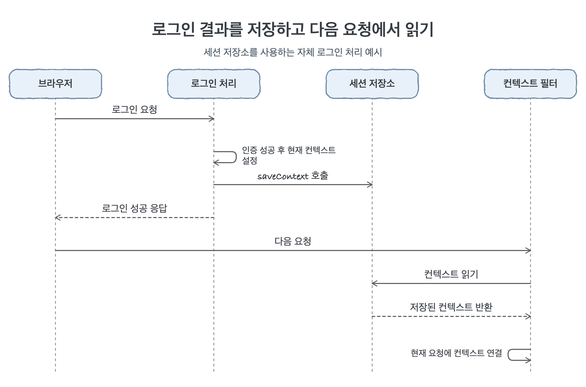

# Spring Security Authentication Persistence

## 1. 요청의 현재 상태와 다음 요청의 상태

`SecurityContextHolder`는 현재 요청의 실행 경로에서 인증을 제공한다. 다음 요청에서도 인증을 사용하려면 `SecurityContextRepository`에서 컨텍스트를 다시 읽을 수 있어야 한다. Spring Security 6의 일반적인 구성에서 `SecurityContextHolderFilter`는 컨텍스트를 읽어 연결하고 종료 시 정리한다. 로그인 구현이 요청 사이에 상태를 유지해야 하면 저장소에 저장하는 단계도 수행한다. 기본 폼 로그인 필터는 구성된 저장소를 사용한다. [Spring Security 6.5 · Persisting Authentication](https://docs.spring.io/spring-security/reference/6.5/servlet/authentication/persistence.html)

| 저장소 | 사용 범위 |
| --- | --- |
| `RequestAttributeSecurityContextRepository` | 같은 서블릿 요청의 재디스패치에서 컨텍스트를 사용할 수 있게 한다. |
| `HttpSessionSecurityContextRepository` | HTTP 세션에 저장해 다음 요청에서도 읽을 수 있게 한다. |
| `DelegatingSecurityContextRepository` | 여러 저장소에 저장하고 컨텍스트를 찾을 때 순서대로 위임한다. |
| `NullSecurityContextRepository` | 요청 사이에 컨텍스트를 저장하지 않는다. |

## 2. 직접 만든 로그인 경로에서 저장하기

자체 MVC 로그인 처리에서 `AuthenticationManager`를 직접 호출한다면 성공 이후 [세션 인증 전략](05_spring_security_session_management.md)을 적용하고, 현재 컨텍스트와 저장소를 갱신한다. 아래 클래스에는 필터 체인과 같은 저장소, 해당 로그인에 적용할 세션 인증 전략을 주입한다. HTTP 성공 응답을 출력하기 전에 저장해야 세션 식별자 헤더도 전송할 수 있다. [Spring Security 6.5 · Explicit Saving](https://docs.spring.io/spring-security/reference/6.5/servlet/authentication/persistence.html) · [Spring Security 6.5 · Manual Authentication](https://docs.spring.io/spring-security/reference/6.5/servlet/authentication/session-management.html)



```java
import jakarta.servlet.http.HttpServletRequest;
import jakarta.servlet.http.HttpServletResponse;

import org.springframework.security.authentication.AuthenticationManager;
import org.springframework.security.authentication.UsernamePasswordAuthenticationToken;
import org.springframework.security.core.context.SecurityContextHolder;
import org.springframework.security.web.authentication.session.SessionAuthenticationStrategy;
import org.springframework.security.web.context.SecurityContextRepository;

public class SessionLogin {

    private final AuthenticationManager authenticationManager;
    private final SessionAuthenticationStrategy sessions;
    private final SecurityContextRepository repository;

    public SessionLogin(AuthenticationManager authenticationManager,
                        SessionAuthenticationStrategy sessions,
                        SecurityContextRepository repository) {
        this.authenticationManager = authenticationManager;
        this.sessions = sessions;
        this.repository = repository;
    }

    public void login(String username, String password,
                      HttpServletRequest request, HttpServletResponse response) {
        var credentials = UsernamePasswordAuthenticationToken.unauthenticated(username, password);
        var authentication = authenticationManager.authenticate(credentials);
        sessions.onAuthentication(authentication, request, response);

        var context = SecurityContextHolder.createEmptyContext();
        context.setAuthentication(authentication);
        SecurityContextHolder.setContext(context);
        repository.saveContext(context, request, response);
    }
}
```

인증 예외를 HTTP 응답으로 바꾸는 처리는 로그인 핸들러가 담당한다. 세션에 상태가 필요한지와, 매 요청의 자격 증명만으로 인증할지는 클라이언트 계약에 따라 결정한다. [Spring Security 6.5 · Session Management](https://docs.spring.io/spring-security/reference/6.5/servlet/authentication/session-management.html)
