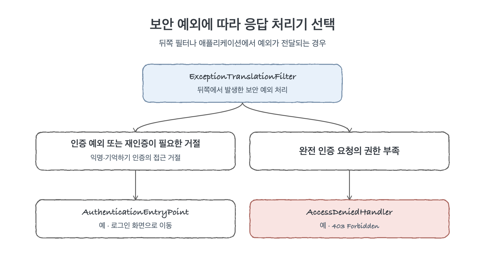

# Spring Security Exception Handling

## 1. 필터에서 나온 예외를 HTTP 응답으로 바꾸기

`ExceptionTranslationFilter`는 자기 뒤의 체인을 호출하고 `AuthenticationException` 또는 `AccessDeniedException`이 전달되면 인증 진입점이나 접근 거부 처리기로 연결한다. 인가 필터에서 권한 판정을 맡고, 예외 변환 필터에서는 필요한 HTTP 응답을 정한다. [Spring Security 6.5 API · ExceptionTranslationFilter](https://docs.spring.io/spring-security/reference/6.5/api/java/org/springframework/security/web/access/ExceptionTranslationFilter.html)

| 상황 | 처리 지점 | 예시 응답 |
| --- | --- | --- |
| 보호된 페이지에 로그인 없이 접근 | `AuthenticationEntryPoint` | 폼 로그인 화면으로 리다이렉트 |
| 인증이 필요한 API에 자격 증명 없이 접근 | 해당 체인의 `AuthenticationEntryPoint` | `401 Unauthorized`. HTTP Basic이면 인증 챌린지 헤더 포함 가능 |
| 로그인한 사용자의 권한 부족 | `AccessDeniedHandler` | `403 Forbidden` |
| 로그인 폼에 틀린 정보 제출 | 폼 인증 필터의 `AuthenticationFailureHandler` | 로그인 오류 페이지나 실패 응답 |
| 상태 변경 요청에 CSRF 토큰이 없거나 유효하지 않음 | `CsrfFilter`가 호출하는 접근 거부 처리기 | `403 Forbidden` |

기억하기 인증으로 접근한 사용자가 더 높은 인증 수준을 요구하는 리소스에서 거절되면, `ExceptionTranslationFilter`는 인증 진입점을 호출해 다시 로그인하도록 할 수 있다. [Spring Security 6.5 · Handling Security Exceptions](https://docs.spring.io/spring-security/reference/6.5/servlet/architecture.html) · [Spring Security 6.5 · CSRF 처리](https://docs.spring.io/spring-security/reference/6.5/servlet/exploits/csrf.html)

## 2. 브라우저와 API의 응답 맞추기

`http.exceptionHandling(...)`에서 진입점과 접근 거부 처리기를 설정할 수 있다. 브라우저 체인에서는 로그인 화면으로 보내고, 기계가 호출하는 API 체인에서는 계약에 맞는 상태 코드와 짧은 오류 본문을 반환할 수 있다. 카탈로그 API의 응답을 확인할 때는 인증 수단이 부족한 요청과 이미 인증했지만 권한이 부족한 요청을 각각 테스트한다. [Spring Security 6.5 · HTTP Basic](https://docs.spring.io/spring-security/reference/6.5/servlet/authentication/passwords/basic.html) · [Spring Security 6.5 API · HttpSecurity](https://docs.spring.io/spring-security/reference/6.5/api/java/org/springframework/security/config/annotation/web/builders/HttpSecurity.html)

MVC의 `@ControllerAdvice`는 컨트롤러 처리 경로의 예외를 다룬다. 디스패처에 들어가기 전에 서블릿 필터에서 종료된 요청은 필터 체인에 연결된 처리기가 응답을 만든다. [Spring MVC API 예외 처리](../spring-mvc/15_spring_mvc_api_exception_handling.md) · [Spring Security 6.5 · Servlet Architecture](https://docs.spring.io/spring-security/reference/6.5/servlet/architecture.html)
