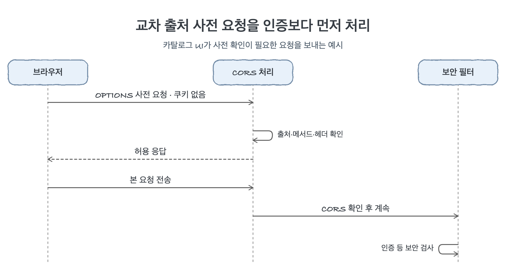

# Spring Security CORS, CSRF, and SameSite

## 1. CORS로 브라우저의 교차 출처 접근 정하기

출처는 스킴, 호스트, 포트로 구분한다. 브라우저가 특정 교차 출처 요청을 보내기 전에 `OPTIONS` 사전 요청으로 허용 여부를 물을 수 있다. 사전 요청에는 로그인 세션 쿠키가 없을 수 있으므로 CORS 처리는 Spring Security의 인증 판정보다 앞에서 이뤄져야 한다. `http.cors(...)`에서 Spring MVC의 CORS 구성이나 `CorsConfigurationSource`를 연결할 수 있다. [Spring Security 6.5 · CORS](https://docs.spring.io/spring-security/reference/6.5/servlet/integrations/cors.html)



아래 예제는 서버 설정에 등록할 CORS 소스로, 카탈로그 UI의 출처와 실제 사용 메서드·헤더를 명시한다. 이 소스를 `http.cors(cors -> cors.configurationSource(CatalogCors.configurationSource()))`로 연결한다. 자격 증명을 포함하는 설정에서는 허용 출처를 구체적으로 지정한다. [Spring Framework 6.2 · CORS](https://docs.spring.io/spring-framework/reference/6.2/web/webmvc-cors.html)

```java
import java.util.List;

import org.springframework.web.cors.CorsConfiguration;
import org.springframework.web.cors.UrlBasedCorsConfigurationSource;

public class CatalogCors {

    public static UrlBasedCorsConfigurationSource configurationSource() {
        var cors = new CorsConfiguration();
        cors.setAllowedOrigins(List.of("https://portal.example.com"));
        cors.setAllowedMethods(List.of("GET", "POST"));
        cors.setAllowedHeaders(List.of("Content-Type", "X-CSRF-TOKEN"));
        cors.setAllowCredentials(true);

        var source = new UrlBasedCorsConfigurationSource();
        source.registerCorsConfiguration("/catalog/**", cors);
        return source;
    }
}
```

## 2. 쿠키를 사용하는 상태 변경에 CSRF 토큰 적용하기

브라우저는 범위에 맞는 쿠키를 요청에 자동으로 첨부할 수 있다. CSRF 보호를 사용하면 상태 변경 요청에 서버가 예상하는 별도 토큰이 있어야 요청을 처리한다. Spring Security는 기본적으로 이 보호를 활성화한다. HTML 폼은 토큰을 숨은 필드로 보내고, JSON 요청은 설정과 일치하는 헤더로 보낼 수 있다. `HttpSessionCsrfTokenRepository`의 기본 헤더는 `X-CSRF-TOKEN`이다. [Spring Security 6.5 · CSRF](https://docs.spring.io/spring-security/reference/6.5/servlet/exploits/csrf.html)

SPA에서 토큰을 쿠키로 전달한다면 `CookieCsrfTokenRepository`와 맞는 요청 처리기를 구성한다. 기본 토큰 헤더는 `X-XSRF-TOKEN`이다. 로그인·로그아웃 뒤 기존 토큰이 지워질 수 있으므로 클라이언트가 다음 쓰기 요청 전에 새 토큰을 받을 수 있게 한다. `GET` 같은 안전한 메서드에는 상태 변경을 배치하지 않는다. [Spring Security 6.5 · JavaScript Applications](https://docs.spring.io/spring-security/reference/6.5/servlet/exploits/csrf.html)

## 3. SameSite로 쿠키 전송 범위 줄이기

| 속성 | 브라우저의 일반적인 전송 범위 |
| --- | --- |
| `Strict` | 같은 사이트의 요청 |
| `Lax` | 같은 사이트와 일부 교차 사이트 최상위 탐색 |
| `None` | 교차 사이트 전송을 허용. `Secure`가 필요하다. |

`SameSite`는 쿠키 전송, CORS는 브라우저의 교차 출처 접근, CSRF 토큰은 상태 변경 요청의 확인을 담당한다. 사이트와 출처는 판단 기준이 다르므로 브라우저에서 로그인, 사전 요청, 상태 변경의 흐름을 각각 확인한다. [HTTP State Management Mechanism · SameSite](https://httpwg.org/http-extensions/draft-ietf-httpbis-rfc6265bis.html) · [Spring Security 6.5 · CSRF와 SameSite](https://docs.spring.io/spring-security/reference/6.5/servlet/exploits/csrf.html)
