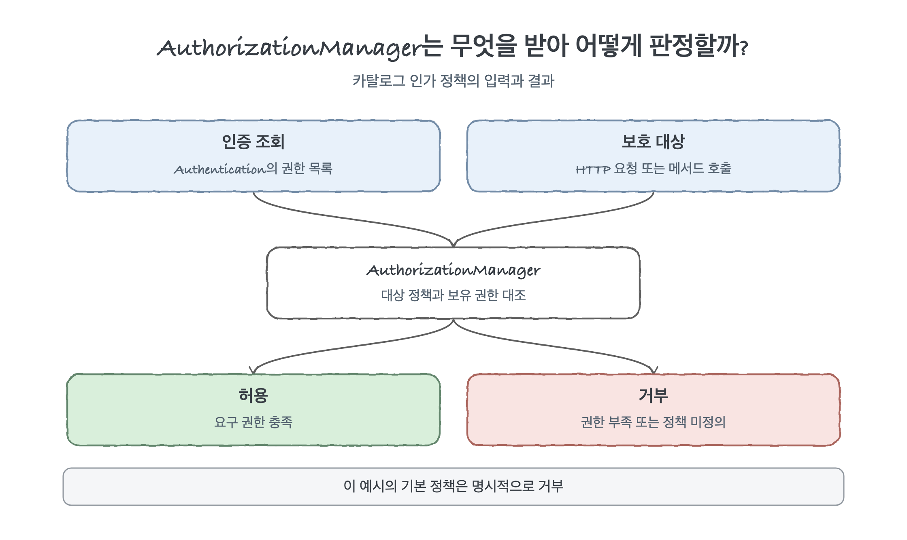

# Spring Security Authorization Architecture

## 1. 권한 모델과 판정 입력

인증이 완료된 `Authentication`에서 `GrantedAuthority` 목록을 읽을 수 있다. `AuthorizationManager<T>`는 인증을 가져오는 `Supplier<Authentication>`과 보호 대상 `T`를 받아 접근 허용 여부를 판정한다. HTTP에서는 요청이나 `RequestAuthorizationContext`가, 메서드 인가에서는 호출 또는 반환 결과가 판단의 입력이 된다. [Spring Security 6.5 · Authorization Architecture](https://docs.spring.io/spring-security/reference/6.5/servlet/authorization/architecture.html) · [Spring Security 6.5 API · AuthorizationManager](https://docs.spring.io/spring-security/reference/6.5/api/java/org/springframework/security/authorization/AuthorizationManager.html)



```text
HTTP  → AuthorizationFilter → 요청 매처에 연결된 AuthorizationManager → 다음 필터 또는 거부
메서드 → Spring AOP 프록시    → 인가 인터셉터 → AuthorizationManager → 메서드 실행 또는 거부
```

## 2. HTTP 인가 아키텍처

`AuthorizationFilter`는 요청을 인가 매니저에 넘긴다. `RequestMatcherDelegatingAuthorizationManager`는 매치된 규칙에 알맞은 매니저를 선택한다. 판정 결과가 접근 거부이면 필터가 접근 거부 예외를 던지고, [예외 변환](06_spring_security_exception_handling.md)이 인증 상태에 맞는 응답을 결정한다. `ERROR`나 `FORWARD` 같은 디스패치에서도 인가가 평가될 수 있어, 필요한 디스패치 유형을 역할 요구사항에 맞춰 명시한다. [Spring Security 6.5 · AuthorizationFilter와 요청 매칭](https://docs.spring.io/spring-security/reference/6.5/servlet/authorization/authorize-http-requests.html)

## 3. 메서드 인가 아키텍처

`AuthorizationManagerBeforeMethodInterceptor`는 `@PreAuthorize` 등에 해당하는 호출을 검사한다. `AuthorizationManagerAfterMethodInterceptor`는 반환 후 검사에 사용된다. 보안 규칙이 적용된 메서드를 같은 빈 내부에서 직접 호출하면 기본 프록시 기반 설정에서는 해당 호출이 인터셉터를 경유하지 않는다. [Spring Security 6.5 · Method Authorization](https://docs.spring.io/spring-security/reference/6.5/servlet/authorization/method-security.html) · [Spring AOP 자기 호출](../spring-advanced/12_spring_aop_proxy_limitations_and_self_invocation.md)

커스텀 매니저는 권한 판단을 정책 코드로 재사용할 수 있게 한다. 규칙을 찾지 못했을 때의 거부 결과를 명시하고, 실제 실행 경로에서 허용과 거부가 어떻게 처리되는지 [요청과 메서드 인가](08_spring_security_request_and_method_authorization.md) 각각에서 확인한다. [Spring Security 6.5 · Custom Authorization Managers](https://docs.spring.io/spring-security/reference/6.5/servlet/authorization/architecture.html)
