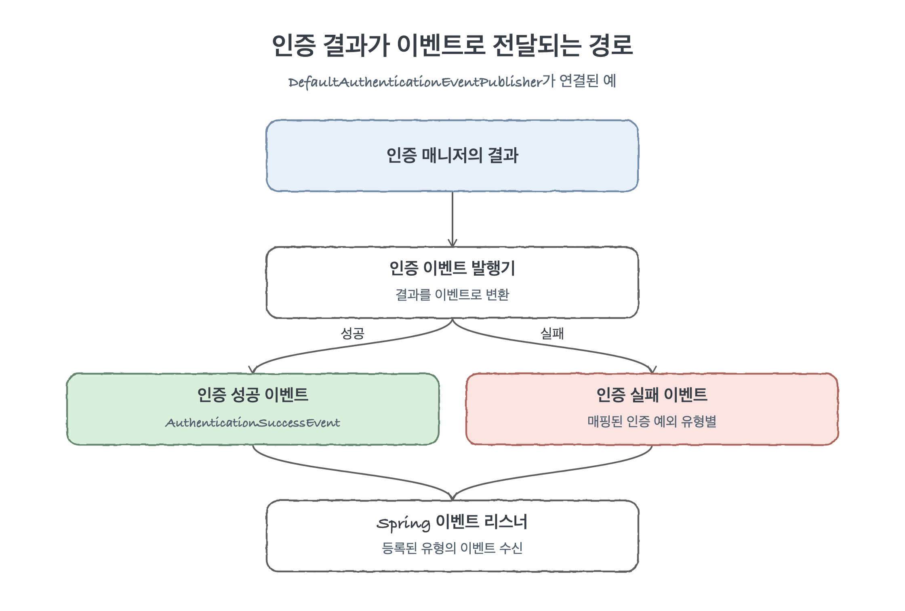

# Spring Security Authentication and Authorization Events

## 1. 인증 이벤트 발행하기

`AuthenticationEventPublisher`는 인증 성공과 실패를 Spring 이벤트로 전달하는 계약이다. `DefaultAuthenticationEventPublisher`를 사용하면 성공은 `AuthenticationSuccessEvent`로, 실패는 인증 예외 유형별 이벤트로 매핑할 수 있다. `ProviderManager`를 직접 만들 때는 그 매니저에 발행기가 설정됐는지 확인한다. [Spring Security 6.5 · Authentication Events](https://docs.spring.io/spring-security/reference/6.5/servlet/authentication/events.html)



| 이벤트 | 관찰할 내용 |
| --- | --- |
| `AuthenticationSuccessEvent` | 인증 매니저가 자격 증명을 수락했다는 결과 |
| `AbstractAuthenticationFailureEvent`의 하위 타입 | 자격 증명 실패, 비활성 계정 등의 종류 |
| `AuthorizationDeniedEvent` | 인가 규칙이 보호 대상을 거부했다는 결과 |

인증 성공 이벤트와 컨텍스트의 세션 저장은 서로 다른 시점에 일어난다. 로그인 전체가 끝난 뒤 결과가 필요하면 성공 핸들러에서 세션 정책과 응답까지 고려한다. [Spring Security 6.5 · Form Login](https://docs.spring.io/spring-security/reference/6.5/servlet/authentication/passwords/form.html) · [Spring Security 6.5 · Persisting Authentication](https://docs.spring.io/spring-security/reference/6.5/servlet/authentication/persistence.html)

## 2. 인가 이벤트로 접근 거부 관찰하기

`AuthorizationEventPublisher`를 인가 경로에 연결하면 판정 결과에 대한 이벤트를 발행할 수 있다. `SpringAuthorizationEventPublisher`는 기본적으로 거부 이벤트를 발행한다. 허용 이벤트가 필요한 경우에는 필요한 대상이나 종류를 고르는 발행 정책을 둔다. [Spring Security 6.5 · Authorization Events](https://docs.spring.io/spring-security/reference/6.5/servlet/authorization/events.html)

아래 리스너를 Spring 빈으로 등록하면 발행된 인증 실패와 인가 거부를 서로 다른 항목으로 집계할 수 있다. 이 예제에는 비밀번호, 인증 헤더, 세션 식별자를 기록하는 코드가 없다.

```java
import java.util.logging.Logger;

import org.springframework.context.event.EventListener;
import org.springframework.security.authentication.event.AbstractAuthenticationFailureEvent;
import org.springframework.security.authorization.event.AuthorizationDeniedEvent;

public class SecurityEventObserver {

    private static final Logger LOG = Logger.getLogger(SecurityEventObserver.class.getName());

    @EventListener
    public void onAuthenticationFailure(AbstractAuthenticationFailureEvent event) {
        LOG.info(() -> "Authentication failure: " + event.getClass().getSimpleName());
    }

    @EventListener
    public void onAuthorizationDenied(AuthorizationDeniedEvent<?> event) {
        LOG.info(() -> "Access denied for target type: " + event.getObject().getClass().getSimpleName());
    }
}
```

이벤트는 성공 화면이나 오류 응답을 만드는 핸들러와 별도로 집계와 감사를 처리한다. 동기 리스너에서 긴 외부 I/O를 실행하면 요청 지연에 영향을 줄 수 있다. [Spring Framework 6.2 · Application Events](https://docs.spring.io/spring-framework/reference/6.2/core/beans/context-introduction.html#context-functionality-events) · [Spring Security 6.5 · Authorization Events](https://docs.spring.io/spring-security/reference/6.5/servlet/authorization/events.html)
