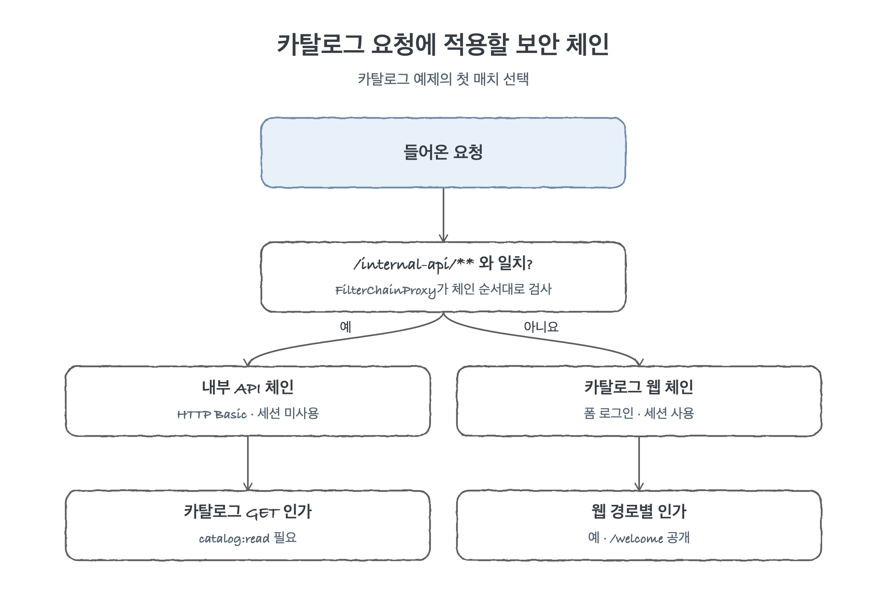

# Advanced Spring Security Configuration

## 1. 요청 종류에 따라 보안 체인 나누기

`SecurityFilterChain` 빈에 `@Order`를 적용하고 구체적인 `securityMatcher`가 먼저 검사되게 한다. 다음 예제는 내부 조회 API에 HTTP Basic을 적용하고, 웹 카탈로그에는 세션 기반 폼 로그인을 사용한다. API는 HTTPS에서 제공하고 `catalog:read` 권한이 있는 사용자만 조회할 수 있게 구성한다. 마지막 체인은 전체 경로에 적용되어 명시한 경로 이외의 요청을 거부한다. [Spring Security 6.5 · Multiple HttpSecurity Instances](https://docs.spring.io/spring-security/reference/6.5/servlet/configuration/java.html) · [Spring Security 6.5 · Servlet Architecture](https://docs.spring.io/spring-security/reference/6.5/servlet/architecture.html)

```java
import org.springframework.context.annotation.Bean;
import org.springframework.context.annotation.Configuration;
import org.springframework.core.annotation.Order;
import org.springframework.http.HttpMethod;
import org.springframework.security.config.annotation.web.builders.HttpSecurity;
import org.springframework.security.config.annotation.web.configuration.EnableWebSecurity;
import org.springframework.security.config.http.SessionCreationPolicy;
import org.springframework.security.web.SecurityFilterChain;

import static org.springframework.security.config.Customizer.withDefaults;

@Configuration(proxyBeanMethods = false)
@EnableWebSecurity
public class CatalogSecurityChains {

    @Bean
    @Order(1)
    SecurityFilterChain catalogApi(HttpSecurity http) throws Exception {
        return http
                .securityMatcher("/internal-api/**")
                .sessionManagement(sessions -> sessions.sessionCreationPolicy(SessionCreationPolicy.STATELESS))
                .authorizeHttpRequests(rules -> rules
                        .requestMatchers(HttpMethod.GET, "/internal-api/catalog").hasAuthority("catalog:read")
                        .anyRequest().denyAll())
                .httpBasic(withDefaults())
                .build();
    }

    @Bean
    @Order(2)
    SecurityFilterChain catalogWeb(HttpSecurity http) throws Exception {
        return http
                .authorizeHttpRequests(rules -> rules
                        .requestMatchers("/welcome", "/assets/**").permitAll()
                        .requestMatchers("/catalog/**").authenticated()
                        .anyRequest().denyAll())
                .formLogin(login -> login.permitAll())
                .build();
    }
}
```

로그인이나 로그아웃 URL이 필터가 제공하는 경로라면 해당 URL도 그 필터가 있는 체인과 매치되어야 한다. 구성이 여러 개일 때는 공개 경로, 서비스 API, 로그인 경로를 각각 요청해 적용된 체인과 상태 코드를 확인한다. [Spring Security 6.5 · SecurityFilterChain Endpoints](https://docs.spring.io/spring-security/reference/6.5/servlet/configuration/java.html)



## 2. 공통 설정을 커스텀 DSL로 묶기

여러 서비스가 같은 필터 설정을 적용해야 하면 `AbstractHttpConfigurer`를 구현하고 `http.with(...)`로 연결할 수 있다. `init(...)`에서는 필요한 다른 configurer를 추가하고, `configure(...)`에서는 공유 객체를 가져와 필터를 구성한다. 필터가 인증에 의존한다면 그 인증 필터 이후에 등록한다. `addFilterAt(...)`로 같은 위치에 여러 필터를 두면 상대 순서가 보장되지 않으므로 순서가 중요한 경우 기준 필터를 명시한다. [Spring Security 6.5 · Custom DSLs](https://docs.spring.io/spring-security/reference/6.5/servlet/configuration/java.html) · [Spring Security 6.5 API · HttpSecurity](https://docs.spring.io/spring-security/reference/6.5/api/java/org/springframework/security/config/annotation/web/builders/HttpSecurity.html)

## 3. 여러 인스턴스에서 세션 공유하기

서버가 여러 대라면 Spring Session으로 HTTP 세션을 Redis 같은 공용 저장소에 둘 수 있다. 브라우저의 세션 쿠키를 받은 인스턴스는 공용 저장소에서 세션을 읽는다. 공유 세션의 TTL, 직렬화 형식, 로그아웃과 만료가 다른 서버에도 반영되는지를 확인한다. 사용자별 동시 로그인 제한이 필요하면 인스턴스 전체에서 세션을 조회할 수 있는 레지스트리도 구성한다. [Spring Session · Redis 구성](https://docs.spring.io/spring-session/reference/guides/boot-redis.html) · [Spring Session · Spring Security 통합](https://docs.spring.io/spring-session/reference/spring-security.html)
