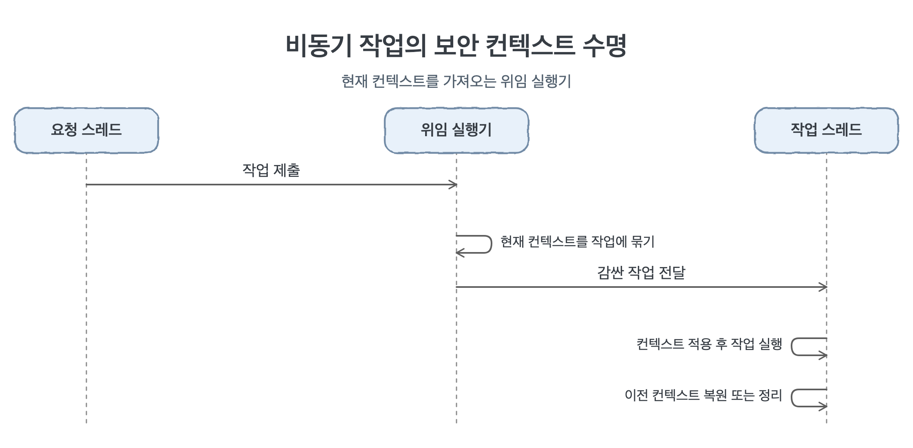

# Spring Security Context Propagation in Asynchronous Tasks

## 1. 요청 스레드와 비동기 작업의 경계

기본 `SecurityContextHolder` 전략은 현재 스레드의 컨텍스트를 사용한다. 요청 처리에서 별도의 실행기로 작업을 보내면 작업 스레드에 인증이 자동으로 존재한다고 가정할 수 없다. Spring Security의 위임 실행기는 작업을 제출할 때 컨텍스트를 가져와 실행 전 적용하고, 완료 뒤 이전 컨텍스트를 복원하거나 정리한다. [Spring Security 6.5 · Concurrency Support](https://docs.spring.io/spring-security/reference/6.5/features/integrations/concurrency.html)



| 비동기 방식 | 컨텍스트 처리 |
| --- | --- |
| Spring MVC가 실행하는 `Callable` | Spring Security의 MVC 통합이 이 작업에 현재 컨텍스트를 전달한다. |
| `DeferredResult`를 완성하는 자체 스레드 | 값을 계산하는 작업의 실행기에서 컨텍스트 전달을 구성한다. |
| `@Async` 또는 `CompletableFuture` | 사용하는 실행기를 확인하고 전파가 필요한 경우 위임 실행기를 지정한다. |
| Servlet의 `AsyncContext.start(...)` | Spring Security의 Servlet API 통합이 적용된 요청에서 등록한 작업에 컨텍스트를 전달할 수 있다. |

[Spring Security 6.5 · Spring MVC 비동기 통합](https://docs.spring.io/spring-security/reference/6.5/servlet/integrations/mvc.html) · [Spring Security 6.5 · Servlet API AsyncContext](https://docs.spring.io/spring-security/reference/6.5/servlet/integrations/servlet-api.html)

## 2. 실행기에 보안 컨텍스트 전파하기

아래 예제는 현재 사용자 이름을 비동기 작업에서 읽는다. 인증이 있는지 표시하는 용도이며, 권한이 필요한 실제 작업에는 [메서드 인가](08_spring_security_request_and_method_authorization.md)를 적용한다.

```java
import java.util.Optional;
import java.util.concurrent.CompletableFuture;
import java.util.concurrent.Executor;

import org.springframework.security.concurrent.DelegatingSecurityContextExecutor;
import org.springframework.security.core.Authentication;
import org.springframework.security.core.context.SecurityContextHolder;

public class AsyncCatalogTasks {

    private final Executor executor;

    public AsyncCatalogTasks(Executor workers) {
        this.executor = new DelegatingSecurityContextExecutor(workers);
    }

    public CompletableFuture<Optional<String>> currentPrincipalName() {
        return CompletableFuture.supplyAsync(() ->
                Optional.ofNullable(SecurityContextHolder.getContext().getAuthentication())
                        .map(Authentication::getName), executor);
    }
}
```

`@Async`에서 `AsyncTaskExecutor`가 필요하면 `DelegatingSecurityContextAsyncTaskExecutor`로 감쌀 수 있다. 스레드 풀은 기존 스레드를 재사용하므로 작업별로 컨텍스트를 넘기고 완료 뒤 정리한다. 여러 사용자 작업을 같은 풀에서 연달아 실행해 컨텍스트가 섞이지 않는지 확인한다. [Spring Security 6.5 · Concurrency Support](https://docs.spring.io/spring-security/reference/6.5/features/integrations/concurrency.html) · [Spring Security 6.5 API · DelegatingSecurityContextAsyncTaskExecutor](https://docs.spring.io/spring-security/reference/6.5/api/java/org/springframework/security/task/DelegatingSecurityContextAsyncTaskExecutor.html)

지금의 인증 정보로 실행하는 요청 연계 작업과, 나중에 서비스 권한으로 실행하는 예약 작업은 실행 주체를 별도로 정한다. 요청 스레드의 컨텍스트 전달은 로그인 상태를 저장하거나 연장하는 기능과 용도가 다르다. [Spring Security 6.5 · Persisting Authentication](https://docs.spring.io/spring-security/reference/6.5/servlet/authentication/persistence.html)
