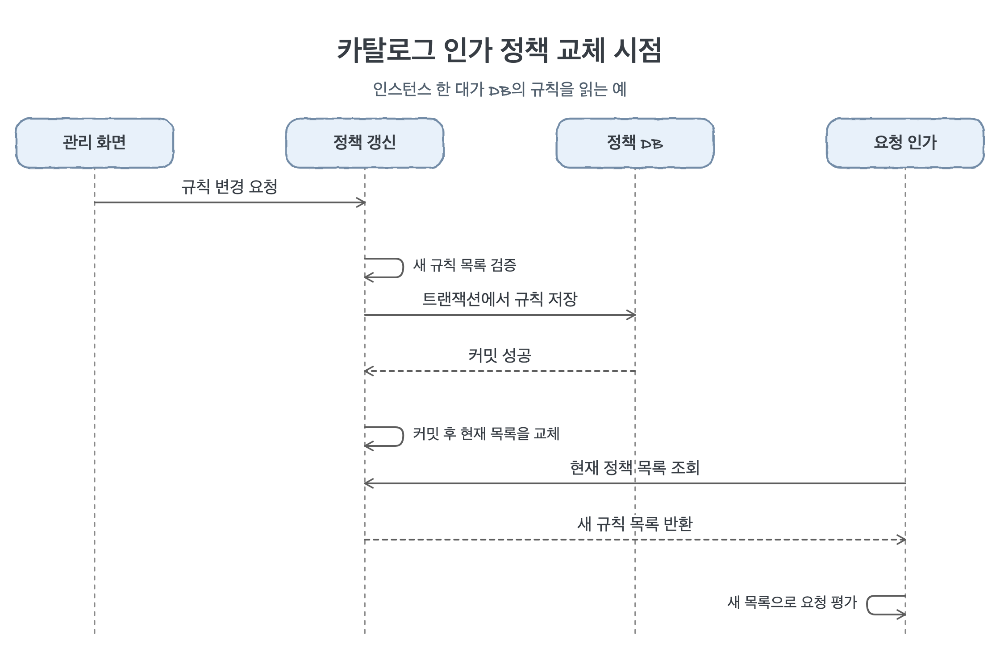

# Practical Spring Security for Account Login and Dynamic Authorization

## 1. 회원 등록과 로그인 연결하기

회원 가입에서 `PasswordEncoder.encode(...)`로 비밀번호 해시를 저장하고, `UserDetailsService`가 로그인용 계정 상태와 부여된 권한을 조회하도록 한다. 사용자 이름과 비밀번호를 사용하는 경우 `DaoAuthenticationProvider`를 기본으로 활용할 수 있다. 추가 인증 절차가 필요하면 어떤 증거를 검사하고 실패를 어떻게 반환할지 정의한 뒤 인증 제공자를 확장한다. [Spring Security 6.5 · Password Storage](https://docs.spring.io/spring-security/reference/6.5/features/authentication/password-storage.html) · [Spring Security 6.5 · DaoAuthenticationProvider](https://docs.spring.io/spring-security/reference/6.5/servlet/authentication/passwords/dao-authentication-provider.html)

| 확장 지점 | 적용 예 |
| --- | --- |
| `AuthenticationDetailsSource` | 인증 판단에 필요한 요청 메타데이터를 만든다. |
| `AuthenticationSuccessHandler`와 `AuthenticationFailureHandler` | 폼 로그인 결과는 이동 경로로, JSON 로그인 결과는 API 응답으로 표현한다. |
| `AuthenticationEntryPoint`와 `AccessDeniedHandler` | 보호 리소스의 미인증과 권한 부족 결과를 각각 정의한다. |
| `@AuthenticationPrincipal` | MVC 컨트롤러에서 현재 인증의 주체를 인자로 받는다. |

[Spring Security 6.5 · 인증 아키텍처](https://docs.spring.io/spring-security/reference/6.5/servlet/authentication/architecture.html) · [Spring Security 6.5 · Form Login](https://docs.spring.io/spring-security/reference/6.5/servlet/authentication/passwords/form.html) · [Spring Security 6.5 · Spring MVC 통합](https://docs.spring.io/spring-security/reference/6.5/servlet/integrations/mvc.html)

### 세션 기반 JSON 로그인

JSON 로그인 경로에 필터를 연결할 때는 정해진 URL과 HTTP 메서드에서만 요청을 읽고 `AuthenticationManager`에서 검증한다. 인증에 성공하면 세션 전략을 적용하고, [컨텍스트 저장](04_spring_security_authentication_persistence.md)까지 끝낸 뒤 성공 응답을 보낸다. 브라우저가 세션 쿠키를 보내는 방식이라면 [CSRF 방어](07_spring_security_cors_csrf_and_samesite.md)를 유지하고 로그인과 로그아웃 후 토큰을 갱신한다. [Spring Security 6.5 · Session Management](https://docs.spring.io/spring-security/reference/6.5/servlet/authentication/session-management.html) · [Spring Security 6.5 · CSRF와 JavaScript 클라이언트](https://docs.spring.io/spring-security/reference/6.5/servlet/exploits/csrf.html)

## 2. 역할과 리소스 정책을 실행 중에 바꾸기

관리 화면에서는 사용자와 역할의 연결, 역할과 리소스 권한의 연결을 저장할 수 있다. 요청의 HTTP 메서드와 경로에 따라 필요한 권한을 조회하도록 `AuthorizationManager`에 정책을 연결한다. 공개 경로는 명시적으로 등록하고, 규칙이 없는 관리 요청은 거부하도록 설계한다. [Spring Security 6.5 · 요청의 커스텀 인가](https://docs.spring.io/spring-security/reference/6.5/servlet/authorization/authorize-http-requests.html) · [Spring Security 6.5 · 인가 아키텍처](https://docs.spring.io/spring-security/reference/6.5/servlet/authorization/architecture.html)

인메모리 규칙으로 정책을 검증한 뒤 DB에서 읽는 구현으로 바꿀 수 있다. 경로 패턴과 우선순위를 검증한 새 정책 목록을 만들고, 저장 트랜잭션이 커밋된 다음 새 목록으로 한 번에 교체한다. 이렇게 하면 각 요청은 한 버전의 정책을 읽는다. 여러 인스턴스가 있다면 규칙 변경을 각 인스턴스에 전달하고, 새 규칙이 도착하지 않은 기간의 처리 방침을 정한다. [Spring Framework 6.2 · 트랜잭션에 연결된 이벤트](https://docs.spring.io/spring-framework/reference/6.2/data-access/transaction/event.html)

역할과 경로의 매핑을 갱신하는 작업과, 기존 세션 안의 사용자 권한을 갱신하는 작업은 적용 시점이 다를 수 있다. 즉시 권한 회수가 필요한 경우 기존 인증 정보가 언제 교체되거나 세션이 언제 만료되는지도 확인한다. 테스트에서는 미인증, 권한 부족, 정책 변경 후 접근, 역할 계층 적용을 각각 확인한다. [Spring Security 6.5 · SecurityContext 저장](https://docs.spring.io/spring-security/reference/6.5/servlet/authentication/persistence.html) · [Spring Security 6.5 · Role Hierarchy](https://docs.spring.io/spring-security/reference/6.5/servlet/authorization/architecture.html)
