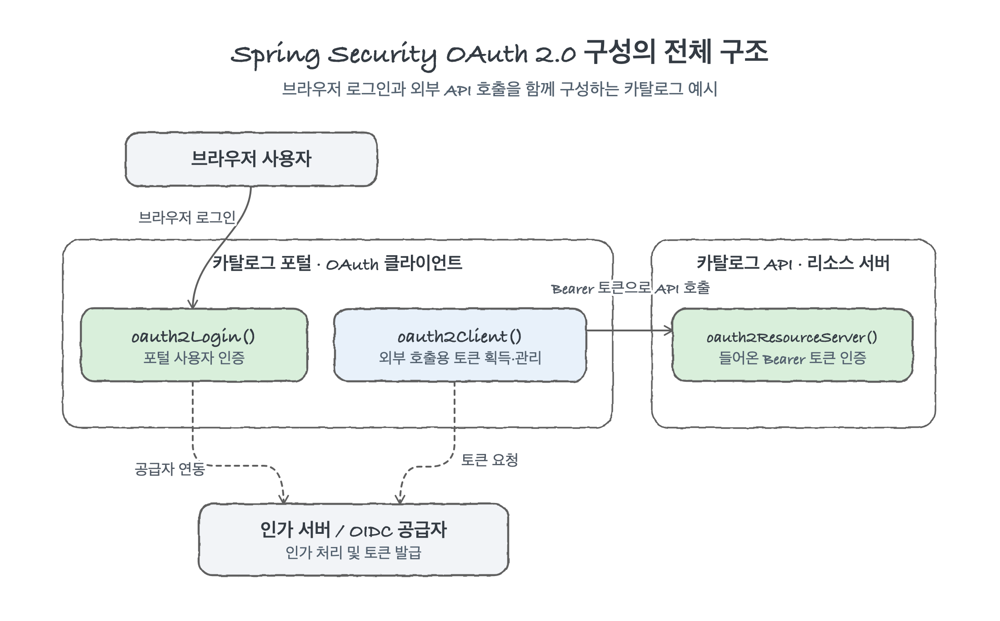

# Spring Security OAuth 2.0 Client Overview

## 1. 웹 애플리케이션이 맡는 역할

카탈로그 포털은 브라우저 사용자를 로그인시키고, 사용자가 승인한 권한으로 카탈로그 API를 호출할 수 있다. Spring Security OAuth2 Client는 인가 요청, 콜백, 토큰 획득과 보관에 필요한 구성 요소를 제공한다. API가 들어오는 Bearer 토큰을 검증할 때는 [Resource Server](22_oauth2_resource_server_and_bearer_authentication.md) 구성에서 처리한다. [Spring Security 6.5 · OAuth2 Overview](https://docs.spring.io/spring-security/reference/6.5/servlet/oauth2/index.html)

| 구성 | 맡는 일 |
| --- | --- |
| `oauth2Login()` | OAuth 2.0 공급자 또는 OIDC를 이용해 현재 애플리케이션의 사용자 인증을 설정한다. |
| `oauth2Client()` | 외부 API를 호출할 때 사용할 토큰의 획득과 재인가를 지원한다. |
| `oauth2ResourceServer()` | 이 애플리케이션에 들어온 Bearer 토큰의 인증을 구성한다. |

한 웹 애플리케이션에서 로그인 및 외부 API 호출을 함께 구성할 수 있다. 사용자의 현재 인증과 외부 API에 사용할 `OAuth2AuthorizedClient`는 연결될 수 있지만 각 객체의 역할이 다르다. [Spring Security 6.5 · OAuth2 Client](https://docs.spring.io/spring-security/reference/6.5/servlet/oauth2/client/index.html) · [Spring Security 6.5 · Authorized Client Features](https://docs.spring.io/spring-security/reference/6.5/servlet/oauth2/client/authorized-clients.html)

## 2. 공급자 연동 범위 정하기

Spring Boot에서는 `spring-boot-starter-oauth2-client`를 추가하고 [클라이언트 등록과 공급자 설정](19_oauth2_client_registration_and_authorized_client_storage.md)을 정의한다. OIDC 공급자는 issuer와 메타데이터로 연결할 수 있다. 직접 속성을 지정하는 공급자에서는 인가·토큰·UserInfo 엔드포인트와 사용자 식별 속성을 해당 공급자 계약에 맞춘다. 브라우저 리다이렉트 주소와 공급자 등록의 콜백 주소가 일치하는지도 확인한다. [Spring Boot 3.5 · OAuth2 Client](https://docs.spring.io/spring-boot/3.5/reference/web/spring-security.html) · [Spring Security 6.5 · OAuth2 Login Core Configuration](https://docs.spring.io/spring-security/reference/6.5/servlet/oauth2/login/core.html)
