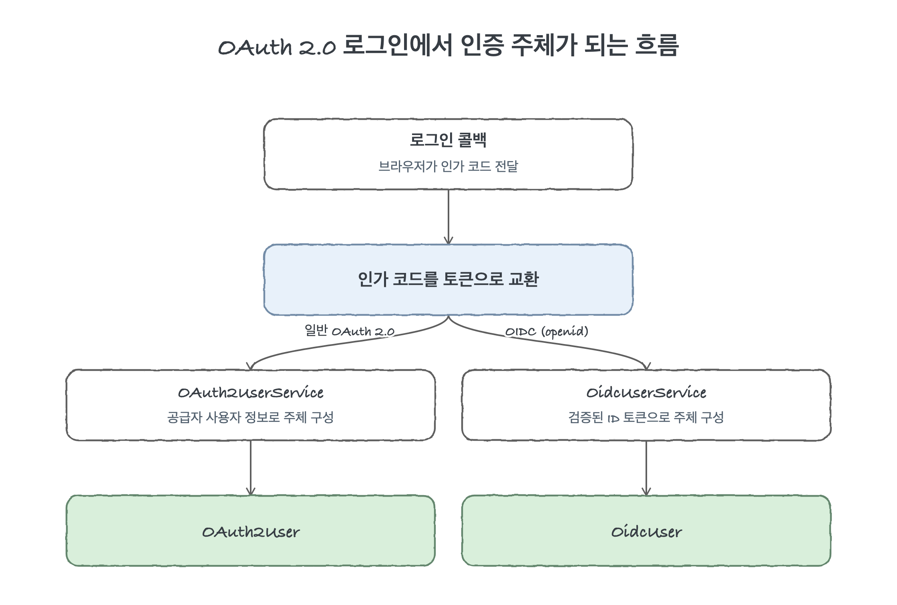

# OAuth 2.0 Login and OIDC User Integration

## 1. 브라우저가 이동하는 경로

`oauth2Login()`이 켜진 체인에서 기본 로그인 링크는 `/oauth2/authorization/{registrationId}`를 사용한다. 인가 서버가 반환한 코드는 기본 콜백인 `/login/oauth2/code/{registrationId}`에서 처리한다. [클라이언트 등록](19_oauth2_client_registration_and_authorized_client_storage.md)의 리다이렉트 URI와 서버가 받은 콜백을 맞춘다. [Spring Security 6.5 · OAuth2 Login Core Configuration](https://docs.spring.io/spring-security/reference/6.5/servlet/oauth2/login/core.html) · [Spring Security 6.5 · Advanced Configuration](https://docs.spring.io/spring-security/reference/6.5/servlet/oauth2/login/advanced.html)

| 단계 | Spring Security의 처리 |
| --- | --- |
| 인가 시작 | `OAuth2AuthorizationRequestRedirectFilter`가 요청 상태를 저장하고 공급자로 이동시킨다. |
| 로그인 콜백 | `OAuth2LoginAuthenticationFilter`가 결과를 받아 인증 매니저에 코드 교환과 로그인 처리를 맡긴다. |
| 주체 구성 | OAuth2 사용자 정보는 `OAuth2UserService`, OIDC 로그인은 ID 토큰 검증과 `OidcUserService` 흐름을 사용한다. |
| 애플리케이션 로그인 | 로그인 결과의 `OAuth2AuthenticationToken`을 컨텍스트에 연결하고 승인된 클라이언트를 저장한다. |

## 2. 로그인 주체를 화면에 연결하기

OIDC 로그인 전용 컨트롤러에서는 `@AuthenticationPrincipal OidcUser user`로 주체를 받을 수 있다. 일반 OAuth2 공급자도 지원한다면 `OAuth2User`를 기준으로 처리하고 공급자별 속성 이름을 매핑한다. 사용자와 로컬 권한 매핑은 신뢰한 공급자와 클레임을 기준으로 설정한다. [Spring Security 6.5 · OAuth2 UserService](https://docs.spring.io/spring-security/reference/6.5/servlet/oauth2/login/advanced.html) · [Spring Security 6.5 · MVC Integration](https://docs.spring.io/spring-security/reference/6.5/servlet/integrations/mvc.html)



## 3. 엔드포인트와 로그아웃 맞추기

로그인 시작 URI나 콜백 경로를 바꿀 때는 로그인 링크, `authorizationEndpoint()` 또는 `redirectionEndpoint()` 설정, 등록의 리다이렉트 URI를 함께 맞춘다. `OAuth2AuthorizationRequestResolver`로 인가 요청을 확장할 경우 상태 확인과 PKCE 등 기존 보호 설정을 유지한다. 공급자 로그아웃까지 연결할 경우 `OidcClientInitiatedLogoutSuccessHandler`와 공급자에 등록한 로그아웃 후 리다이렉트 URI를 사용할 수 있다. [Spring Security 6.5 · Advanced Configuration](https://docs.spring.io/spring-security/reference/6.5/servlet/oauth2/login/advanced.html) · [Spring Security 6.5 · OIDC Logout](https://docs.spring.io/spring-security/reference/6.5/servlet/oauth2/login/logout.html)

[카탈로그 포털 등록](29_spring_authorization_server_domain_model.md)처럼 기밀 클라이언트에도 PKCE를 요구하는 서버와 연결할 때는 아래 리졸버를 `oauth2Login`의 `authorizationEndpoint`에서 `authorizationRequestResolver(...)`로 설정한다. [Spring Security 6.5 · Authorization Grant Support](https://docs.spring.io/spring-security/reference/6.5/servlet/oauth2/client/authorization-grants.html) · [Spring Security 6.5 API · OAuth2AuthorizationRequestCustomizers](https://docs.spring.io/spring-security/reference/6.5/api/java/org/springframework/security/oauth2/client/web/OAuth2AuthorizationRequestCustomizers.html)

```java
import org.springframework.security.oauth2.client.registration.ClientRegistrationRepository;
import org.springframework.security.oauth2.client.web.DefaultOAuth2AuthorizationRequestResolver;
import org.springframework.security.oauth2.client.web.OAuth2AuthorizationRequestCustomizers;
import org.springframework.security.oauth2.client.web.OAuth2AuthorizationRequestResolver;

public class CatalogLoginPkce {

    public static OAuth2AuthorizationRequestResolver resolver(ClientRegistrationRepository registrations) {
        var resolver = new DefaultOAuth2AuthorizationRequestResolver(registrations, "/oauth2/authorization");
        resolver.setAuthorizationRequestCustomizer(OAuth2AuthorizationRequestCustomizers.withPkce());
        return resolver;
    }
}
```
