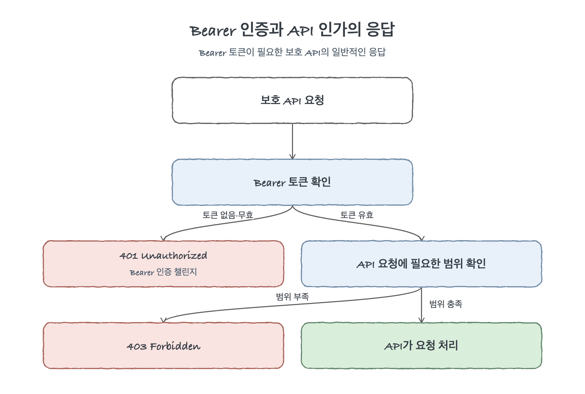

# OAuth 2.0 Resource Server and Bearer Authentication

## 1. 들어오는 API 요청에서 토큰 처리하기

리소스 서버는 `Authorization: Bearer …`로 전달된 액세스 토큰을 검증하고, 토큰에 부여된 권한으로 API 접근을 판단한다. Spring Boot에서는 `spring-boot-starter-oauth2-resource-server`와 리소스 서버 속성을 구성한다. JWT는 구성한 디코더로 확인하고, 불투명 토큰은 인가 서버의 인트로스펙션 응답을 통해 확인할 수 있다. [RFC 6750 · Bearer Token Usage](https://www.rfc-editor.org/rfc/rfc6750.html) · [Spring Boot 3.5 · OAuth2 Resource Server](https://docs.spring.io/spring-boot/3.5/reference/web/spring-security.html)

```text
Authorization 헤더 → BearerTokenAuthenticationFilter → 인증 매니저
                   → JWT 디코더 또는 인트로스펙터 → 인증 컨텍스트 → 인가 규칙
```

토큰을 추출한 필터는 인증 매니저에 검증을 맡긴다. 인증 결과를 받은 뒤 `AuthorizationFilter`가 URL과 메서드에 필요한 권한을 평가한다. 기본 Bearer 토큰 리졸버는 헤더를 사용한다. URL에 토큰이 들어가면 접근 로그나 기록에 남을 수 있으므로 헤더를 사용한다. [Spring Security 6.5 · Bearer Tokens](https://docs.spring.io/spring-security/reference/6.5/servlet/oauth2/resource-server/bearer-tokens.html) · [Spring Security 6.5 · Request Authorization](https://docs.spring.io/spring-security/reference/6.5/servlet/authorization/authorize-http-requests.html)

## 2. 인증과 인가 실패 구분하기

| 상황 | 보호 API의 일반적인 응답 |
| --- | --- |
| 액세스 토큰이 없거나 유효하지 않음 | `401 Unauthorized`와 Bearer 인증 챌린지 |
| 유효한 토큰의 권한 범위가 부족함 | `403 Forbidden` |
| 유효한 토큰과 필요한 권한이 있음 | 애플리케이션이 요청을 처리 |

API가 요청마다 Bearer 헤더로 인증한다면 `STATELESS` 정책으로 세션에 보안 컨텍스트를 유지하지 않도록 구성할 수 있다. 브라우저 로그인 화면과 같은 애플리케이션에 배치할 때는 [체인 매칭 순서](11_advanced_spring_security_configuration.md)를 확인한다. [RFC 6750 · WWW-Authenticate](https://www.rfc-editor.org/rfc/rfc6750.html#section-3) · [Spring Security 6.5 · Session Management](https://docs.spring.io/spring-security/reference/6.5/servlet/authentication/session-management.html)


