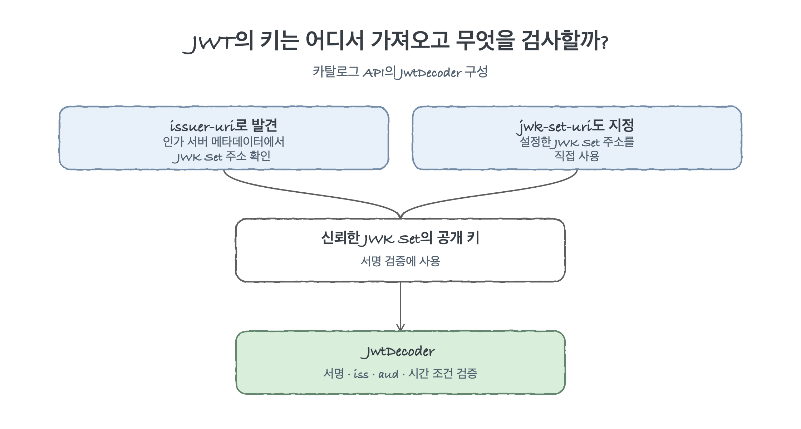

# OAuth 2.0 Resource Server JWT Configuration

## 1. Boot에 발급자와 대상 API 지정하기

Boot의 리소스 서버 속성에서 issuer와 허용할 audience를 설정할 수 있다. 아래 예제는 `https://id.example.com`이 카탈로그 API를 대상으로 발급한 액세스 토큰을 받는다. [Spring Boot 3.5 · OAuth2 Resource Server와 audiences](https://docs.spring.io/spring-boot/3.5/reference/web/spring-security.html)

```yaml
spring:
  security:
    oauth2:
      resourceserver:
        jwt:
          issuer-uri: https://id.example.com
          audiences: ["https://catalog-api.example.com"]
```

issuer를 사용해 메타데이터에서 JWK Set 주소를 확인할 수 있다. 키 주소가 고정된 배포에서는 `jwk-set-uri`를 함께 지정해 메타데이터 조회를 생략하고 issuer 검증을 유지할 수 있다. 다른 공급자의 메타데이터 URL이나 요청이 지정한 키 URL을 신뢰 대상으로 삼지 않는다. [Spring Security 6.5 · JWT Minimal Configuration](https://docs.spring.io/spring-security/reference/6.5/servlet/oauth2/resource-server/jwt.html)



## 2. jwt DSL과 검증 컴포넌트 연결하기

`JwtAuthenticationProvider`는 `JwtDecoder`로 토큰을 읽고 검증한 뒤 `JwtAuthenticationConverter`로 인증 객체를 만든다. 아래 체인은 카탈로그 조회에 토큰의 `catalog.read` 범위를 요구하고 그 외에는 거부한다. 이 단일 체인은 Bearer API를 제공하는 애플리케이션을 가정한다. [Spring Security 6.5 · JWT Authentication Architecture](https://docs.spring.io/spring-security/reference/6.5/servlet/oauth2/resource-server/jwt.html)

```java
import org.springframework.context.annotation.Bean;
import org.springframework.context.annotation.Configuration;
import org.springframework.http.HttpMethod;
import org.springframework.security.config.annotation.web.builders.HttpSecurity;
import org.springframework.security.config.annotation.web.configuration.EnableWebSecurity;
import org.springframework.security.config.http.SessionCreationPolicy;
import org.springframework.security.web.SecurityFilterChain;

import static org.springframework.security.config.Customizer.withDefaults;

@Configuration(proxyBeanMethods = false)
@EnableWebSecurity
public class CatalogJwtApiSecurity {

    @Bean
    SecurityFilterChain catalogApiSecurity(HttpSecurity http) throws Exception {
        return http
                .sessionManagement(sessions -> sessions.sessionCreationPolicy(SessionCreationPolicy.STATELESS))
                .authorizeHttpRequests(rules -> rules
                        .requestMatchers(HttpMethod.GET, "/items", "/items/**").hasAuthority("SCOPE_catalog.read")
                        .anyRequest().denyAll())
                .oauth2ResourceServer(server -> server.jwt(withDefaults()))
                .build();
    }
}
```

`jwt.decoder(...)`로 직접 디코더를 지정하거나 `JwtDecoder` 빈을 제공하면 자동 구성한 디코더 대신 설정한 구현이 사용된다. 사용자 정의 디코더에는 발급자, 대상 API, 시간 등 필요한 [클레임 검증](24_jwt_validation_fundamentals.md)을 포함한다. [Spring Security 6.5 · Overriding or Replacing Boot Auto Configuration](https://docs.spring.io/spring-security/reference/6.5/servlet/oauth2/resource-server/jwt.html)
