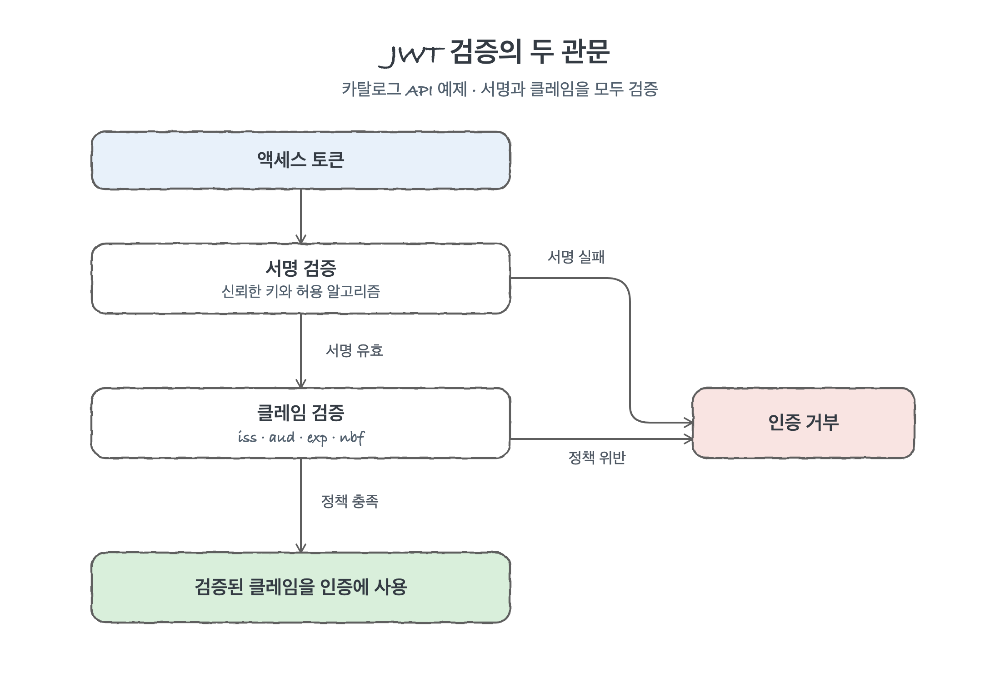

# JWT Validation Fundamentals

## 1. JWT 구조와 검증 API

서명된 JWT의 일반적인 JWS 직렬화는 헤더, 페이로드, 서명을 점으로 연결한다. 헤더의 `alg`와 `kid`는 검증을 보조한다. 페이로드의 클레임은 Base64url로 표현되므로 내용을 읽을 수 있다. Java의 JCA는 `Signature`, `Mac`, `KeyFactory` 등 암호 기능의 API와 공급자 구조를 제공한다. Spring Security에서는 검증 API를 직접 조립할 필요 없이 `JwtDecoder`를 구성할 수 있다. [RFC 7515 · JSON Web Signature](https://www.rfc-editor.org/rfc/rfc7515.html) · [RFC 7519 · JSON Web Token](https://www.rfc-editor.org/rfc/rfc7519.html) · [Java 17 · JCA](https://docs.oracle.com/en/java/javase/17/security/java-cryptography-architecture-jca-reference-guide.html)

| 검증 | 확인 대상 |
| --- | --- |
| 서명 | 신뢰한 발급자에 연결된 키와 허용 알고리즘으로 검증되는가 |
| `iss`와 `aud` | 허용한 발급자가 이 API를 대상으로 발급했는가 |
| `exp`와 `nbf` | 토큰이 만료되지 않았고 사용 가능 시점이 지났는가 |
| 토큰 종류 | 발급자와 합의한 액세스 토큰 규격에 맞는가 |

프로파일로 RFC 9068을 사용하면 `typ`와 필수 클레임을 그 규격에 맞춰 검증한다. ID 토큰과 액세스 토큰은 검증 대상과 키 사용 정책을 각각 정한다. [RFC 8725 · JWT Best Current Practices](https://www.rfc-editor.org/rfc/rfc8725.html) · [RFC 9068 · JWT Access Tokens](https://www.rfc-editor.org/rfc/rfc9068.html)

## 2. 애플리케이션에 필요한 클레임 정책 추가하기

아래 예제는 Spring Security의 기본 시간·issuer 검증을 유지하면서 대상 API와 만료 클레임의 존재를 검사한다. 디코더는 이 검증기를 실행하기 전에 설정한 키로 서명을 확인한다. [Spring Security 6.5 · Configuring Validation](https://docs.spring.io/spring-security/reference/6.5/servlet/oauth2/resource-server/jwt.html)



```java
import java.time.Instant;
import java.util.List;
import java.util.Objects;

import org.springframework.security.oauth2.core.DelegatingOAuth2TokenValidator;
import org.springframework.security.oauth2.core.OAuth2TokenValidator;
import org.springframework.security.oauth2.jwt.Jwt;
import org.springframework.security.oauth2.jwt.JwtClaimNames;
import org.springframework.security.oauth2.jwt.JwtClaimValidator;
import org.springframework.security.oauth2.jwt.JwtValidators;

public class CatalogJwtValidation {

    public static OAuth2TokenValidator<Jwt> claims(String issuer, String expectedAudience) {
        var audience = new JwtClaimValidator<List<String>>(JwtClaimNames.AUD,
                values -> values != null && values.contains(expectedAudience));
        var expiryRequired = new JwtClaimValidator<Instant>(JwtClaimNames.EXP, Objects::nonNull);
        return new DelegatingOAuth2TokenValidator<>(
                JwtValidators.createDefaultWithIssuer(issuer), audience, expiryRequired);
    }
}
```

설정한 디코더가 `NimbusJwtDecoder`이면 `setJwtValidator(...)`로 연결한다. 검증이 끝난 뒤에만 `@AuthenticationPrincipal Jwt`로 필요한 클레임을 읽고 인가 판정에 사용한다. [Spring Security 6.5 · JWT Runtime Expectations](https://docs.spring.io/spring-security/reference/6.5/servlet/oauth2/resource-server/jwt.html)
