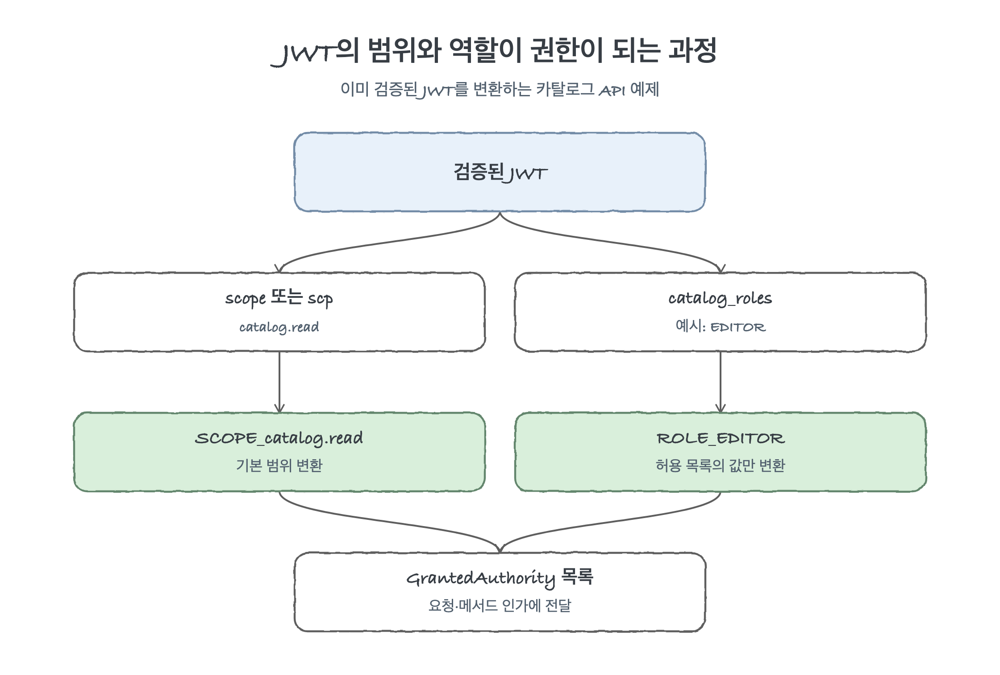

# OAuth 2.0 Resource Server Scopes and Authorities

## 1. 토큰의 범위를 Spring 권한으로 매핑하기

기본 `JwtGrantedAuthoritiesConverter`는 `scope` 또는 `scp`에 담긴 범위를 읽어 `SCOPE_` 접두사를 붙인다. 카탈로그 읽기 범위 `catalog.read`는 `hasAuthority("SCOPE_catalog.read")`로 검사할 수 있다. 범위는 토큰이 허용하는 API 동작을 표현한다. 시스템의 역할과 객체 소유권 규칙은 애플리케이션에 필요한 경우 따로 적용한다. [Spring Security 6.5 · Mapping Authorities](https://docs.spring.io/spring-security/reference/6.5/servlet/oauth2/resource-server/jwt.html) · [요청과 메서드 인가](08_spring_security_request_and_method_authorization.md)

## 2. 합의한 역할 클레임만 추가로 사용하기

아래 예제는 기본 범위 매핑을 유지하고, 신뢰한 발급자와 합의한 `catalog_roles` 배열에서 알려진 역할만 권한으로 추가한다. `jwt.jwtAuthenticationConverter(CatalogJwtAuthorities.converter())`로 [JWT 체인](23_oauth2_resource_server_jwt_configuration.md)에 연결한다. [Spring Security 6.5 · Extracting Authorities Manually](https://docs.spring.io/spring-security/reference/6.5/servlet/oauth2/resource-server/jwt.html)



```java
import java.util.Collection;
import java.util.LinkedHashSet;
import java.util.Set;

import org.springframework.security.core.GrantedAuthority;
import org.springframework.security.core.authority.SimpleGrantedAuthority;
import org.springframework.security.oauth2.server.resource.authentication.JwtAuthenticationConverter;
import org.springframework.security.oauth2.server.resource.authentication.JwtGrantedAuthoritiesConverter;

public class CatalogJwtAuthorities {

    public static JwtAuthenticationConverter converter() {
        var scopes = new JwtGrantedAuthoritiesConverter();
        var converter = new JwtAuthenticationConverter();
        Set<String> catalogRoles = Set.of("AUDITOR", "EDITOR");

        converter.setJwtGrantedAuthoritiesConverter(jwt -> {
            Collection<GrantedAuthority> authorities = new LinkedHashSet<>(scopes.convert(jwt));
            if (jwt.getClaims().get("catalog_roles") instanceof Collection<?> roles) {
                for (Object value : roles) {
                    if (value instanceof String role && catalogRoles.contains(role)) {
                        authorities.add(new SimpleGrantedAuthority("ROLE_" + role));
                    }
                }
            }
            return authorities;
        });
        return converter;
    }
}
```

메서드 인가에서는 `@PreAuthorize("hasAuthority('SCOPE_catalog.read')")`처럼 같은 권한 이름을 사용할 수 있다. 자원별 접근은 토큰의 주체와 서버의 리소스 관계를 추가로 확인한다. 필터 체인 테스트는 필요한 범위가 없을 때 `403`인지 확인하고, 디코더 테스트는 서명과 클레임 검증을 별도로 확인한다. [Spring Security 6.5 · Method Security](https://docs.spring.io/spring-security/reference/6.5/servlet/authorization/method-security.html)
