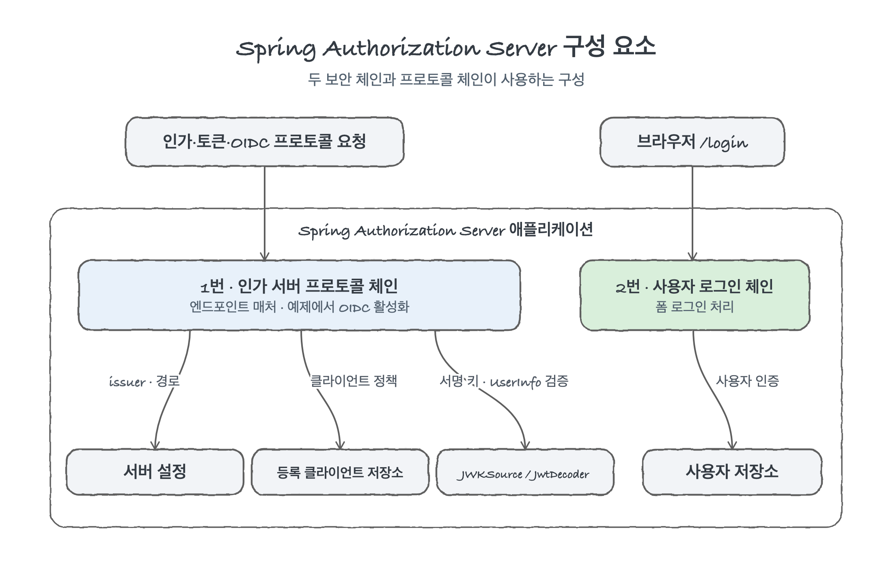

# Spring Authorization Server Configuration

## 1. 인가 서버가 담당하는 경계

Spring Authorization Server 1.5는 OAuth 2.0의 인가 요청과 토큰 발급·검사 엔드포인트를 제공한다. OIDC를 활성화하면 로그인 결과를 담은 ID 토큰과 관련 엔드포인트도 제공할 수 있다. 이 문서의 예제는 Spring Boot 3.5와 Spring Security 6.5를 기준으로 한다. [Spring Authorization Server · Getting Started](https://docs.spring.io/spring-authorization-server/reference/getting-started.html) · [Spring Boot 3.5 · Authorization Server](https://docs.spring.io/spring-boot/3.5/reference/web/spring-security.html)

| 설정 | 구성하는 부분 |
| --- | --- |
| 프로토콜 체인 | 인가·토큰·검사 등 프레임워크의 엔드포인트를 처리한다. |
| 사용자 로그인 체인 | 인가 과정의 브라우저가 로그인할 수 있게 한다. |
| `RegisteredClientRepository` | 서버가 허용한 클라이언트와 인가 방식을 조회한다. |
| `AuthorizationServerSettings` | 발급자의 issuer와 엔드포인트 경로를 정한다. |
| `JWKSource` | 발급 토큰 서명에 쓰이는 키를 제공한다. 공개 키는 JWK Set으로 제공할 수 있다. |

## 2. 인가 서버 체인과 로그인 체인 구성하기

아래 구성에는 [등록 클라이언트 저장소](29_spring_authorization_server_domain_model.md), 사용자 저장소, `JWKSource` 및 필요한 `JwtDecoder` 빈을 함께 둔다. OIDC를 켠 경우 UserInfo 같은 보호된 프로토콜 엔드포인트에도 디코더가 사용된다. 브라우저 로그인과 프로토콜 요청은 각 체인의 매처가 구분한다. [Spring Authorization Server · Configuration Model](https://docs.spring.io/spring-authorization-server/reference/configuration-model.html)



```java
import org.springframework.context.annotation.Bean;
import org.springframework.context.annotation.Configuration;
import org.springframework.core.annotation.Order;
import org.springframework.http.MediaType;
import org.springframework.security.config.annotation.web.builders.HttpSecurity;
import org.springframework.security.config.annotation.web.configuration.EnableWebSecurity;
import org.springframework.security.oauth2.server.authorization.config.annotation.web.configurers.OAuth2AuthorizationServerConfigurer;
import org.springframework.security.oauth2.server.authorization.settings.AuthorizationServerSettings;
import org.springframework.security.web.SecurityFilterChain;
import org.springframework.security.web.authentication.LoginUrlAuthenticationEntryPoint;
import org.springframework.security.web.util.matcher.MediaTypeRequestMatcher;

import static org.springframework.security.config.Customizer.withDefaults;

@Configuration(proxyBeanMethods = false)
@EnableWebSecurity
public class CatalogAuthorizationServer {

    @Bean
    @Order(1)
    SecurityFilterChain protocolEndpoints(HttpSecurity http) throws Exception {
        var server = OAuth2AuthorizationServerConfigurer.authorizationServer();
        return http
                .securityMatcher(server.getEndpointsMatcher())
                .with(server, endpoints -> endpoints.oidc(withDefaults()))
                .authorizeHttpRequests(rules -> rules.anyRequest().authenticated())
                .exceptionHandling(errors -> errors.defaultAuthenticationEntryPointFor(
                        new LoginUrlAuthenticationEntryPoint("/login"),
                        new MediaTypeRequestMatcher(MediaType.TEXT_HTML)))
                .build();
    }

    @Bean
    @Order(2)
    SecurityFilterChain login(HttpSecurity http) throws Exception {
        return http
                .authorizeHttpRequests(rules -> rules.requestMatchers("/login").permitAll().anyRequest().denyAll())
                .formLogin(login -> login.permitAll())
                .build();
    }

    @Bean
    AuthorizationServerSettings issuerSettings() {
        return AuthorizationServerSettings.builder()
                .issuer("https://id.example.com")
                .build();
    }
}
```

issuer는 클라이언트의 발견 설정과 리소스 서버의 검증 설정에서 같은 값으로 사용한다. 배포 시 외부에서 접근하는 issuer와 엔드포인트 주소를 확인한다. Spring의 인가 서버 컨텍스트는 요청 처리에 사용할 서버 설정과 issuer를 제공한다. [Spring Authorization Server · Authorization Server Context](https://docs.spring.io/spring-authorization-server/reference/configuration-model.html) · [RFC 8414 · Authorization Server Metadata](https://www.rfc-editor.org/rfc/rfc8414.html)
