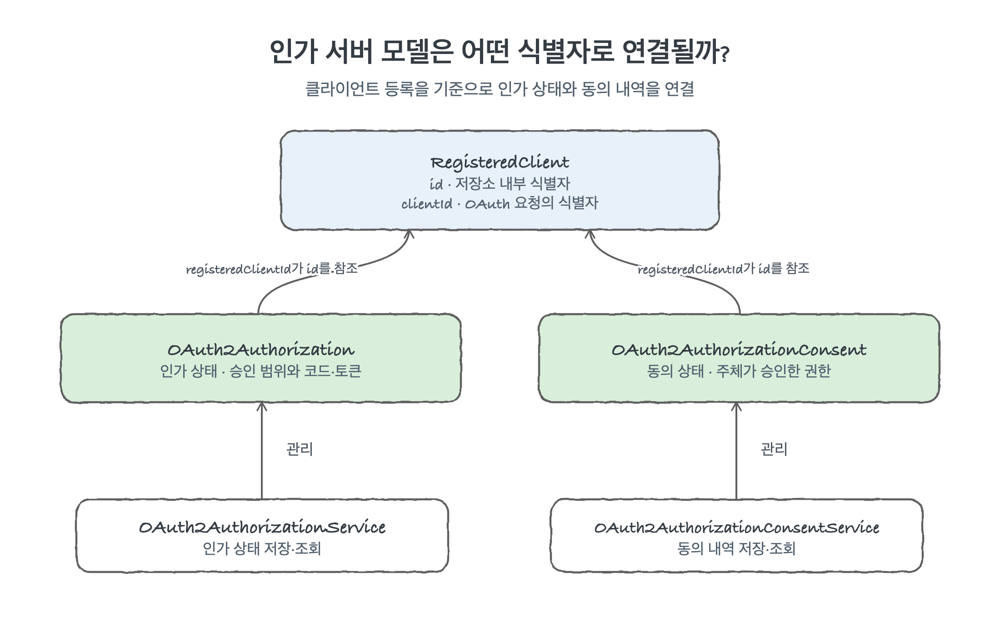

# Spring Authorization Server Domain Model

## 1. 클라이언트 등록과 발급 상태 구분하기

| 모델 또는 서비스 | 저장하는 정보 |
| --- | --- |
| `RegisteredClient` | 클라이언트 식별자, 인증 방식, 권한 부여 유형, 리다이렉트 URI, 범위 |
| `RegisteredClientRepository` | 서버가 허용한 클라이언트 등록 |
| `OAuth2Authorization` | 클라이언트와 주체, 승인 범위, 인가 코드 및 발급된 토큰과 상태 |
| `OAuth2AuthorizationService` | 인가 코드 교환, 토큰 조회와 폐기에 필요한 인가 상태 |
| `OAuth2AuthorizationConsent` | 사용자와 클라이언트의 승인 내역 |
| `OAuth2AuthorizationConsentService` | 동의 저장과 조회 |

인가 서버가 보관하는 `RegisteredClient`와 클라이언트 앱이 보관하는 `ClientRegistration`은 각각의 입장에서 계약을 표현한다. `RegisteredClient.id`는 저장소 내부 식별자이고, `clientId`는 OAuth 요청에서 사용하는 클라이언트 식별자다. [Spring Authorization Server · Core Model](https://docs.spring.io/spring-authorization-server/reference/core-model-components.html) · [Spring Security 6.5 · ClientRegistration](https://docs.spring.io/spring-security/reference/6.5/servlet/oauth2/client/core.html)



## 2. 코드 흐름을 사용하는 카탈로그 포털 등록하기

아래 팩터리의 `encodedSecret`은 서버가 사용하는 `PasswordEncoder` 형식으로 저장한 비밀 값이다. 브라우저가 돌아올 URI와 제공할 scope를 각 등록에 지정한다. [Spring Authorization Server · RegisteredClient](https://docs.spring.io/spring-authorization-server/reference/core-model-components.html)

```java
import java.util.List;

import org.springframework.security.oauth2.core.AuthorizationGrantType;
import org.springframework.security.oauth2.core.ClientAuthenticationMethod;
import org.springframework.security.oauth2.core.oidc.OidcScopes;
import org.springframework.security.oauth2.server.authorization.OAuth2TokenType;
import org.springframework.security.oauth2.server.authorization.client.RegisteredClient;
import org.springframework.security.oauth2.server.authorization.settings.ClientSettings;
import org.springframework.security.oauth2.server.authorization.settings.TokenSettings;
import org.springframework.security.oauth2.server.authorization.token.JwtEncodingContext;
import org.springframework.security.oauth2.server.authorization.token.OAuth2TokenCustomizer;

public class CatalogClientRegistration {

    public static RegisteredClient create(String id, String encodedSecret) {
        return RegisteredClient.withId(id)
                .clientId("catalog-portal")
                .clientSecret(encodedSecret)
                .clientAuthenticationMethod(ClientAuthenticationMethod.CLIENT_SECRET_BASIC)
                .authorizationGrantType(AuthorizationGrantType.AUTHORIZATION_CODE)
                .authorizationGrantType(AuthorizationGrantType.REFRESH_TOKEN)
                .redirectUri("https://portal.example.com/login/oauth2/code/catalog-ui")
                .scope(OidcScopes.OPENID)
                .scope(OidcScopes.PROFILE)
                .scope("catalog.read")
                .clientSettings(ClientSettings.builder()
                        .requireProofKey(true)
                        .requireAuthorizationConsent(true)
                        .build())
                .tokenSettings(TokenSettings.builder().reuseRefreshTokens(false).build())
                .build();
    }

    public static OAuth2TokenCustomizer<JwtEncodingContext> catalogAudience() {
        return context -> {
            if (OAuth2TokenType.ACCESS_TOKEN.equals(context.getTokenType())
                    && "catalog-portal".equals(context.getRegisteredClient().getClientId())
                    && context.getAuthorizedScopes().contains("catalog.read")) {
                context.getClaims().audience(List.of("https://catalog-api.example.com"));
            }
        };
    }
}
```

이 등록을 사용하려면 포털의 코드 흐름도 PKCE를 보내도록 설정한다. 공개 클라이언트는 공유 비밀을 저장할 수 없는 배포를 전제로 하며, Spring Authorization Server에서는 `ClientAuthenticationMethod.NONE`과 PKCE를 사용하는 등록을 구성할 수 있다. [Spring Authorization Server · PKCE 구성](https://docs.spring.io/spring-authorization-server/reference/guides/how-to-pkce.html) · [Spring Security 6.5 · Authorization Grant Support](https://docs.spring.io/spring-security/reference/6.5/servlet/oauth2/client/authorization-grants.html)

`catalogAudience()`의 반환값을 기본 JWT 토큰 생성기에 사용할 `OAuth2TokenCustomizer<JwtEncodingContext>` 빈으로 등록하면, 승인된 카탈로그 조회 범위의 액세스 토큰에 [API가 요구하는 audience](23_oauth2_resource_server_jwt_configuration.md)를 지정할 수 있다. ID 토큰의 audience에는 로그인 클라이언트가 사용된다. [Spring Authorization Server · OAuth2TokenCustomizer](https://docs.spring.io/spring-authorization-server/reference/core-model-components.html) · [OpenID Connect Core 1.0](https://openid.net/specs/openid-connect-core-1_0.html)

## 3. 저장 방식을 인가 상태 수명에 맞추기

메모리 구현은 단일 프로세스의 예제에서 사용할 수 있다. 재시작 후나 여러 서버에서 같은 인가 상태를 읽어야 하면 JDBC 구현 등 공유 저장 방식을 사용한다. 토큰 값과 동의 상태에 접근할 수 있는 주체, 만료 데이터 정리, 기존 승인 취소의 반영 시점을 정한다. [Spring Authorization Server · Core Model and Components](https://docs.spring.io/spring-authorization-server/reference/core-model-components.html)
